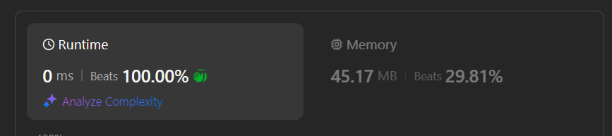

# ✅Beats 100% -Explained with [ Video ] -C++/Java/Python/ - DFS + Two Pointers- Explained in Detail

**Author:** lancertech6
**Votes:** 159
**Link:** [https://leetcode.com/problems/linked-list-in-binary-tree/solutions/5748536/](https://leetcode.com/problems/linked-list-in-binary-tree/solutions/5748536/)

---




# YouTube Video Explanation:

### To watch the video please click on "Watch On Youtube" option  available the left bottom corner of the thumbnail.

<!-- **If you want a video for this question please write in the comments** -->


https://youtu.be/Pe_-F50UhU4


**\uD83D\uDD25 Please like, share, and subscribe to support our channel's mission of making complex concepts easy to understand.**

Subscribe Link: https://www.youtube.com/@leetlogics/?sub_confirmation=1

*Subscribe Goal: 2800 Subscribers*
*Current Subscribers: 2793*

Follow me on Instagram : https://www.instagram.com/divyansh.nishad/

---

# Intuition
<!-- Describe your first thoughts on how to solve this problem. -->
The goal is to determine if the elements in the linked list correspond to a downward path in a binary tree. We start from any node in the tree and check if we can find the sequence of values from the linked list along a path down the tree. The search must continue along valid paths and stop when we either find the full sequence or determine it doesn't exist.

The key is to use Depth-First Search (DFS) to explore possible paths in the binary tree while matching the elements in the linked list. We attempt to match the current node's value with the current linked list node's value, and then continue the search down both the left and right children of the binary tree.

# Approach
<!-- Describe your approach to solving the problem. -->
1. **DFS Search**: We will perform a DFS on the binary tree, starting from each node, and attempt to match the values of the nodes along the way with the values from the linked list.
2. **Two Pointers (Tree and List)**: Use two pointers:
   - One (`head`) to traverse the linked list starting from the head.
   - Another (`cur`) to track the current position in the list as we attempt to match it with the tree node values.
3. **Matching Process**:
   - If the current tree node value matches the linked list node value, we move to the next linked list node and continue the DFS on the left and right children of the tree.
   - If the values don\u2019t match but the current tree node's value matches the head of the list, we start a new matching attempt from that node.
4. **Base Cases**:
   - If we reach the end of the linked list (`cur == null`), this means we successfully matched all elements, so return `true`.
   - If we reach a `null` tree node without having matched the entire list (`cur != null`), return `false`.

# Step By Step Explanation


### Problem Breakdown:
- We have a **Linked List** and a **Binary Tree**.
- We need to determine if the linked list corresponds to some downward path in the binary tree (starting from any node in the tree and going downward).

### Example:

**Linked List:** `4 -> 2 -> 8`

**Binary Tree:**

```
        1
       / \\
      4   4
     /   / \\
    2   2   1
   /   / \\
  6   6   8
```

### Approach:
- Perform a DFS for each node in the binary tree.
- For each node, check if the current node in the binary tree matches the head of the linked list.
- If the value matches, continue to the next node in the linked list and traverse down the tree.
- If the current tree node doesn\u2019t match the linked list or a mismatch is found, reset the list pointer and continue searching.


| Step | Linked List Node | Binary Tree Node | Action Taken                              |
|------|------------------|------------------|-------------------------------------------|
| 1    | 4                | 1                | No match, move to the left child (DFS).   |
| 2    | 4                | 4                | Match found, move to next linked list node (2), explore subtree. |
| 3    | 2                | 2                | Match found, move to next linked list node (8), explore subtree. |
| 4    | 8                | 6                | No match, backtrack and try right subtree. |
| 5    | 8                | 8                | Match found, complete list traversal. Subpath found! |
| 6    |                  |                  | End of list reached, return True.         |

#### Detailed Table Explanation:

1. **Initial DFS at Root (1):**  
   - Linked List starts at `4`, Tree Node is `1`.  
   - **No match**, so we move to the left child.

2. **Next DFS at Node (4):**  
   - Linked List is still at `4`, Tree Node is `4`.  
   - **Match found**. Move the linked list pointer to the next node `2` and explore the left subtree of this `4`.

3. **DFS at Node (2):**  
   - Linked List is at `2`, Tree Node is `2`.  
   - **Match found**. Move to the next linked list node `8`, continue exploring.

4. **DFS at Node (6):**  
   - Linked List is at `8`, Tree Node is `6`.  
   - **No match**. Backtrack to the right child of `2`.

5. **DFS at Node (8):**  
   - Linked List is at `8`, Tree Node is `8`.  
   - **Match found**. The linked list is now fully traversed.

6. **End of List:**  
   - The linked list has been fully matched along the path from `4 -> 2 -> 8`. Return `True`.

### Another Example with No Match:

#### Linked List: `1 -> 4 -> 2 -> 6 -> 8`

**Binary Tree:**

```
        1
       / \\
      4   4
     /   / \\
    2   2   1
   /   / \\
  6   6   8
```

| Step | Linked List Node | Binary Tree Node | Action Taken                              |
|------|------------------|------------------|-------------------------------------------|
| 1    | 1                | 1                | Match found, move to next node (4).       |
| 2    | 4                | 4                | Match found, move to next node (2).       |
| 3    | 2                | 2                | Match found, move to next node (6).       |
| 4    | 6                | 6                | Match found, move to next node (8).       |
| 5    | 8                | -                | No more nodes in the subtree, fail match. |

In this example, the binary tree does not contain a path corresponding to the entire linked list (`1 -> 4 -> 2 -> 6 -> 8`), so we return `False`.


# Complexity
1. **Time Complexity**:  
   - In the worst case, we need to start a DFS from each node in the tree, and for each DFS, we may traverse up to the entire linked list. 
   - If `n` is the number of nodes in the binary tree and `m` is the number of nodes in the linked list:
     - The DFS will be performed on each node in the binary tree.
     - In each DFS call, the maximum number of comparisons is `O(m)` if we traverse the entire linked list.
   - Thus, the overall time complexity is **O(n * m)**.

2. **Space Complexity**:  
   - The space complexity depends on the depth of the recursion, which is proportional to the depth of the binary tree.
   - In the worst case, the tree can be fully unbalanced, giving a depth of `O(n)` for the recursion stack.
   - Therefore, the space complexity is **O(n)** for the binary tree recursion. Additionally, no extra space is required for storing values or lists beyond a few pointers.


# Code
```java []
class Solution {
    public boolean isSubPath(ListNode head, TreeNode root) {
        return dfs(head, head, root);  // Start DFS search
    }

    // DFS helper function
    boolean dfs(ListNode head, ListNode cur, TreeNode root) {
        // If we reach the end of the linked list, return true (successful match)
        if (cur == null) return true;
        // If we reach the end of a path in the tree without fully matching the list, return false
        if (root == null) return false;
        
        // Match the current tree node with the current linked list node
        if (cur.val == root.val) cur = cur.next;
        // If no match, but the tree node matches the head of the linked list, start a new match
        else if (head.val == root.val) head = head.next;
        // Otherwise, reset `cur` to `head` to attempt matching the linked list from scratch
        else cur = head;

        // Continue DFS down both left and right children
        return dfs(head, cur, root.left) || dfs(head, cur, root.right);
    }
}

```
```C++ []
class Solution {
public:
    bool isSubPath(ListNode* head, TreeNode* root) {
        return dfs(head, head, root);
    }
    
    bool dfs(ListNode* head, ListNode* cur, TreeNode* root) {
        if (cur == nullptr) return true;  // Successfully matched the list
        if (root == nullptr) return false; // Reached the end of the tree without matching
        
        if (cur->val == root->val) {
            cur = cur->next;  // Move to the next list node if value matches
        } else if (head->val == root->val) {
            head = head->next; // Start new matching attempt if the value matches head of list
        } else {
            cur = head;  // Reset the matching pointer
        }
        
        return dfs(head, cur, root->left) || dfs(head, cur, root->right); // Recursively check left and right subtrees
    }
};
```
```Python []
class Solution:
    def isSubPath(self, head, root):
        return self.dfs(head, head, root)

    def dfs(self, head, cur, root):
        if cur is None:  # Successfully matched the list
            return True
        if root is None:  # Reached the end of the tree without matching
            return False
        
        if cur.val == root.val:
            cur = cur.next  # Move to the next list node if value matches
        elif head.val == root.val:
            head = head.next  # Start new matching attempt if the value matches head of list
        else:
            cur = head  # Reset the matching pointer

        # Recursively check left and right subtrees
        return self.dfs(head, cur, root.left) or self.dfs(head, cur, root.right)
```
```JavaScript []
var isSubPath = function(head, root) {
    return dfs(head, head, root);
};

var dfs = function(head, cur, root) {
    if (cur === null) return true;  // Successfully matched the list
    if (root === null) return false; // Reached the end of the tree without matching
    
    if (cur.val === root.val) {
        cur = cur.next;  // Move to the next list node if value matches
    } else if (head.val === root.val) {
        head = head.next; // Start new matching attempt if the value matches head of list
    } else {
        cur = head;  // Reset the matching pointer
    }
    
    // Recursively check left and right subtrees
    return dfs(head, cur, root.left) || dfs(head, cur, root.right);
};
```


