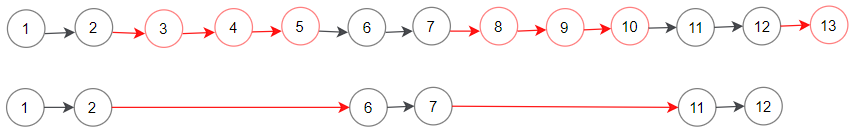
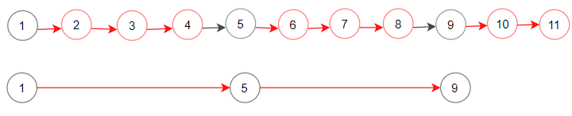

# [1474. Delete N Nodes After M Nodes of a Linked List](https://leetcode.com/problems/delete-n-nodes-after-m-nodes-of-a-linked-list/)

| Category | Difficulty | Likes | Dislikes |
| :------: | :--------: | :---: | :------: |
| Algorithms | Easy | 433 | 17 |

**Tags:** [`linked-list`](https://leetcode.com/tag/linked-list)

**Companies:** `microsoft`

## Description

You are given the `head` of a linked list and two integers `m` and `n`.

Traverse the linked list and remove some nodes in the following way:

	- Start with the head as the current node.

	- Keep the first `m` nodes starting with the current node.

	- Remove the next `n` nodes

	- Keep repeating steps 2 and 3 until you reach the end of the list.

Return *the head of the modified list after removing the mentioned nodes*.

 

**Example 1:**


```

Input: head = [1,2,3,4,5,6,7,8,9,10,11,12,13], m = 2, n = 3
Output: [1,2,6,7,11,12]
Explanation: Keep the first (m = 2) nodes starting from the head of the linked List  (1 -&gt;2) show in black nodes.
Delete the next (n = 3) nodes (3 -&gt; 4 -&gt; 5) show in read nodes.
Continue with the same procedure until reaching the tail of the Linked List.
Head of the linked list after removing nodes is returned.

```

**Example 2:**


```

Input: head = [1,2,3,4,5,6,7,8,9,10,11], m = 1, n = 3
Output: [1,5,9]
Explanation: Head of linked list after removing nodes is returned.

```

 

**Constraints:**

	- The number of nodes in the list is in the range `[1, 10^4]`.

	- `1 <= Node.val <= 10^6`

	- `1 <= m, n <= 1000`

 

**Follow up:** Could you solve this problem by modifying the list in-place?

---

**Links:** [Submissions](https://leetcode.com/problems/delete-n-nodes-after-m-nodes-of-a-linked-list/) | [Solutions](https://leetcode.com/problems/delete-n-nodes-after-m-nodes-of-a-linked-list/)
