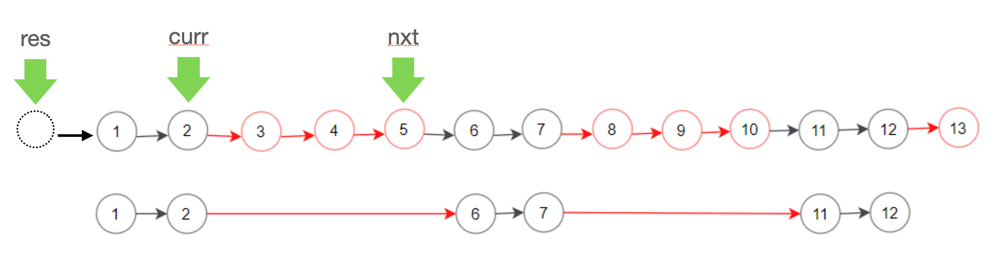

# [C++] easy code

**Author:** Araceae
**Votes:** 3
**Link:** [https://leetcode.com/problems/delete-n-nodes-after-m-nodes-of-a-linked-list/solutions/1138387/](https://leetcode.com/problems/delete-n-nodes-after-m-nodes-of-a-linked-list/solutions/1138387/)

---

### **Code**
```
/**
 * Definition for singly-linked list.
 * struct ListNode {
 *     int val;
 *     ListNode *next;
 *     ListNode() : val(0), next(nullptr) {}
 *     ListNode(int x) : val(x), next(nullptr) {}
 *     ListNode(int x, ListNode *next) : val(x), next(next) {}
 * };
 */
class Solution {
public:
    ListNode* deleteNodes(ListNode* head, int m, int n) {
        ListNode* res = new ListNode;
        res->next = head;
        ListNode* curr = res;
        
        while (curr->next){
            for (int i = 0; i < m && curr->next; ++i) curr = curr->next;
            ListNode* nxt = curr;
            for (int i = 0; i < n && nxt->next; ++i) nxt = nxt->next;
            curr->next = nxt->next;
        }
        
        return res->next;
    }
};
```

### **Schematic diagram**



### **Performance**
- Runtime: 28 ms, faster than 76.64%
- Memory Usage: 15.7 MB, less than 78.35%