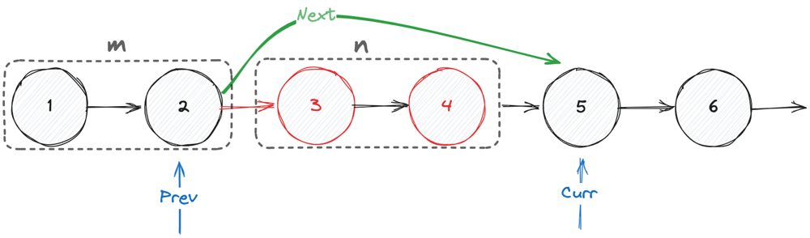

# [Go] Fastest and clean one-pass in-place in Go (GoLang) 6ms 100%

**Author:** krex0r
**Votes:** 1
**Link:** [https://leetcode.com/problems/delete-n-nodes-after-m-nodes-of-a-linked-list/solutions/2480931/](https://leetcode.com/problems/delete-n-nodes-after-m-nodes-of-a-linked-list/solutions/2480931/)

---

Hello Gophers!

## Complexity

Where `n` is the number of nodes:

Time: `O(n)` (going through the list once)
Space: `O(1)`

## Code

```go
func deleteNodes(head *ListNode, m int, n int) *ListNode {
    if head == nil || head.Next == nil {
        return head
    }

    var previous, current *ListNode = nil, head
    for current != nil {
        for i := 0; i < m && current != nil; i++ {
            previous, current = current, current.Next
        }

        for i := 0; i < n && current != nil; i++ {
            current = current.Next
        }
        previous.Next = current
    }
    
    return head
}
```

## Explanation



Don't forget `if current != nil` to not hit a `nil pointer`!


I hope it helped! =)