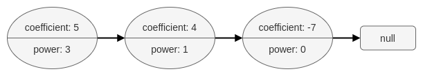
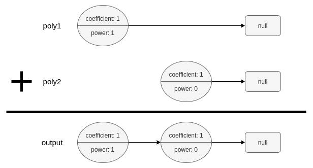

# [1634. Add Two Polynomials Represented as Linked Lists](https://leetcode.com/problems/add-two-polynomials-represented-as-linked-lists/)

| Category | Difficulty | Likes | Dislikes |
| :------: | :--------: | :---: | :------: |
| Algorithms | Medium | 173 | 14 |

**Tags:** [`linked-list`](https://leetcode.com/tag/linked-list), [`math`](https://leetcode.com/tag/math), [`two-pointers`](https://leetcode.com/tag/two-pointers)

**Companies:** `amazon`

## Description

A polynomial linked list is a special type of linked list where every node represents a term in a polynomial expression.


Each node has three attributes:


	- `coefficient`: an integer representing the number multiplier of the term. The coefficient of the term `9x^4` is `9`.

	- `power`: an integer representing the exponent. The power of the term `9x^4` is `4`.

	- `next`: a pointer to the next node in the list, or `null` if it is the last node of the list.


For example, the polynomial `5x^3 + 4x - 7` is represented by the polynomial linked list illustrated below:





The polynomial linked list must be in its standard form: the polynomial must be in **strictly** descending order by its `power` value. Also, terms with a `coefficient` of `0` are omitted.


Given two polynomial linked list heads, `poly1` and `poly2`, add the polynomials together and return *the head of the sum of the polynomials*.


**`PolyNode` format:**


The input/output format is as a list of `n` nodes, where each node is represented as its `[coefficient, power]`. For example, the polynomial `5x^3 + 4x - 7` would be represented as: `[[5,3],[4,1],[-7,0]]`.


 


**Example 1:**





```

Input: poly1 = [[1,1]], poly2 = [[1,0]]
Output: [[1,1],[1,0]]
Explanation: poly1 = x. poly2 = 1. The sum is x + 1.

```


**Example 2:**


```

Input: poly1 = [[2,2],[4,1],[3,0]], poly2 = [[3,2],[-4,1],[-1,0]]
Output: [[5,2],[2,0]]
Explanation: poly1 = 2x2 + 4x + 3. poly2 = 3x2 - 4x - 1. The sum is 5x2 + 2. Notice that we omit the &quot;0x&quot; term.

```


**Example 3:**


```

Input: poly1 = [[1,2]], poly2 = [[-1,2]]
Output: []
Explanation: The sum is 0. We return an empty list.

```


 


**Constraints:**


	- `0  PolyNode.next.power`

---

**Links:** [Submissions](https://leetcode.com/problems/add-two-polynomials-represented-as-linked-lists/) | [Solutions](https://leetcode.com/problems/add-two-polynomials-represented-as-linked-lists/)
