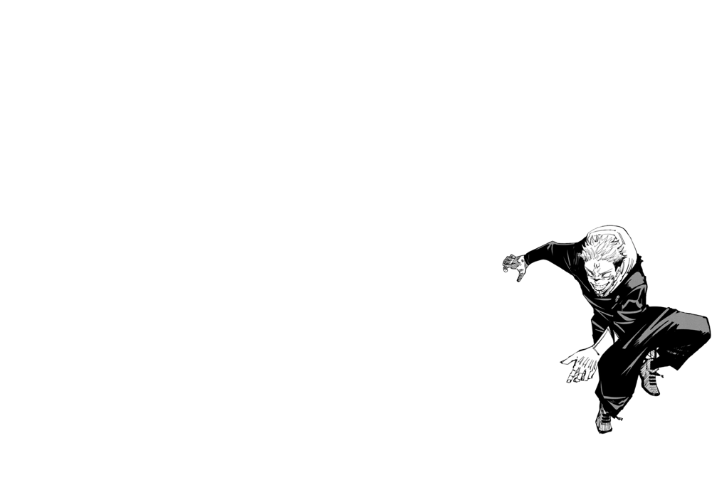
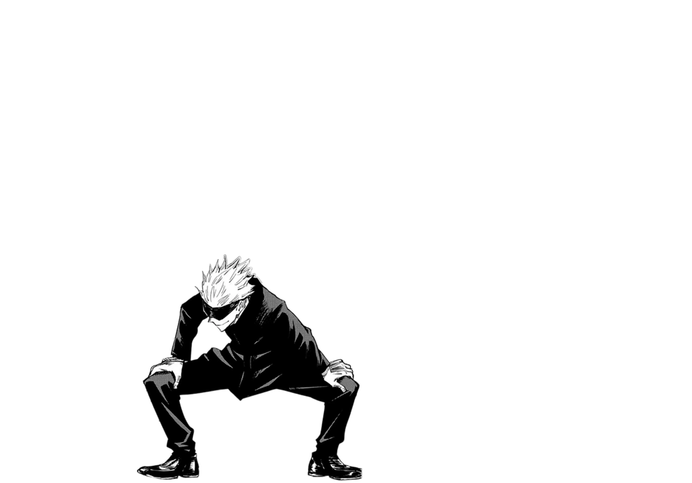
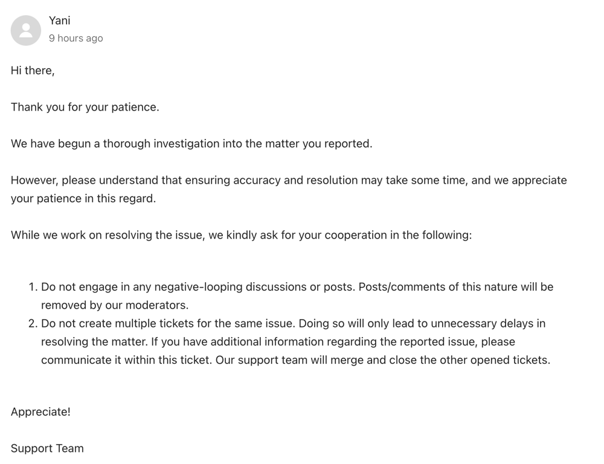

# 🔥✅✅ Beat 97.13% | ✅ Full Explanation ✅✅🔥

**Author:** DevOgabek
**Votes:** 89
**Link:** [https://leetcode.com/problems/merge-in-between-linked-lists/solutions/4898944/](https://leetcode.com/problems/merge-in-between-linked-lists/solutions/4898944/)

---

# Show your appreciation by clicking the upvote button
# UPVOTE
# UPVOTE
# UPVOTE
# UPVOTE
# UPVOTE
# UPVOTE
# UPVOTE
# UPVOTE
# UPVOTE


[](https://leetcode.com/problems/merge-in-between-linked-lists/submissions/1208633836?envType=daily-question&envId=Invalid%20Date)







<details>
<summary><b>Click here to see the text explanation</b></summary>
<br>
<br>

1. **Initialization**:
    - `ptr` is initialized to `list1`. This will serve as a pointer to navigate to the node just before the `a`th node in `list1`.
    - `qtr` is initialized to the node after `ptr`. This will serve as a pointer to navigate to the node after the `b`th node in `list1`.

2. **Navigating to the Appropriate Positions**:
    - A loop is used to move `ptr` to the node just before the `a`th node in `list1`. It iterates `a - 1` times.
    - Another loop is used to move `qtr` to the node after the `b`th node in `list1`. It iterates `b - a + 1` times.

3. **Merging `list2` into `list1`**:
    - The `next` pointer of the node pointed by `ptr` is updated to point to the head of `list2`, effectively inserting `list2` into `list1` at position `a`.
    - Then, it traverses through `list2` until it reaches the last node.
    - Finally, it sets the `next` pointer of the last node of `list2` to point to the node pointed by `qtr`, effectively linking `list2` to `list1` after the removed portion.

4. **Return**: 
    - It returns `list1`, which now represents the merged linked list.
</details>

<br>
<br>

```python []
class Solution(object):
    def mergeInBetween(self, list1, a, b, list2):
        ptr = list1
        for _ in range(a - 1):
            ptr = ptr.next
        
        qtr = ptr.next
        for _ in range(b - a + 1):
            qtr = qtr.next
        
        ptr.next = list2
        while list2.next:
            list2 = list2.next
        list2.next = qtr
        
        return list1
```
```python3 []
class Solution:
    def mergeInBetween(self, list1: ListNode, a: int, b: int, list2: ListNode) -> ListNode:
        ptr = list1
        for _ in range(a - 1):
            ptr = ptr.next
        
        qtr = ptr.next
        for _ in range(b - a + 1):
            qtr = qtr.next
        
        ptr.next = list2
        while list2.next:
            list2 = list2.next
        list2.next = qtr
        
        return list1
```
```C++ []
class Solution {
public:
    ListNode* mergeInBetween(ListNode* list1, int a, int b, ListNode* list2) {
        ListNode* ptr = list1;
        for (int i = 0; i < a - 1; ++i)
            ptr = ptr->next;
        
        ListNode* qtr = ptr->next;
        for (int i = 0; i < b - a + 1; ++i)
            qtr = qtr->next;
        
        ptr->next = list2;
        while (list2->next)
            list2 = list2->next;
        list2->next = qtr;
        
        return list1;
    }
};
```
```javascript []
var mergeInBetween = function(list1, a, b, list2) {
    let ptr = list1;
    for (let i = 0; i < a - 1; ++i)
        ptr = ptr.next;
    
    let qtr = ptr.next;
    for (let i = 0; i < b - a + 1; ++i)
        qtr = qtr.next;
    
    ptr.next = list2;
    while (list2.next)
        list2 = list2.next;
    list2.next = qtr;
    
    return list1;
};
```


<hr>

*These solutions are sorted from easiest to most challenging problems, tailored to your expertise*

<details>
<summary><b>Click here to see more of my solutions</b></summary>

## **My solutions**

\uD83D\uDFE2 - easy  
\uD83D\uDFE1 - medium 
\uD83D\uDD34 - hard

**These solutions are sorted from easiest to most challenging problems, tailored to your expertise.**

\uD83D\uDFE2 [9. Palindrome Number](https://leetcode.com/problems/palindrome-number/solutions/4795373/why-not-1-line-of-code-python-python3-c-everyone-can-understand/)
\uD83D\uDFE2 [1. Two Sum](https://leetcode.com/problems/two-sum/solutions/4791305/5-methods-python-c-python3-from-easy-to-difficult/)
\uD83D\uDFE2 [35. Search Insert Position](https://leetcode.com/problems/search-insert-position/solutions/4898401/beat-100-full-explanation-binary-search-demystified)
\uD83D\uDFE2 [543. Diameter of Binary Tree](https://leetcode.com/discuss/topic/4787634/surpassing-9793-memory-magician-excelling-at-9723/)
\uD83D\uDFE2 [2864. Maximum Odd Binary Number](https://leetcode.com/problems/maximum-odd-binary-number/solutions/4802402/visual-max-odd-binary-solver-python-python3-javascript-c)
\uD83D\uDFE2 [2864. Maximum Odd Binary Number](https://leetcode.com/problems/maximum-odd-binary-number/solutions/4802402/visual-max-odd-binary-solver-python-python3-javascript-c)
\uD83D\uDFE2 [977. Squares of a Sorted Array](https://leetcode.com/problems/squares-of-a-sorted-array/solutions/4807704/square-sorter-python-python3-javascript-c/)
\uD83D\uDFE2 [876. Middle of the Linked List](https://leetcode.com/problems/middle-of-the-linked-list/solutions/4834682/beat-10000-full-explanation-with-pictures)
\uD83D\uDFE2 [3028. Ant on the Boundary](https://leetcode.com/problems/ant-on-the-boundary/solutions/4837433/full-explanation-with-pictures)
\uD83D\uDFE2 [3005. Count Elements With Maximum Frequency](https://leetcode.com/problems/count-elements-with-maximum-frequency/solutions/4839796/beat-8369-full-explanation-with-pictures)
\uD83D\uDFE2 [2540. Minimum Common Value](https://leetcode.com/problems/minimum-common-value/solutions/4845076/beat-9759-full-explanation-with-pictures)
\uD83D\uDFE2 [101. Symmetric Tree](https://leetcode.com/problems/symmetric-tree/solutions/4848126/beat-100-full-explanation-with-pictures)
\uD83D\uDFE2 [349. Intersection of Two Arrays](https://leetcode.com/problems/intersection-of-two-arrays/solutions/4850588/beat-100-full-explanation-with-pictures)
\uD83D\uDFE2 [88. Merge Sorted Array](https://leetcode.com/problems/merge-sorted-array/solutions/4856902/beat-100-full-explanation-with-pictures/)
\uD83D\uDFE2 [136. Single Number](https://leetcode.com/problems/single-number/solutions/4862807/master-the-xor-trick-beat-9720-with-full-explanation)
\uD83D\uDFE2 [283. Move Zeroes](https://leetcode.com/problems/move-zeroes/solutions/4864068/mastering-efficiency-beat-9871)
\uD83D\uDFE2 [108. Convert Sorted Array to Binary Search Tree](https://leetcode.com/problems/convert-sorted-array-to-binary-search-tree/solutions/4864578/mastering-efficiency-beat-8974)
\uD83D\uDFE2 [2485. Find the Pivot Integer](https://leetcode.com/problems/find-the-pivot-integer/solutions/4866463/beat-100-full-explanation-with-pictures)
\uD83D\uDFE2 [104. Maximum Depth of Binary Tree](https://leetcode.com/problems/maximum-depth-of-binary-tree/solutions/4876170/beat-100-full-explanation-with-pictures)
\uD83D\uDFE1 [1669. Merge In Between Linked Lists](https://leetcode.com/problems/merge-in-between-linked-lists/solutions/4898944/beat-97-13-full-explanation)
\uD83D\uDFE1 [513. Find Bottom Left Tree Value](https://leetcode.com/problems/find-bottom-left-tree-value/solutions/4792022/binary-tree-explorer-mastered-javascript-python-python3-c-10000-efficiency-seeker/)
\uD83D\uDFE1 [1609. Even Odd Tree](https://leetcode.com/problems/even-odd-tree/solutions/4797529/even-odd-tree-validator-python-python3-javascript-c/)
\uD83D\uDFE1 [19. Remove Nth Node From End of List](https://leetcode.com/problems/remove-nth-node-from-end-of-list/solutions/4813340/beat-10000-full-explanation-with-pictures/)
\uD83D\uDFE1 [948. Bag of Tokens](https://leetcode.com/problems/bag-of-tokens/solutions/4818912/beat-10000-full-explanation-with-pictures)
\uD83D\uDFE1 [1750. Minimum Length of String After Deleting Similar Ends](https://leetcode.com/problems/minimum-length-of-string-after-deleting-similar-ends/solutions/4824224/beat-10000-full-explanation-with-pictures)
\uD83D\uDFE1 [17. Letter Combinations of a Phone Number](https://leetcode.com/problems/letter-combinations-of-a-phone-number/solutions/4845532/there-is-an-80-chance-of-being-in-the-interview-full-problem-explanation)
\uD83D\uDFE1 [22. Generate Parentheses](https://leetcode.com/problems/generate-parentheses/solutions/4845742/beat-9334-simple-explanation-with-pictures)
\uD83D\uDFE1 [39. Combination Sum](https://leetcode.com/problems/combination-sum/solutions/4847482/beat-8292-full-explanation-with-pictures)
\uD83D\uDFE1 [1171. Remove Zero Sum Consecutive Nodes from Linked List](https://leetcode.com/problems/remove-zero-sum-consecutive-nodes-from-linked-list/solutions/4862064/mastering-efficiency-beat-9231-with-full-explanation-and-visuals)
\uD83D\uDFE1 [238. Product of Array Except Self](https://leetcode.com/problems/product-of-array-except-self/solutions/4876797/beat-8080-full-explanation-with-pictures)
\uD83D\uDFE1 [57. Insert Interval](https://leetcode.com/problems/insert-interval/solutions/4885946/beat-9722-full-explanation-with-pictures)
\uD83D\uDFE1 [452. Minimum Number of Arrows to Burst Balloons](https://leetcode.com/problems/minimum-number-of-arrows-to-burst-balloons/solutions/4890366/beat-9380-full-explanation-with-pictures)
\uD83D\uDFE1 [131. Palindrome Partitioning](https://leetcode.com/problems/palindrome-partitioning/solutions/4892678/beat-9373-full-explanation-with-pictures)
\uD83D\uDFE1 [930. Binary Subarrays With Sum](https://leetcode.com/problems/binary-subarrays-with-sum/solutions/4872569/beat-8020-full-explanation-with-pictures)

[More...](https://leetcode.com/DevOgabek/)

</details>

<hr>
<details>
<summary><b>Why I do not respond to negative comments</b></summary>

## **Why I do not respond to negative comments**



</details>

<hr>
