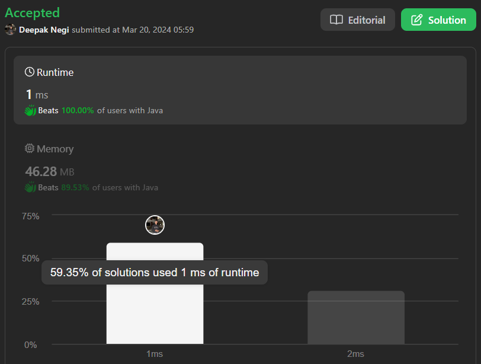

# Basic Approach | | Easy Explanation | | Time O(n) , Space O(1) | | C++ | | Java | | Python3 | | ✅✅🔥

**Author:** Hunter_0718
**Votes:** 12
**Link:** [https://leetcode.com/problems/merge-in-between-linked-lists/solutions/4898974/](https://leetcode.com/problems/merge-in-between-linked-lists/solutions/4898974/)

---



**Intuition:**

To solve this problem, we need to traverse `list1` to find the nodes at positions `a` and `b`. Once we locate these nodes, we can splice `list2` between them. We'll connect the node before position `a` to the head of `list2`, and the last node of `list2` to the node after position `b`. 

**Approach:**

1. Traverse `list1` to find the node at position `a-1`, `a`, and `b+1`.
2. Attach the last node of `list2` to the node after position `b`.
3. Attach the node before position `a` to the head of `list2`.
4. Return the head of `list1`.

**Complexity:**
- Time complexity: O(n), where n is the size of `list1` since we traverse it once to find the positions.
- Space complexity: O(1), as we use a constant amount of extra space.

**Code with Story:**

```C++ []
class Solution {
public:
    ListNode* mergeInBetween(ListNode* list1, int a, int b, ListNode* list2) {
        ListNode *prev = list1;  // Initialize pointers to traverse list1
        ListNode *temp1 = list1;  // Modified variable name
        ListNode *curr = list1;
        a--;  // Adjust a to match zero-based indexing
        
        // Traverse list1 to find the node at position (a-1)
        while(temp1 != NULL && a--) {
            temp1 = temp1->next;
            prev = temp1;
        }
        
        temp1 = list1;  // Reset temp1 to traverse list1 again
        
        // Traverse list1 to find the node at position (b+1)
        while(temp1 != NULL && b--) {
            temp1 = temp1->next;
            curr = temp1;
        }
        
        ListNode *temp2 = list2;  // Initialize pointer to traverse list2
        
        // Traverse list2 to find the last node
        while(temp2->next != NULL) {
            temp2 = temp2->next;
        }
        
        prev->next = list2;  // Connect the node before position 'a' to the head of list2
        temp2->next = curr->next;  // Connect the last node of list2 to the node after position 'b'
        
        return list1;  // Return the head of list1
    }
};

```
```Java []
/**
 * Definition for singly-linked list.
 * public class ListNode {
 *     int val;
 *     ListNode next;
 *     ListNode() {}
 *     ListNode(int val) { this.val = val; }
 *     ListNode(int val, ListNode next) { this.val = val; this.next = next; }
 * }
 */
class Solution {
    public ListNode mergeInBetween(ListNode list1, int a, int b, ListNode list2) {
        ListNode prev = list1, temp1 = list1, curr = list1;
        a--; // Adjust a to match zero-based indexing
        
        // Traverse list1 to find the node at position (a-1)
        while (temp1 != null && a-- > 0) {
            temp1 = temp1.next;
            prev = temp1;
        }
        
        temp1 = list1; // Reset temp1 to traverse list1 again
        
        // Traverse list1 to find the node at position (b+1)
        while (temp1 != null && b-- > 0) {
            temp1 = temp1.next;
            curr = temp1;
        }
        
        ListNode temp2 = list2; // Initialize pointer to traverse list2
        
        // Traverse list2 to find the last node
        while (temp2.next != null) {
            temp2 = temp2.next;
        }
        
        prev.next = list2; // Connect the node before position 'a' to the head of list2
        temp2.next = curr.next; // Connect the last node of list2 to the node after position 'b'
        
        return list1; // Return the head of list1
    }
}

```
```Python3 []
# Definition for singly-linked list.
# class ListNode:
#     def __init__(self, val=0, next=None):
#         self.val = val
#         self.next = next
class Solution:
    def mergeInBetween(self, list1: ListNode, a: int, b: int, list2: ListNode) -> ListNode:
        prev = list1
        temp1 = list1
        curr = list1
        a -= 1  # Adjust a to match zero-based indexing
        
        # Traverse list1 to find the node at position (a-1)
        while temp1 and a > 0:
            temp1 = temp1.next
            prev = temp1
            a -= 1
        
        temp1 = list1  # Reset temp1 to traverse list1 again
        
        # Traverse list1 to find the node at position (b+1)
        while temp1 and b > 0:
            temp1 = temp1.next
            curr = temp1
            b -= 1
        
        temp2 = list2  # Initialize pointer to traverse list2
        
        # Traverse list2 to find the last node
        while temp2.next:
            temp2 = temp2.next
        
        prev.next = list2  # Connect the node before position 'a' to the head of list2
        temp2.next = curr.next  # Connect the last node of list2 to the node after position 'b'
        
        return list1  # Return the head of list1
```

```Kotlin []
/**
 * Example:
 * var li = ListNode(5)
 * var v = li.`val`
 * Definition for singly-linked list.
 * class ListNode(var `val`: Int) {
 *     var next: ListNode? = null
 * }
 */
class Solution {
    fun mergeInBetween(list1: ListNode?, a: Int, b: Int, list2: ListNode?): ListNode? {
        var prev = list1
        var temp1 = list1
        var curr = list1
        var aCopy = a - 1 // Adjust a to match zero-based indexing
        
        // Traverse list1 to find the node at position (a-1)
        while (temp1 != null && aCopy > 0) {
            temp1 = temp1.next
            prev = temp1
            aCopy--
        }
        
        temp1 = list1 // Reset temp1 to traverse list1 again
        
        // Traverse list1 to find the node at position (b+1)
        var bCopy = b
        while (temp1 != null && bCopy > 0) {
            temp1 = temp1.next
            curr = temp1
            bCopy--
        }
        
        var temp2 = list2 // Initialize pointer to traverse list2
        
        // Traverse list2 to find the last node
        while (temp2?.next != null) {
            temp2 = temp2.next
        }
        
        prev?.next = list2 // Connect the node before position 'a' to the head of list2
        temp2?.next = curr?.next // Connect the last node of list2 to the node after position 'b'
        
        return list1 // Return the head of list1
    }
}
```
```JavaScript []
/**
 * Definition for singly-linked list.
 * function ListNode(val, next) {
 *     this.val = (val===undefined ? 0 : val)
 *     this.next = (next===undefined ? null : next)
 * }
 */
/**
 * @param {ListNode} list1
 * @param {number} a
 * @param {number} b
 * @param {ListNode} list2
 * @return {ListNode}
 */
var mergeInBetween = function(list1, a, b, list2) {
    let prev = list1, temp1 = list1, curr = list1;
    a--; // Adjust a to match zero-based indexing
    
    // Traverse list1 to find the node at position (a-1)
    while (temp1 && a-- > 0) {
        temp1 = temp1.next;
        prev = temp1;
    }
    
    temp1 = list1; // Reset temp1 to traverse list1 again
    
    // Traverse list1 to find the node at position (b+1)
    while (temp1 && b-- > 0) {
        temp1 = temp1.next;
        curr = temp1;
    }
    
    let temp2 = list2; // Initialize pointer to traverse list2
    
    // Traverse list2 to find the last node
    while (temp2.next !== null) {
        temp2 = temp2.next;
    }
    
    prev.next = list2; // Connect the node before position 'a' to the head of list2
    temp2.next = curr.next; // Connect the last node of list2 to the node after position 'b'
    
    return list1; // Return the head of list1
};
```


**Dry Run:**


**Here's a step-by-step execution of the code using the specified input:**

1. **Initialization:**
   - `prev`: points to head of `list1` (node 0).
   - `temp1`: points to head of `list1` (node 0).
   - `curr`: points to head of `list1` (node 0).
   - `a`: decremented to 1 (for zero-based indexing).

2. **Traverse list1 to position (a-1):**
   - Loop iterates once:
     - `temp1` moves to node 1 (value 1).
     - `prev` also moves to node 1 (value 1).
   - After loop:
     - `prev` points to node 1 (value 1).
     - `temp1` points to node 2 (value 2).

3. **Reset temp1 and traverse list1 to position (b+1):**
   - `temp1` is reset back to head of `list1` (node 0).
   - Loop iterates 5 times:
     - `temp1` moves to node 5 (value 5).
     - `curr` also moves to node 5 (value 5).
   - After loop:
      - `curr` points to node 6 (value 6).

4. **Find last node of list2:**
   - `temp2` iterates through `list2` until it reaches the last node (node 1000004).

5. **Merge the lists:**
   - `prev->next` (node 1's next pointer) is set to `list2` (connecting node 1 to `list2`).
   - `temp2->next` (last node of `list2`'s next pointer) is set to `curr->next` (connecting `list2` to node 6).

**Final Output:**
- The modified `list1` becomes: [0, 1, 1000000, 1000001, 1000002, 1000003, 1000004, 6].
- Nodes from index 2 to 5 of the original `list1` are effectively replaced with `list2`.

**Edge Cases:**
- If `list1` is empty.
- If `list2` is empty.
- If `a` is 0 (edge case for the beginning of the list).
- If `b` is the last index of `list1` (edge case for the end of the list).