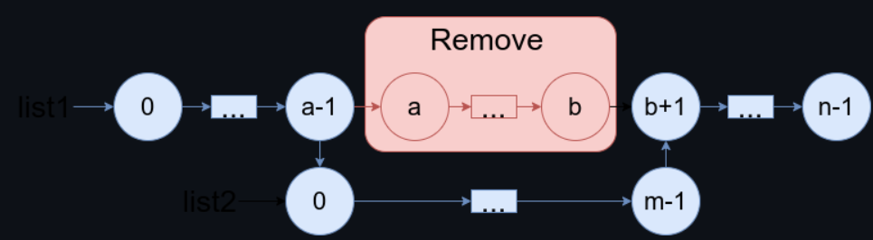

# Simple ,Beginner friendly & Dry Run & Advanced Sol, Full Explanation||Time O(n) Space O(1)||Gits✅✅✅

**Author:** GiteshSK_12
**Votes:** 3
**Link:** [https://leetcode.com/problems/merge-in-between-linked-lists/solutions/4696471/](https://leetcode.com/problems/merge-in-between-linked-lists/solutions/4696471/)

---


# Intuition \uD83D\uDC48

In the question, we are given two linked lists, List1 and List2, and two numbers, a and b. We have to remove nodes of List1 from a to b and insert List2 in their place.

# Approach \uD83D\uDC48

To solve this question, we will simply create a dummy list with a random value and a `prev` node, which will point to the node previous to `a`. Then, we will create a node `after_idx`, which will point to the node next to `b`. Next, we will set `prev.next` to point to `list2`. We will create a node `last_idx`, which will point to the last node of `list2`. Finally, we will set `last_idx.next` to point to `after_idx`.



# Code Explanation \uD83D\uDC48


*   **Creating a Dummy Node**: A new `ListNode` named `dummy` is created with a value of `0`. This node does not actually hold data relevant to the lists being merged but serves as a placeholder to simplify manipulation of the list heads and ensure uniform handling of all nodes during the merge. `dummy.next` is set to point to the head of `list1`, effectively placing the dummy node at the beginning of `list1`.
    
*   **Locating the Insertion Point**: The method starts by finding the node in `list1` immediately before the position `a` where `list2` will be inserted. This is done by advancing a pointer `pre` from the dummy node up to, but not including, the `a`th node. This loop runs `a` times.
    
*   **Skipping Over Nodes to be Replaced**: Another pointer, `last`, is set to the position of `pre` and then advanced to the node immediately after position `b`, effectively locating the part of `list1` that will remain after the nodes from `a` to `b` are replaced by `list2`. This loop runs `(b - a + 1)` times to include both the start and end positions in the count.
    
*   **Inserting `list2` into `list1`**: The `next` pointer of the node just before `a` (now held by `pre`) is set to point to the head of `list2`, beginning the process of insertion by linking the end of the preserved start segment of `list1` to the beginning of `list2`.
    
*   **Finding the End of `list2`**: The code then iterates through `list2` to find its last node, using a pointer `tail2`. This is necessary to connect the end of `list2` back into `list1`.
    
*   **Completing the Merge**: Once the end of `list2` is found, `tail2.next` is set to `last`, which points to the node immediately after position `b` in `list1`. This links the end of `list2` to the remainder of `list1`, completing the merge.
    
*   **Returning the Merged List**: Finally, the method returns `dummy.next`. Since `dummy` was initially set to point to the head of `list1`, and `list1` was modified to include `list2`, `dummy.next` now points to the head of the fully merged list. The use of the dummy node means the head of the merged list is returned correctly, even if `list2` was inserted at the very start of `list1`.

# Complexity \uD83D\uDC48
- Time complexity: O(n) Where n is the sum of length of the Linked Lists .

- Space complexity: O(1)

# Code \uD83D\uDC48

```C []
/**
 * Definition for singly-linked list.
 * struct ListNode {
 *     int val;
 *     struct ListNode *next;
 * };
 */


struct ListNode* mergeInBetween(struct ListNode* list1, int a, int b, struct ListNode* list2){
    struct ListNode* dummy = (struct ListNode*)malloc(sizeof(struct ListNode)); // Corrected type casting
    dummy->val = 0;
    dummy->next = list1;
    struct ListNode* prev = dummy;

    for(int i = 0; i < a; i++) {
        prev = prev->next;
    }

    struct ListNode* after_idx = prev;
    for(int i = a; i <= b + 1; i++) {
        after_idx = after_idx->next;
    }

    struct ListNode* last_idx = list2;
    while(last_idx->next != NULL) {
        last_idx = last_idx->next;
    }

    last_idx->next = after_idx;
    prev->next = list2;

    struct ListNode* result = dummy->next;
    free(dummy); 
    return result;
}
```
```C++ []
/**
 * Definition for singly-linked list.
 * struct ListNode {
 *     int val;
 *     ListNode *next;
 *     ListNode() : val(0), next(nullptr) {}
 *     ListNode(int x) : val(x), next(nullptr) {}
 *     ListNode(int x, ListNode *next) : val(x), next(next) {}
 * };
 */
class Solution {
public:
    ListNode* mergeInBetween(ListNode* list1, int a, int b, ListNode* list2) {
        ListNode* dummy = new ListNode(0);
        dummy->next = list1;
        ListNode* prev = dummy;
        for(int i=0; i<a; i++){
            prev = prev->next;
        }
        ListNode* after_idx  = prev;
        for(int i = a; i<= b+1; i++){
            after_idx = after_idx->next;
        }
        ListNode* last_idx = list2;
        while(last_idx->next != NULL){
            last_idx = last_idx->next;
        }
        last_idx->next = after_idx;
        prev->next = list2;
        return dummy->next;
    }
};
```
```Java []
/**
 * Definition for singly-linked list.
 * public class ListNode {
 *     int val;
 *     ListNode next;
 *     ListNode() {}
 *     ListNode(int val) { this.val = val; }
 *     ListNode(int val, ListNode next) { this.val = val; this.next = next; }
 * }
 */
class Solution {
    public ListNode mergeInBetween(ListNode list1, int a, int b, ListNode list2) {
        ListNode dummy = new ListNode(0);
        dummy.next = list1;
        ListNode prev = dummy;
        for(int i=0; i<a; i++){
            prev = prev.next;
        }
        ListNode after_idx  = prev;
        for(int i = a; i<= b+1; i++){
            after_idx = after_idx.next;
        }
        ListNode last_idx = list2;
        while(last_idx.next != null){
            last_idx = last_idx.next;
        }
        last_idx.next = after_idx;
        prev.next = list2;
        return dummy.next;
    }
}
```
```javascript []
/**
 * Definition for singly-linked list.
 * function ListNode(val, next) {
 *     this.val = (val===undefined ? 0 : val)
 *     this.next = (next===undefined ? null : next)
 * }
 */
/**
 * @param {ListNode} list1
 * @param {number} a
 * @param {number} b
 * @param {ListNode} list2
 * @return {ListNode}
 */
var mergeInBetween = function(list1, a, b, list2) {
        dummy = new ListNode(0);
        dummy.next = list1;
        prev = dummy;
        for(let i=0; i<a; i++){
            prev = prev.next;
        }
        after_idx  = prev;
        for(let i = a; i<= b+1; i++){
            after_idx = after_idx.next;
        }
        last_idx = list2;
        while(last_idx.next != null){
            last_idx = last_idx.next;
        }
        last_idx.next = after_idx;
        prev.next = list2;
        return dummy.next;
};
```
```C# []
/**
 * Definition for singly-linked list.
 * public class ListNode {
 *     public int val;
 *     public ListNode next;
 *     public ListNode(int val=0, ListNode next=null) {
 *         this.val = val;
 *         this.next = next;
 *     }
 * }
 */
public class Solution {
    public ListNode MergeInBetween(ListNode list1, int a, int b, ListNode list2) {
        ListNode dummy = new ListNode(0);
        dummy.next = list1;
        ListNode prev = dummy;
        for(int i=0; i<a; i++){
            prev = prev.next;
        }
        ListNode after_idx  = prev;
        for(int i = a; i<= b+1; i++){
            after_idx = after_idx.next;
        }
        ListNode last_idx = list2;
        while(last_idx.next != null){
            last_idx = last_idx.next;
        }
        last_idx.next = after_idx;
        prev.next = list2;
        return dummy.next;
    }
}
```
```python []
# Definition for singly-linked list.
# class ListNode(object):
#     def __init__(self, val=0, next=None):
#         self.val = val
#         self.next = next
class Solution(object):
    def mergeInBetween(self, list1, a, b, list2):
        """
        :type list1: ListNode
        :type a: int
        :type b: int
        :type list2: ListNode
        :rtype: ListNode
        """
        dummy = ListNode(0)
        dummy.next = list1
        pre = dummy

        for _ in range(0,a):
            pre = pre.next

        last = pre

        for _ in range(a, b+2):
            last = last.next

        pre.next = list2
        tail2 = list2

        while tail2.next != None:
            tail2 = tail2.next
    
        tail2.next = last
        return dummy.next
```
```ruby []
# Definition for singly-linked list.
# class ListNode
#     attr_accessor :val, :next
#     def initialize(val = 0, _next = nil)
#         @val = val
#         @next = _next
#     end
# end
# @param {ListNode} list1
# @param {Integer} a
# @param {Integer} b
# @param {ListNode} list2
# @return {ListNode}
def merge_in_between(list1, a, b, list2)
    dummy = ListNode.new(0)
        dummy.next = list1
        pre = dummy

        for i in 0..a-1 do
            pre = pre.next
        end

        last = pre

        for i in a..b+1 do
            last = last.next
        end

        pre.next = list2
        tail2 = list2

        while tail2.next != nil 
            tail2 = tail2.next
        end
        tail2.next = last
        return dummy.next
end
```


# Dry Run  \uD83D\uDC48

1.  **Traverse to Node Before `a`**: The loop runs until `i < a`, moving `pre` to point to the node just before the `a`th node in `list1`. For `a = 3`, `pre` ends up pointing to the node with value `2`.
    
2.  **Find Node After `b`**: Another loop runs to move the `last` pointer to the node just after `b`, which for `b = 4`, ends up pointing to the node with value `5`.
    
3.  **Insert `list2` into `list1`**: The `next` of `pre` (which points to `2`) is set to the head of `list2` (`1000000`). This operation effectively begins the process of inserting `list2` between the nodes `2` and `5` of `list1`.
    
4.  **Find Last Node of `list2`**: Iteration through `list2` finds the last node, which has the value `1000002`.
    
5.  **Link the Last Node of `list2` to `list1`**: The `next` of the last node of `list2` (`1000002`) is set to `last`, which points to the node with value `5` in `list1`.
    
6.  **Result**: The `dummy.next` is returned, which now points to the head of the modified `list1`.
    

Here's how the lists change at each step:

*   **Original list1**: `0 -> 1 -> 2 -> 3 -> 4 -> 5`
*   **list2**: `1000000 -> 1000001 -> 1000002`

**After Step 2**: `pre` points to `2`.

**After Step 3**: `last` points to `5`.

**After Step 4**: `list1` changes to `0 -> 1 -> 2 -> 1000000 -> 1000001 -> 1000002` (temporarily disconnected from the rest of `list1`).

**After Step 6**: The connection is completed as `1000002 -> 5`.

**Final merged list**: `0 -> 1 -> 2 -> 1000000 -> 1000001 -> 1000002 -> 5`

Thus, nodes `3` and `4` from `list1` have been replaced by all nodes from `list2`, and the final list after the operation is `[0, 1, 2, 1000000, 1000001, 1000002, 5]`.

# Guys if the explanation and solution is helpful then up vote me.\u2764\uFE0F\u2764\uFE0F\u2764\uFE0F\u2764\uFE0F\u2764\uFE0F


