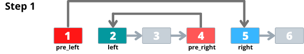
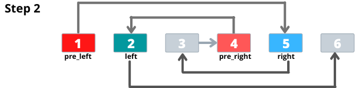
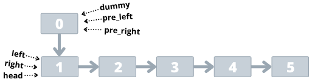
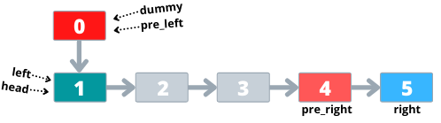
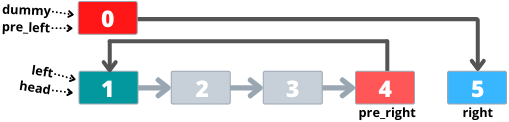
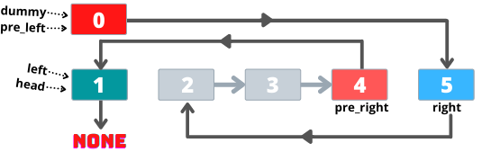
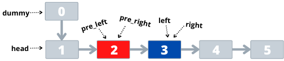

# Python 3 | Swapping NODES | Swapping Values | One Pass | Fully explained

**Author:** NanakBanerjee
**Votes:** 425
**Link:** [https://leetcode.com/problems/swapping-nodes-in-a-linked-list/solutions/1054370/](https://leetcode.com/problems/swapping-nodes-in-a-linked-list/solutions/1054370/)

---

# Swapping Values 
**This question can be very easily solved if we only swap the value in the nodes. Follow the bellow steps to swap the values :-**
1. Find the k-th node from the front.
2. Find the k-th last element using two poiners method.
3. Swap their values.
4. Return the head of the Linked List

**CODE-** 
```
def swapNodes(self, head: ListNode, k: int) -> ListNode:
	first = last = head
	for i in range(1, k):
		first = first.next
		
	null_checker = first 
	while null_checker.next:
		last = last.next
		null_checker = null_checker.next
	first.val, last.val = last.val, first.val
	return head
```

________________________________________________________________________

# Swapping Nodes
**Here, the very first step will be to find the K-th first and K-th last nodes.** 
While doing so, we also need to store the addresses of previous nodes of the K-th first and K-th last nodes in two poiners. 

To make it less confusing, here's a breakdown.
`left `=  Kth node of the Linked List
`pre_left`= the previous node to `left`
`right` = Kth node of the LinkedList from the end
`pre_right` = the previous node to `right`


*The above image illustrates for K=2*

Now we need to swap node `left` with node `right`.

Let's do it in 2 simple steps -



 - Assign `right` and `left` to `pre_left.next` and `pre_right.next` respectively. 


- Swap `left.next` and `right.next`


**Finally the list should look like this**


Now that we have visualized the basic idea behind swapping the Nodes, let's address **the elephant in the room**.

You see, I have never mentioned how we'll be initializing the `pre_left` and `pre_right` variables or infact any variables. In case of `left` and `right`, we'll initialize them with the address of head. `left=right=head` will do the job. Now comming to the `pre_left` and `pre_right`.

If we initialize them with `None`, the code wont give correct results for k=1.
This is because `left` will point to the head of the linked list and `pre_left` will point to `None`. We won't be able to perform step 1 of swapping the nodes as `pre_left.next` will be an invalid statement.

To solve this issue, we can introduce a dummy node whose next will point to the head of the linked list. Something like this,


Once we're done with creating the dummy node and initializing appropriately, we can go back to finding the K-th and K-th last nodes in the list.

 
 Now perform **step 1 of swapping** `left` and `right`
 

 **Step 2 of swapping**
 
 *NOTE - Node 1 is pointing to `None` because `right.next` was pointing to `None`.*
 
 Also **keep in mind** that in cases where `k` points to the middle element of the LinkedList, i.e where `left == right`, return back the head of the LinkedList. The following image illustrates what i'm trying to say.
 

In such a cases there is no need to perform any swapping of nodes. Simply return the head or `dummy.next`.
 
 **And we are done!**
Using the dummy node will always give the correct result. Return back `dummy.next` instead of `head` as it'll always point to the starting node.
 
 **CODE**
 

    def swapNodes(self, head: ListNode, k: int) -> ListNode:
        dummy = pre_right = pre_left = ListNode(next=head)
        right = left = head
        for i in range(k-1):
            pre_left = left
            left = left.next
        
        null_checker = left
        
        while null_checker.next:
            pre_right = right
            right = right.next
            null_checker = null_checker.next
            
        if left == right:
            return head
        
        pre_left.next, pre_right.next = right, left
        left.next, right.next = right.next, left.next
        return dummy.next        


**I Hope this helped. If so, an Upvote will be really Awesome.** \uD83D\uDE0A
Btw this was my first time I'm sharing an answer in LeetCode.