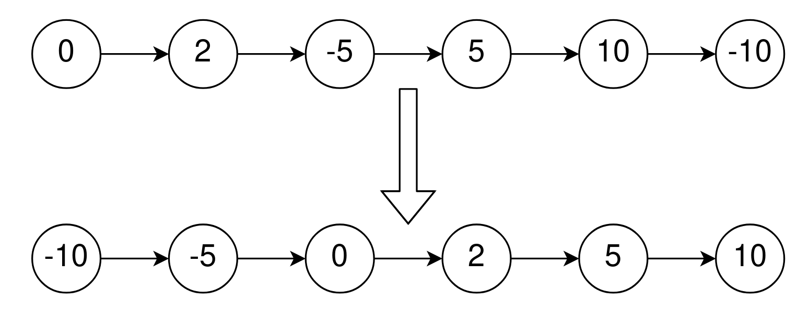
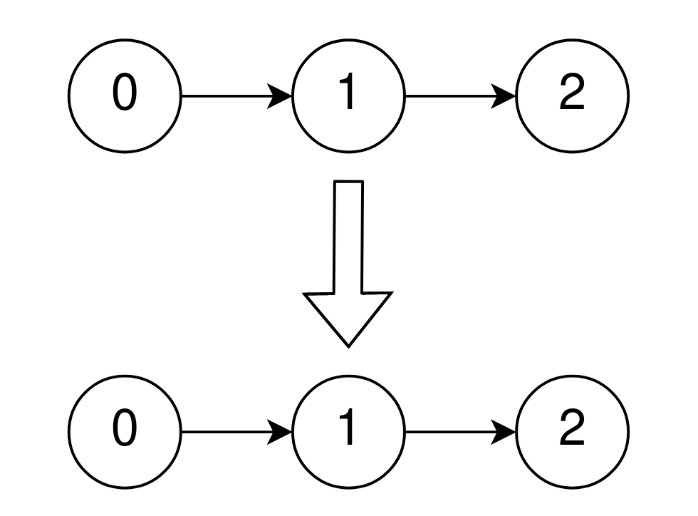

# [2046. Sort Linked List Already Sorted Using Absolute Values](https://leetcode.com/problems/sort-linked-list-already-sorted-using-absolute-values/)

| Category | Difficulty | Likes | Dislikes |
| :------: | :--------: | :---: | :------: |
| Algorithms | Medium | 173 | 3 |

**Tags:** [`linked-list`](https://leetcode.com/tag/linked-list), [`two-pointers`](https://leetcode.com/tag/two-pointers), [`sorting`](https://leetcode.com/tag/sorting)


## Description

Given the `head` of a singly linked list that is sorted in **non-decreasing** order using the **absolute values** of its nodes, return *the list sorted in **non-decreasing** order using the **actual values** of its nodes*.

 

**Example 1:**


```

Input: head = [0,2,-5,5,10,-10]
Output: [-10,-5,0,2,5,10]
Explanation:
The list sorted in non-descending order using the absolute values of the nodes is [0,2,-5,5,10,-10].
The list sorted in non-descending order using the actual values is [-10,-5,0,2,5,10].

```

**Example 2:**


```

Input: head = [0,1,2]
Output: [0,1,2]
Explanation:
The linked list is already sorted in non-decreasing order.

```

**Example 3:**

```

Input: head = [1]
Output: [1]
Explanation:
The linked list is already sorted in non-decreasing order.

```

 

**Constraints:**

	- The number of nodes in the list is the range `[1, 10^5]`.

	- `-5000 <= Node.val <= 5000`

	- `head` is sorted in non-decreasing order using the absolute value of its nodes.

 

**Follow up:**

	- Can you think of a solution with `O(n)` time complexity?

---

**Links:** [Submissions](https://leetcode.com/problems/sort-linked-list-already-sorted-using-absolute-values/) | [Solutions](https://leetcode.com/problems/sort-linked-list-already-sorted-using-absolute-values/)
