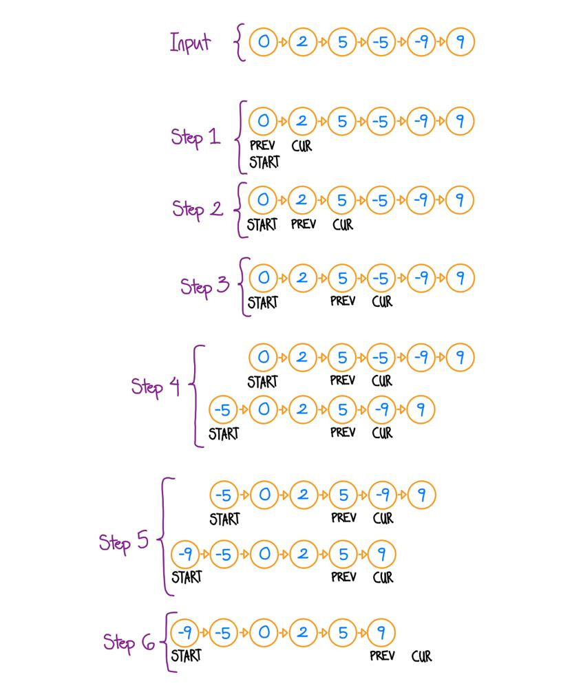
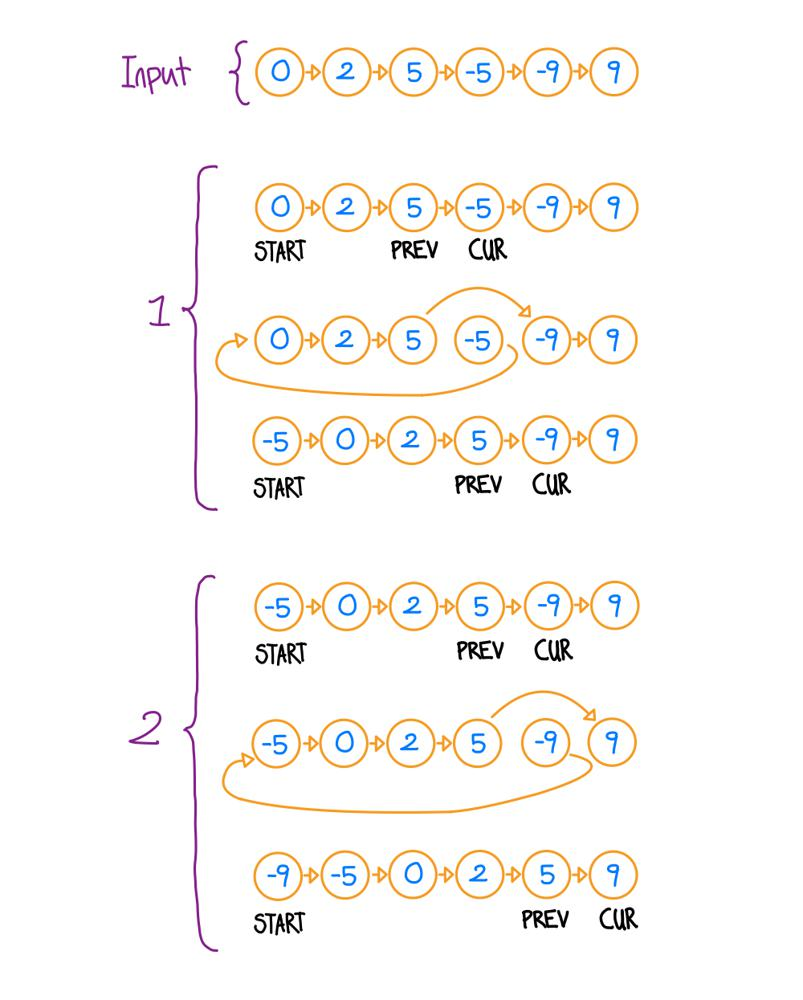

# Golang solution with explanation and images

**Author:** nathannaveen
**Votes:** 2
**Link:** [https://leetcode.com/problems/sort-linked-list-already-sorted-using-absolute-values/solutions/1543938/](https://leetcode.com/problems/sort-linked-list-already-sorted-using-absolute-values/solutions/1543938/)

---

**The First Solution:**

The idea of this solution is to check whether the current value is smaller than `0`. If so, we can remove it from its current position, add a node with the same value to the beginning of the list, and make that the new beginning.

This solution works because the absolute value of `-1` will always be smaller than the absolute value of `-5`, but `-1` is greater than `-5`. So if we have the linked list `[-1, -5]`, we can go through the linked list from the `0` index to the end, find the greatest valued negative numbers, and add them to the beginning before the smaller negative numbers.

The idea of this solution can be shown using the following image:




* Step one is initializing the `start, prev`, and `cur` variables. 
    * `start` is the very beginning of the linked list. In this example, `0` is the head. Notice how `start` is always the beginning of the linked list while the head isn't always.
    * `cur` is the current value we are on. We can initialize it at position `1` (**0 Indexed**) because if position `0` is negative, it is the greatest negative number, and we don't have to worry. And if the value at position `0` is positive, it is the smallest positive value, and all the negative values that we add before it will always be smaller.
    * `prev` is always the node before `cur` so we can check whether `cur.Val` is negative and remove the node from the linked list.
* In step 2, we have moved `prev` and `cur` up by one node.
* In step three, we move `prev` and `cur` up by one more node.
* In step 4, we can see that cur is negative. So we can remove it from the list and add another `ListNode` with the same value to the beginning. We make `start` equal to this new `ListNode` because that is the new start of the linked list.
* In step 5, we can see that cur is negative, so we can do the same thing as step 4.
* In step 6, we move `cur` and `prev` up by a node, but `cur == nil`, so we break out of the loop and return `start`.


``` go
func sortLinkedList(head *ListNode) *ListNode {
    cur := head.Next
    prev := head
    start := head
    
    for cur != nil {
        if cur.Val < 0 {
            start = &ListNode{ cur.Val, start }
            cur = cur.Next
            prev.Next = prev.Next.Next
        } else {
            prev = prev.Next
            cur = cur.Next
        }
    }
    
    return start
}
```

**The Second Solution:** *(O(1) space)*

The idea of this solution is to remove the node from the linked list and move it to the front while the first solution's idea was to remove the node from the linked list and add a new node with the same value to the front.




* For this solution I decided to just show an image when `cur.Val` is negative.
* We have the same example input as the first solution.

``` go
func sortLinkedList(head *ListNode) *ListNode {
    cur := head.Next
    prev := head
    
    for cur != nil {
        if cur.Val < 0 {
            prev.Next = prev.Next.Next
            cur.Next = head
            head = cur
            cur = prev.Next
        } else {
            prev = prev.Next
            cur = cur.Next
        }
    }
    
    return head
}
```

*Note that we can take out `start` from both solutions and use `head` instead. I used `start` so it would be easier for any readers.*