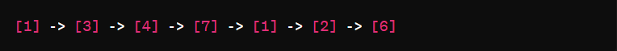
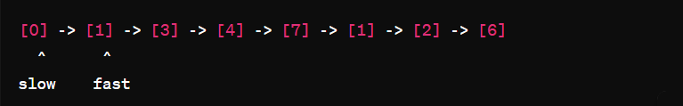
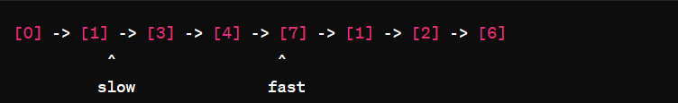
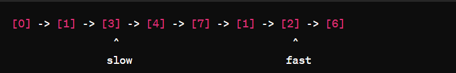
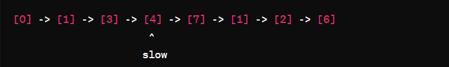
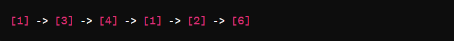

# Simple ,Beginner Friendly & Dry Run || Two Pointer approach || Time O(n) Space O(1) || Gits✅✅✅👈👈👈

**Author:** GiteshSK_12
**Votes:** 156
**Link:** [https://leetcode.com/problems/delete-the-middle-node-of-a-linked-list/solutions/4705282/](https://leetcode.com/problems/delete-the-middle-node-of-a-linked-list/solutions/4705282/)

---


# Intuition \uD83D\uDC48

In the given problem, we are presented with a singly linked list, which is a collection of elements, called nodes, each containing a value and a pointer to the next node in the sequence. The task is to identify and remove the middle node from this list. The "middle" node is defined as the node that resides at the halfway point of the list. In cases where the list contains an even number of nodes, and thus has two middle nodes, the task is to remove the first of these two middle nodes.

# Approach \uD83D\uDC48

The objective is to achieve this removal efficiently, without traversing the list more than once. A popular and effective strategy to accomplish this is the two-pointer technique, also known as the "fast and slow pointer" method. In this approach, two pointers are initialized at the beginning of the list, but they move at different speeds. The "fast" pointer advances two nodes for every one node that the "slow" pointer advances. By the time the fast pointer reaches the end of the list, the slow pointer will be positioned just before the middle node, enabling its easy removal. This method ensures that the algorithm only needs to pass through the list once, thus optimizing both time and computational resources.

# Code Explanation : \uD83D\uDC48

*   **Base Case Check**:
    
    *   If `head` is `null`, the list is empty. The method returns `null` since there's nothing to delete.
*   **Initialization**:
    
    *   A dummy node, `prev`, is created and its `next` pointer is set to `head`. This dummy node serves as a placeholder to simplify edge case handling, especially when the list has only one node or when we need to delete the first real node of the list.
    *   Two pointers, `slow` and `fast`, are initialized: `slow` starts at `prev` and `fast` starts at `head`.
*   **Traversal**:
    
    *   The list is traversed using the two-pointer technique where `fast` moves twice as fast as `slow`. For every move `fast` makes two steps (if possible), `slow` makes one step.
    *   This traversal continues until `fast` reaches the end of the list (`fast` is `null`) or `fast` is at the last node (`fast.next` is `null`). At this point, `slow` will be just before the middle node of the list. This is because while `fast` moves through the entire list, `slow` moves only half the distance.
*   **Deletion**:
    
    *   Once the traversal is complete, `slow` is either at the node just before the middle of the list (for odd-length lists) or at the node before the second middle node (for even-length lists, where there are two middle nodes, and the first one is considered the middle for deletion).
    *   The middle node is then removed by adjusting the `next` pointer of the `slow` node to skip over the middle node and point directly to the node after the middle node. This effectively removes the middle node from the list.
*   **Return**:
    
    *   Finally, the method returns the new list, but since the `prev` node was a dummy node added at the start, the method returns `prev.next` to return the actual head of the modified list.
    
# Complexity \uD83D\uDC48
- Time complexity: O(n)

- Space complexity: O(1)

# Code \uD83D\uDC48
```C []
/**
 * Definition for singly-linked list.
 * struct ListNode {
 *     int val;
 *     struct ListNode *next;
 * };
 */
struct ListNode* deleteMiddle(struct ListNode* head) {
    if (head == NULL) return NULL;
    struct ListNode* prev = (struct ListNode*)malloc(sizeof(struct ListNode));
    prev->val = 0;
    prev->next = head;
    struct ListNode* slow = prev;
    struct ListNode* fast = head;
    while (fast != NULL && fast->next != NULL) {
        slow = slow->next;
        fast = fast->next->next;
    }
    struct ListNode* temp = slow->next;
    slow->next = slow->next->next;
    free(temp); 
    struct ListNode* newHead = prev->next;
    free(prev);
    return newHead;
}
```
```C++ []
/**
 * Definition for singly-linked list.
 * struct ListNode {
 *     int val;
 *     ListNode *next;
 *     ListNode() : val(0), next(nullptr) {}
 *     ListNode(int x) : val(x), next(nullptr) {}
 *     ListNode(int x, ListNode *next) : val(x), next(next) {}
 * };
 */
class Solution {
public:
    ListNode* deleteMiddle(ListNode* head) {
        if(head == NULL)return NULL;
        ListNode* prev = new ListNode(0);
        prev->next = head;
        ListNode* slow = prev;
        ListNode* fast = head;
        while(fast != NULL && fast->next != NULL){
            slow = slow->next;
            fast = fast->next->next;
        }
        slow->next = slow->next->next;
        return prev->next;
    }
};
```
```Java []
/**
 * Definition for singly-linked list.
 * public class ListNode {
 *     int val;
 *     ListNode next;
 *     ListNode() {}
 *     ListNode(int val) { this.val = val; }
 *     ListNode(int val, ListNode next) { this.val = val; this.next = next; }
 * }
 */
class Solution {
    public ListNode deleteMiddle(ListNode head) {
        if(head == null)return null;
        ListNode prev = new ListNode(0);
        prev.next = head;
        ListNode slow = prev;
        ListNode fast = head;
        while(fast != null && fast.next != null){
            slow = slow.next;
            fast = fast.next.next;
        }
        slow.next = slow.next.next;
        return prev.next;
    }
}
```
```JavaScript []
/**
 * Definition for singly-linked list.
 * function ListNode(val, next) {
 *     this.val = (val===undefined ? 0 : val)
 *     this.next = (next===undefined ? null : next)
 * }
 */
/**
 * @param {ListNode} head
 * @return {ListNode}
 */
var deleteMiddle = function(head) {
    if(head === null)return null;
    prev = new ListNode(0);
    prev.next = head;
    slow = prev;
    fast = head;
    while(fast != null && fast.next != null){
        slow = slow.next;
        fast = fast.next.next;
    }
    slow.next = slow.next.next;
    return prev.next;
};
```
```C# []
/**
 * Definition for singly-linked list.
 * public class ListNode {
 *     public int val;
 *     public ListNode next;
 *     public ListNode(int val=0, ListNode next=null) {
 *         this.val = val;
 *         this.next = next;
 *     }
 * }
 */
public class Solution {
    public ListNode DeleteMiddle(ListNode head) {
        if(head == null)return null;
        ListNode prev = new ListNode(0);
        prev.next = head;
        ListNode slow = prev;
        ListNode fast = head;
        while(fast != null && fast.next != null){
            slow = slow.next;
            fast = fast.next.next;
        }
        slow.next = slow.next.next;
        return prev.next;
    }
}
```
```Python []
# Definition for singly-linked list.
# class ListNode(object):
#     def __init__(self, val=0, next=None):
#         self.val = val
#         self.next = next
class Solution(object):
    def deleteMiddle(self, head):
        """
        :type head: Optional[ListNode]
        :rtype: Optional[ListNode]
        """
        if head == None :return None
        prev = ListNode(0)
        prev.next = head
        slow = prev
        fast = head
        while fast != None and fast.next != None:
            slow = slow.next
            fast = fast.next.next
        
        slow.next = slow.next.next
        return prev.next
```
```ruby []
# Definition for singly-linked list.
# class ListNode
#     attr_accessor :val, :next
#     def initialize(val = 0, _next = nil)
#         @val = val
#         @next = _next
#     end
# end
# @param {ListNode} head
# @return {ListNode}
def delete_middle(head)
    if head == nil 
        return nil
    end
    prev = ListNode.new(0)
    prev.next = head
    slow = prev
    fast = head
    while fast != nil and fast.next != nil
        slow = slow.next
        fast = fast.next.next
    end
    slow.next = slow.next.next
    return prev.next
end
```

# Dry Run \uD83D\uDC48

Initially, the list looks like this:




1.  **Initialize pointers**:
    *   A dummy node `prev` is created and its `next` is pointed to `head`.
    *   `slow` is pointed to `prev`.
    *   `fast` is pointed to `head`.

So, the setup now looks like this (let's represent `prev` as `[0]` for visualization):




2.  **Traverse the list**:
    *   The loop is entered. `slow` moves one step at a time, and `fast` moves two steps at a time.
    *   The goal here is to have `slow` point to the node just before the middle node by the time `fast` reaches the end of the list.

Here's the progression:

*   After 1st iteration:




*   After 2nd iteration:




*   After 3rd iteration, `fast` will be `null` (as `fast.next.next` from `[6]` is `null`), and the loop terminates:




3.  **Delete the middle node**:
    *   `slow.next` is the middle node `[7]`, so we set `slow.next` to `slow.next.next`, effectively removing `[7]` from the list.
    *   The list now looks like this:


4.  **Return the modified list**:
    *   We return `prev.next`, which is the head of the new list without the middle node:




So, the modified list after removing the middle node (`[7]`) is `[1, 3, 4, 1, 2, 6]`.

# Guys if the explanation and the solution is helpful then upvote me.\u2764\uFE0F\u2764\uFE0F\u2764\uFE0F\u2764\uFE0F\u2764\uFE0F\u2764\uFE0F\u2764\uFE0F\u2764\uFE0F


