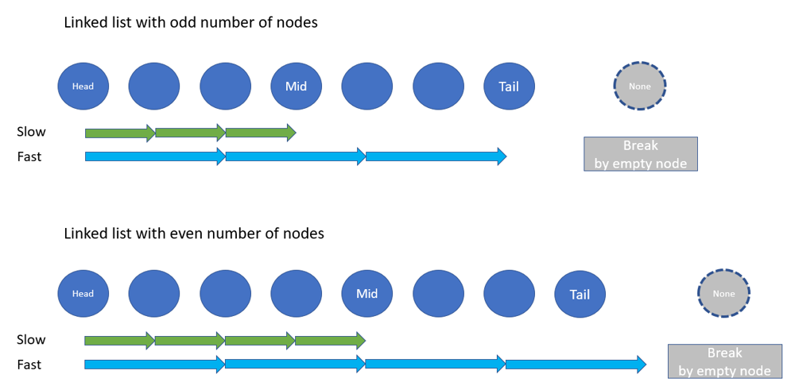
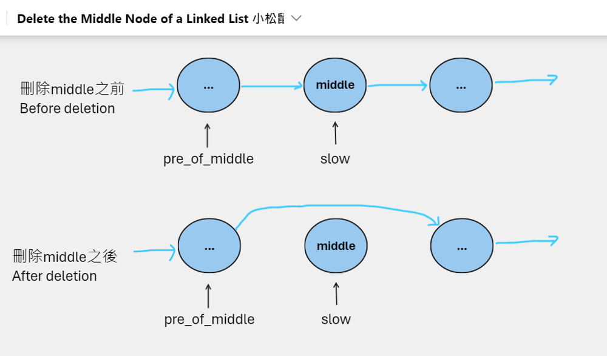

# Python/JS/Java/Cpp/Go O(n) by two-pointers [w/ Visualization]

**Author:** brianchiang_tw
**Votes:** 15
**Link:** [https://leetcode.com/problems/delete-the-middle-node-of-a-linked-list/solutions/1619599/](https://leetcode.com/problems/delete-the-middle-node-of-a-linked-list/solutions/1619599/)

---

O(n) by two-pointers

---

**Hint**:

Just like the way we did in **[Leetcode #876 Middle of the Linked list](https://leetcode.com/problems/middle-of-the-linked-list/)**

Think of **two pointers technique** with slow runner and fast runner, also known as **tortoise-and-hare algorithm**.

Both slow runner and fast runner are initialized to head node.

Each iteration, **fast** runner moves **two steps forward** while the **slow** one moves **one steps** only.

When fast runner meets the empty node (i.e., NULL) on the tail, the slow one will be right on the node of midpoint.

---

**Visualization**






---

**Implementation**:

Python:

```
# Definition for singly-linked list.
# class ListNode:
#     def __init__(self, val=0, next=None):
#         self.val = val
#         self.next = next

class Solution:
    def deleteMiddle(self, head: Optional[ListNode]) -> Optional[ListNode]:
        
		# dummy head make it easier for us to handle special case on linked list with one node only
        dummy_head = ListNode(-1, head)
        pre_of_middle,slow, fast = dummy_head, head, head
        
        # use tortoise-and-hare algorithm to locate the middle node
        while fast and fast.next:
            
            # locate the node before middle node
            pre_of_middle = slow
            
            # tortoise move one step on each round
            slow = slow.next
            
            # hare move two steps on each round
            fast = fast.next.next
            
        
        # locate the node after middle node
        junction = slow.next
        
        # update linkage between previous one and next one
        pre_of_middle.next = junction
        
        # delete and release middle node
        del slow
        
        
        return dummy_head.next
```

---

Javascript:

```
var deleteMiddle = function(head) {
    
    let dummyHead = new ListNode(-1, head);
    
    let [prevOfMiddle, slow, fast] = [dummyHead, head, head];
    
    // Use tortoise and hare algorithm to locate the middle node
    while( fast != null && fast.next != null ){
        
        // locate the node before middle node
        prevOfMiddle = slow;
        
        // tortoise moves one step on each round
        slow = slow.next;
        
        // hare mvoves two steps on each round
        fast = fast.next.next;
    }
    
    
    // locate the node after middle node
    let junction = slow.next;
    
    // update linkage betwen previous one and next node
    prevOfMiddle.next = junction;
    
    // release middle node
    slow = null;
    
    return dummyHead.next;
};
```

---

Java:

```
class Solution {
    public ListNode deleteMiddle(ListNode head) {
        
        ListNode dummyHead = new ListNode(-1, head);
        
        ListNode prevOfMiddle = dummyHead, slow = head, fast = head;
        
        // Use tortoise and hare algorithm to locate the middle node
        while( fast != null && fast.next != null ){
            
            // locate the node before middle node
            prevOfMiddle = slow;
            
            // tortoise moves one step on each round
            slow = slow.next;
            
            // hare moves two steps on each round
            fast = fast.next.next;
        }
        
        // locate the node after middle node
        ListNode junction = slow.next;
        
        // update linkage between previous one and next node
        prevOfMiddle.next = junction;
        
        // release middle node
        slow = null;
        
        return dummyHead.next;
    }
}
```

---

C++

```
class Solution {
public:
    ListNode* deleteMiddle(ListNode* head) {
        
        ListNode *dummyHead = new ListNode(-1, head);
        
        ListNode *prevOfMiddle = dummyHead, *slow = head, *fast = head;
        
        // Use tortoise and hare algorithm to locate the middle node
        while( fast != nullptr && fast->next != nullptr ){
            
            // locate the node before middle node
            prevOfMiddle = slow;
            
            // tortoise moves one step on each round
            slow = slow->next;
            
            // hare moves two steps on each round
            fast = fast->next->next;
        }
        
        // locate the node after middle node
        ListNode *junction = slow->next;
        
        // update linkage between previous one and next node
        prevOfMiddle->next = junction;
        
        // release middle node
        delete slow;
        
        return dummyHead->next;
    }
};
```

---

Go:

```
func deleteMiddle(head *ListNode) *ListNode {
    
    dummyHead := &ListNode{ -1, head}
    
    prevOfMiddle, slow, fast := dummyHead, head, head
    
    // Use tortoise and hare algorithm to locate the middle node
    for( fast != nil ) && ( fast.Next != nil ) {
        
        // locate the node before middle node
        prevOfMiddle = slow
        
        // tortoise moves one step on each round
        slow = slow.Next
        
        // hare moves two steps on each round
        fast = fast.Next.Next
        
    }
    
    
    // locate the node after middle node
    junction := slow.Next
    
    // update linkage between previous one and next node
    prevOfMiddle.Next = junction
    
    // release middle node
    slow = nil
    
    
    return dummyHead.Next
}
```

---

**Related leetcode challenge**:

[Leetcode #876 Middle of the Linked list](https://leetcode.com/problems/middle-of-the-linked-list/)

