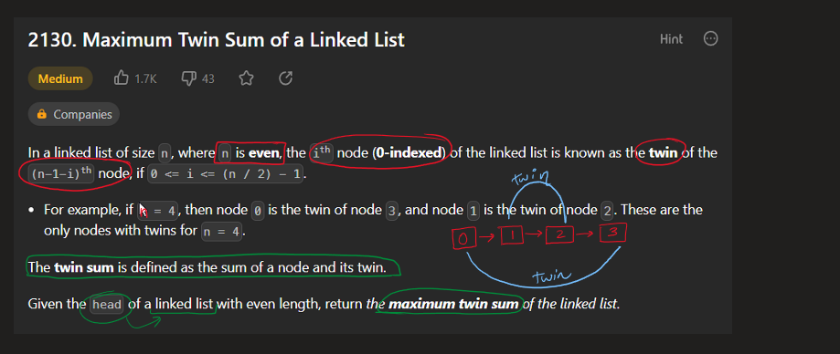
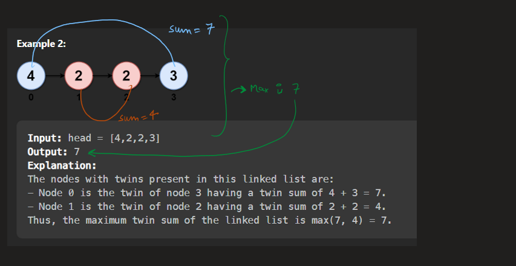
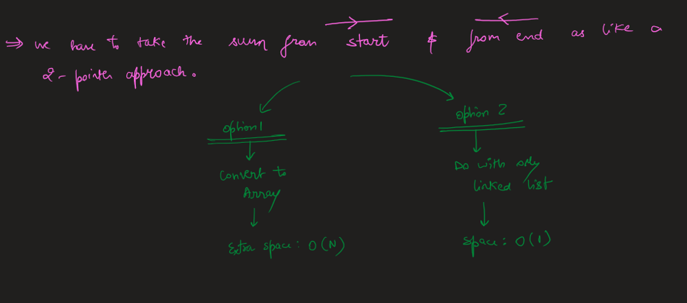
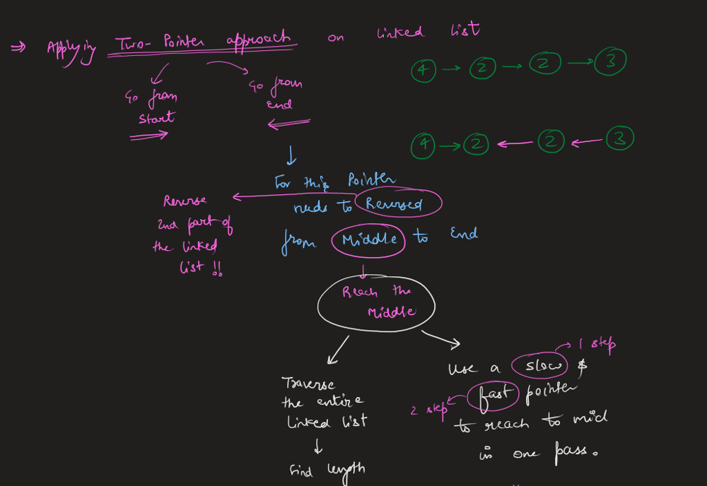
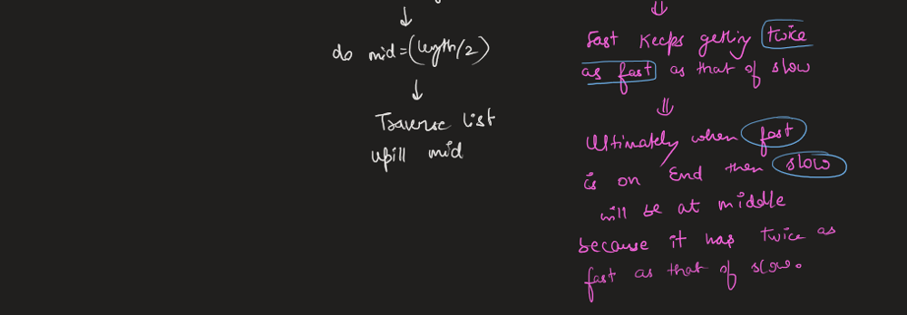
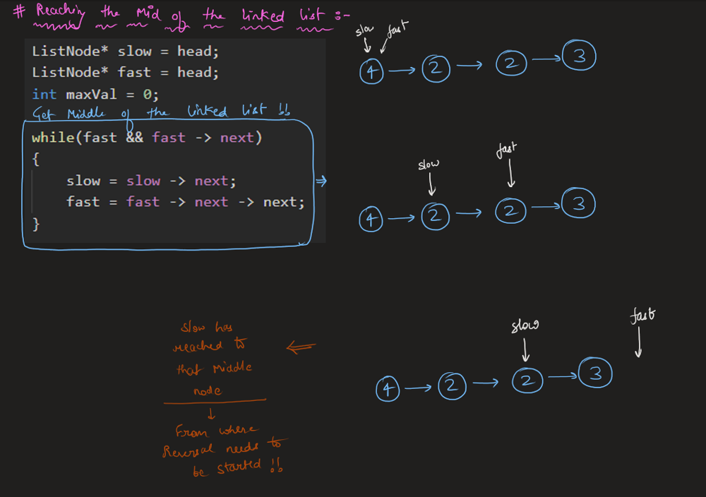
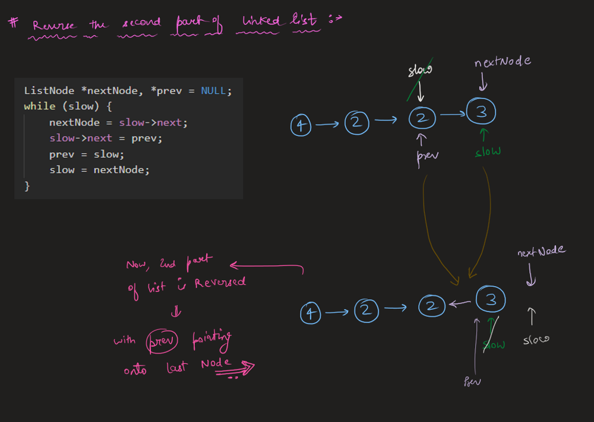
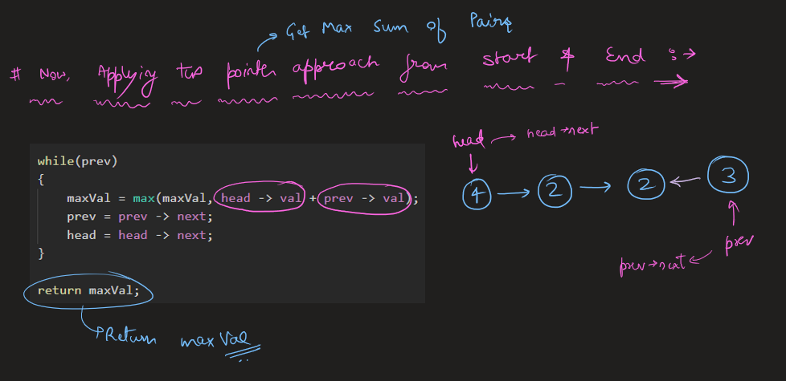
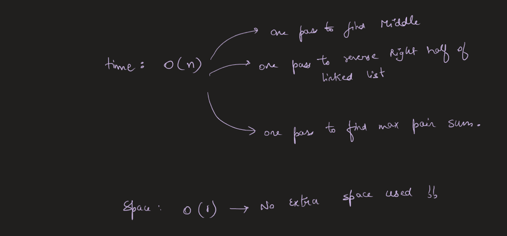

# Image Explanation🏆- [Fastest, Easiest & Concise] - C++/Java/Python

**Author:** aryan_0077
**Votes:** 89
**Link:** [https://leetcode.com/problems/maximum-twin-sum-of-a-linked-list/solutions/3532531/](https://leetcode.com/problems/maximum-twin-sum-of-a-linked-list/solutions/3532531/)

---

# Video Solution (`Aryan Mittal`) - Link in LeetCode Profile
`Maximum Twin Sum of a Linked List` by `Aryan Mittal`


# Approach & Intution











# Code
```C++ []
class Solution {
    public:
     int pairSum(ListNode* head) {
        ListNode* slow = head;
        ListNode* fast = head;
        int maxVal = 0;

        while(fast && fast -> next)
        {
            slow = slow -> next;
            fast = fast -> next -> next;
        }

        ListNode *nextNode, *prev = NULL;
        while (slow) {
            nextNode = slow->next;
            slow->next = prev;
            prev = slow;
            slow = nextNode;
        }

        while(prev)
        {
            maxVal = max(maxVal, head -> val + prev -> val);
            prev = prev -> next;
            head = head -> next;
        }

        return maxVal;
    }
};
```
```Java []
class Solution {
    public int pairSum(ListNode head) {
        ListNode slow = head;
        ListNode fast = head;
        int maxVal = 0;

        while (fast != null && fast.next != null) {
            slow = slow.next;
            fast = fast.next.next;
        }

        ListNode nextNode, prev = null;
        while (slow != null) {
            nextNode = slow.next;
            slow.next = prev;
            prev = slow;
            slow = nextNode;
        }

        while (prev != null) {
            maxVal = Math.max(maxVal, head.val + prev.val);
            prev = prev.next;
            head = head.next;
        }

        return maxVal;
    }
}
```
```Python []
class Solution:
    def pairSum(self, head):
        slow = head
        fast = head
        maxVal = 0

        while fast and fast.next:
            slow = slow.next
            fast = fast.next.next

        nextNode, prev = None, None
        while slow:
            nextNode = slow.next
            slow.next = prev
            prev = slow
            slow = nextNode

        while prev:
            maxVal = max(maxVal, head.val + prev.val)
            prev = prev.next
            head = head.next

        return maxVal
```