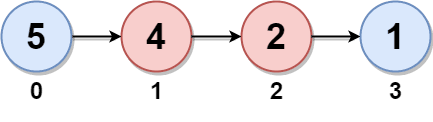

# 🔥🔥 Java | Python | PHP | C++ | JavaScript | Explicación y Resolución Del Ejercicio En Español 🔥🔥

**Author:** hermescoder02
**Votes:** 4
**Link:** [https://leetcode.com/problems/maximum-twin-sum-of-a-linked-list/solutions/4094817/](https://leetcode.com/problems/maximum-twin-sum-of-a-linked-list/solutions/4094817/)

---

# Lectura

*Suma m\xE1xima de gemelos de una lista enlazada (Java, Python, PHP, C++, JavaScript)*

El ejercicio consiste en encontrar la suma m\xE1xima de pares de nodos en su posici\xF3n gemelo en una lista enlazada. 

Las posiciones gemelo cumplen la condici\xF3n de, dado una posici\xF3n i, se tendr\xE1 la posici\xF3n  n-1-i donde:

        * n es el total de elementos de la lista
        * I es la posici\xF3n actual del nodo.




Como se puede apreciar en el ejemplo, la posici\xF3n 0 es gemela de la posici\xF3n 3,
Ya que el tama\xF1o total de la lista es 4 y la posici\xF3n actual es 0, as\xED que, se realiza el c\xE1lculo que en este caso  es 4-1-0 y da como resultado 3, su posici\xF3n gemela.

Igualmente para para la posici\xF3n 1, ya que 4-1-1 es 2, osea el siguiente nodo y su posici\xF3n gemela


# Explicaci\xF3n del ejercicio Paso por paso

https://youtu.be/lQT9TdkBGJo

Si te gust\xF3 el contenido \xA1visita mi canal de youtube!: 
\u2705https://www.youtube.com/@hermescoder

Si deseas profundizar m\xE1s en este tema \xA1visita mi blog!: 
https://hermescoder.com/maximum-twin-sum-of-a-linked-list-leetcode-espanol.html


# C\xF3digo 

```Java []
/**
 * Definition for singly-linked list.
 * public class ListNode {
 *     int val;
 *     ListNode next;
 *     ListNode() {}
 *     ListNode(int val) { this.val = val; }
 *     ListNode(int val, ListNode next) { this.val = val; this.next = next; }
 * }
 */
public class Solution {

    public static int pairSum(ListNode head) {
        // Paso #1
        int n = 0;
        ListNode aux = head;
        while (aux != null) {
            n++;
            aux = aux.next;
        }

        // Paso #2
        Map<Integer, Integer> hm = new HashMap<>();

        // Paso #3
        for (int i = 0; i < n / 2; i++) {
            hm.put(n - 1 - i, head.val);
            head = head.next;
        }

        // Paso #4
        for (int i = n / 2; i < n; i++) {
            hm.put(i, hm.get(i) + head.val);
            head = head.next;
        }

        // Paso #5
        return Collections.max(hm.values());
    }
}
```
```Python []
# Definition for singly-linked list.
# class ListNode(object):
#     def __init__(self, val=0, next=None):
#         self.val = val
#         self.next = next
class Solution:
    def pairSum(self, head):
        #paso #1
        n = 0
        aux = head
        while aux:
            n += 1
            aux = aux.next

        #paso #2
        hm = {}

        #paso #3
        for i in range(n // 2):
            hm[n - 1 - i] = head.val
            head = head.next

        #paso #4
        for i in range(n // 2, n):
            hm[i] = hm[i] + head.val
            head = head.next

        #paso #5
        return max(hm.values())
```
```PHP []
/**
* Definition for a singly-linked list.
* class ListNode {
*     public $val = 0;
*     public $next = null;
*     function __construct($val = 0, $next = null) {
*         $this->val = $val;
*         $this->next = $next;
*     }
* }
*/
class Solution {
 
    /**
     * @param ListNode $head
     * @return Integer
     */
    function pairSum($head) {
        //Paso #1
        $n=0;
        $aux=$head;
 
        while($aux){
            $n++;
            $aux=$aux->next;
        }
 
        //Paso #2
        $hm=array();
 
        //Paso #3
        for ($i = 0; $i < $n/2; $i++) {
            $hm[$n-1-$i]=$head->val;
            $head=$head->next;
        }   
 
        //Paso #4
        for ($i; $i<$n;$i++){
            $hm[$i]=$hm[$i]+$head->val;
            $head=$head->next;
        }
 
        //Paso #5
        return max($hm);
    }
}
```
```C++ []
/**
 * Definition for singly-linked list.
 * struct ListNode {
 *     int val;
 *     ListNode *next;
 *     ListNode() : val(0), next(nullptr) {}
 *     ListNode(int x) : val(x), next(nullptr) {}
 *     ListNode(int x, ListNode *next) : val(x), next(next) {}
 * };
 */
class Solution {
public:
  int pairSum(ListNode* head) {
    // Paso #1
    int n = 0;
    ListNode* aux = head;
    while (aux != nullptr) {
      n++;
      aux = aux->next;
    }

    // Paso #2
    std::vector<int> hm(n);

    // Paso #3
    for (int i = 0; i < n / 2; i++) {
      hm[n - 1 - i] = head->val;
      head = head->next;
    }

    // Paso #4
    for (int i = n / 2; i < n; i++) {
      hm[i] = hm[i] + head->val;
      head = head->next;
    }

    // Paso #5
    return *std::max_element(hm.begin(), hm.end());
  }
};
```
```JavaScript []
/**
 * Definition for singly-linked list.
 * function ListNode(val, next) {
 *     this.val = (val===undefined ? 0 : val)
 *     this.next = (next===undefined ? null : next)
 * }
 */
/**
 * @param {ListNode} head
 * @return {number}
 */
var pairSum = function(head) {
      // Paso #1
    let n = 0;
    let aux = head;

    while (aux) {
      n++;
      aux = aux.next;
    }

    // Paso #2
    const hm = {};

    // Paso #3
    for (let i = 0; i < n / 2; i++) {
      hm[n - 1 - i] = head.val;
      head = head.next;
    }

    // Paso #4
    for (let i = n / 2; i < n; i++) {
      hm[i] = hm[i] + head.val;
      head = head.next;
    }

    // Paso #5
    return Math.max(...Object.values(hm));
};
```


