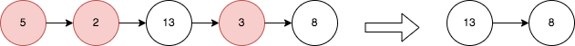

# [2487. Remove Nodes From Linked List](https://leetcode.com/problems/remove-nodes-from-linked-list/)

| Category | Difficulty | Likes | Dislikes |
| :------: | :--------: | :---: | :------: |
| Algorithms | Medium | 2363 | 84 |

**Tags:** [`linked-list`](https://leetcode.com/tag/linked-list), [`stack`](https://leetcode.com/tag/stack), [`recursion`](https://leetcode.com/tag/recursion), [`monotonic-stack`](https://leetcode.com/tag/monotonic-stack)

**Companies:** `google`, `facebook`, `uber`, `adobe`, `microsoft`, `amazon`

## Description

You are given the `head` of a linked list.

Remove every node which has a node with a greater value anywhere to the right side of it.

Return *the *`head`* of the modified linked list.*

 

**Example 1:**


```

Input: head = [5,2,13,3,8]
Output: [13,8]
Explanation: The nodes that should be removed are 5, 2 and 3.
- Node 13 is to the right of node 5.
- Node 13 is to the right of node 2.
- Node 8 is to the right of node 3.

```

**Example 2:**

```

Input: head = [1,1,1,1]
Output: [1,1,1,1]
Explanation: Every node has value 1, so no nodes are removed.

```

 

**Constraints:**

	- The number of the nodes in the given list is in the range `[1, 10^5]`.

	- `1 <= Node.val <= 10^5`

---

**Links:** [Submissions](https://leetcode.com/problems/remove-nodes-from-linked-list/) | [Solutions](https://leetcode.com/problems/remove-nodes-from-linked-list/)
