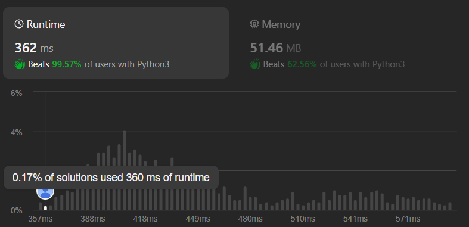

# ✅Detailed Explanation💯3 Approaches🔥Stack | Recursion | Reversal🔥O(1) space🔥Efficient🔥🔥

**Author:** Saketh3011
**Votes:** 376
**Link:** [https://leetcode.com/problems/remove-nodes-from-linked-list/solutions/5118366/](https://leetcode.com/problems/remove-nodes-from-linked-list/solutions/5118366/)

---



[Submission Link](https://leetcode.com/problems/remove-nodes-from-linked-list/submissions/1250452066)

## \uD83C\uDFAF Problem Explanation:
We are given a linked list and the task is to remove every node which has a node with a greater value anywhere to its right.


---


# Method 1: Monotonic Stack Approach

## \uD83E\uDD14 Intuition:
One approach is to traverse the linked list and maintain a stack to store nodes in non-decreasing order of their values. While traversing, if we encounter a node with a value greater than the top element of the stack, we pop elements from the stack until the condition is met. This ensures that the stack contains only nodes with the highest values seen so far. Finally, we reverse the stack to get the modified linked list.

## \uD83E\uDDE0 Approach:
1. Initialize a stack to store nodes in non-increasing order of their values.
2. Traverse the linked list:
    - If the current node's value is greater than the top element of the stack, pop elements from the stack until the condition is met.
    - Push the current node onto the stack.
3. Reverse the stack to obtain the modified linked list.
4. Return the head of the modified linked list.

## \u2699\uFE0F Dry Run:

#### **Given Linked List:** 5 -> 2 -> 13 -> 3 -> 8
Iteration | Node | Stack            
:------:|:------:|:-------------:
Step 1  |   5   |   5
Step 2  |   2   |  5, 2
Step 3  |   13  |  ~~5, 2,~~ 13
Step 4  |   3   |  13, 3
Step 5  |   8   |  13, ~~3,~~ 8           

**Stack: [13, 8]**
Now Creating Linked List using stack from top-bottom from tail to head.
#### Result: 13 -> 8

## \uD83D\uDCD2 Complexity:
- \u23F0 Time complexity: $$O(n)$$, where n is the number of nodes in the linked list.
    - Outer while: O(n)
    - Inner while: O(n - k), where k is length of resultand linked list
    - Stack while: O(k)
    - Total Time complexity: O(n) + O(n-k) + O(k) = O(2n) -> O(n). This is a linear 2 pass solution.
    **Note:** Even thought there is nested while loop TC is O(n) because a node is pushed and popped from the stack at most once.
- \uD83E\uDDFA Space complexity: $$O(n)$$, to store nodes in the stack.

## \uD83E\uDDD1\u200D\uD83D\uDCBB Code
``` python []
class Solution:
    def removeNodes(self, head: Optional[ListNode]) -> Optional[ListNode]:
        cur = head
        stack = []
        while cur:
            while stack and stack[-1].val < cur.val:
                stack.pop()
            stack.append(cur)
            cur = cur.next
        
        nxt = None
        while stack:
            cur = stack.pop()
            cur.next = nxt
            nxt = cur
        
        return cur
```
``` java []
class Solution {
    public ListNode removeNodes(ListNode head) {
        ListNode cur = head;
        Stack<ListNode> stack = new Stack<>();
        
        while (cur != null) {
            while (!stack.isEmpty() && stack.peek().val < cur.val) {
                stack.pop();
            }
            stack.push(cur);
            cur = cur.next;
        }
        
        ListNode nxt = null;
        while (!stack.isEmpty()) {
            cur = stack.pop();
            cur.next = nxt;
            nxt = cur;
        }
        
        return cur;
    }
}
```
``` cpp []
class Solution {
public:
    ListNode* removeNodes(ListNode* head) {
        ListNode* cur = head;
        stack<ListNode*> stack;
        
        while (cur != nullptr) {
            while (!stack.empty() && stack.top()->val < cur->val) {
                stack.pop();
            }
            stack.push(cur);
            cur = cur->next;
        }
        
        ListNode* nxt = nullptr;
        while (!stack.empty()) {
            cur = stack.top();
            stack.pop();
            cur->next = nxt;
            nxt = cur;
        }
        
        return cur;
    }
};
```
```javascript []
var removeNodes = function(head) {
    let cur = head;
    let stack = [];
    
    while (cur !== null) {
        while (stack.length > 0 && stack[stack.length - 1].val < cur.val) {
            stack.pop();
        }
        stack.push(cur);
        cur = cur.next;
    }
    
    let nxt = null;
    while (stack.length > 0) {
        cur = stack.pop();
        cur.next = nxt;
        nxt = cur;
    }
    
    return cur;

};
```
---

# Method 2: Recursive Approach

## \uD83E\uDD14 Intuition:
We can use recursion to traverse the linked list and at each step, we compare the current node's value with the value of the next greater node. If the next greater node has a value less than the current node, we keep the current node; otherwise, we skip the current node.

## \uD83E\uDDE0 Approach:
1. Recursively traverse the linked list.
2. At each step, compare the current node's value with the value of the next greater node.
3. If the next greater node has a value less than the current node, keep the current node; otherwise, skip the current node.
4. Return the head of the modified linked list.

## \uD83D\uDCD2 Complexity:
- \u23F0 Time complexity: O(n), where n is the number of nodes in the linked list.
- \uD83E\uDDFA Space complexity: O(n), due to the recursive stack space.

## \uD83E\uDDD1\u200D\uD83D\uDCBB Code
``` python []
class Solution:
    def removeNodes(self, head: Optional[ListNode]) -> Optional[ListNode]:
        if not head:
            return None
        node = head
        # Gives next greater node
        nxt_greater = self.removeNodes(node.next)

        node.next = nxt_greater
        if not nxt_greater or node.val >= nxt_greater.val:
            return node
        return nxt_greater
```
``` java []
class Solution {
    public ListNode removeNodes(ListNode head) {
        if (head == null) {
            return null;
        }
        ListNode node = head;
        ListNode nxtGreater = removeNodes(node.next);

        node.next = nxtGreater;
        if (nxtGreater == null || node.val >= nxtGreater.val) {
            return node;
        }
        return nxtGreater;
    }
}
```
``` cpp []
class Solution {
public:
    ListNode* removeNodes(ListNode* head) {
        if (head == nullptr) {
            return nullptr;
        }
        ListNode* node = head;
        ListNode* nxtGreater = removeNodes(node->next);

        node->next = nxtGreater;
        if (nxtGreater == nullptr || node->val >= nxtGreater->val) {
            return node;
        }
        return nxtGreater;
    }
};
```
```javascript []
var removeNodes = function(head) {
    if (!head) {
        return null;
    }
    let node = head;
    let nxtGreater = removeNodes(node.next);

    node.next = nxtGreater;
    if (!nxtGreater || node.val >= nxtGreater.val) {
        return node;
    }
    return nxtGreater;
};
```

---


# Method 3: Reverse and Filter Approach (Best)

## \uD83E\uDD14 Intuition:
We can reverse the given linked list first. Then we traverse the reversed list, keeping nodes whose values are greater than or equal to the previous node's value. After traversing, we reverse the resulting list to obtain the modified linked list.

## \uD83E\uDDE0 Approach:
1. Reverse the given linked list.
2. Initialize a dummy node to hold the result.
3. Traverse the reversed list, keeping nodes whose values are greater than or equal to the previous node's value.
4. Reverse the resulting list to obtain the modified linked list.
5. Return the head of the modified linked list.

## \u2699\uFE0F Dry Run:
 Process | Linked List
:----:|:----:
Given Linked List |    5 -> 2 -> 13 -> 3 -> 8
Reverse it   |      8-> 3 -> 13 -> 2 -> 5
Remove Nodes smaller than Previous nodes | 8 -> 13
Reverse it again | 13 -> 8


## \uD83D\uDCD2 Complexity:
- \u23F0 Time complexity: $$O(n)$$, where n is the number of nodes in the linked list. 3 pass.
- \uD83E\uDDFA Space complexity: $$O(1)$$, as no extra space is used apart from a few pointers.

## \uD83E\uDDD1\u200D\uD83D\uDCBB Code:
``` python []
class Solution:
    def removeNodes(self, head: Optional[ListNode]) -> Optional[ListNode]:
        # Reverse the list
        prev, curr = None, head
        while curr:
            curr.next, prev, curr = prev, curr, curr.next

        # Initialize a dummy node to hold the result
        dummy_head = ListNode(-1)
        temp_prev, curr = dummy_head, prev
        # Traverse the reversed list, keeping nodes greater or equal to previous
        while curr:
            if curr.val >= temp_prev.val:
                temp_prev.next = curr
                temp_prev = curr
                curr = curr.next
            else:
                curr = curr.next
        temp_prev.next = None
        
        # Reverse the result list again
        new_prev = None
        curr = dummy_head.next
        while curr:
            curr.next, new_prev, curr = new_prev, curr, curr.next

        return new_prev
```
``` java []
class Solution {
    public ListNode removeNodes(ListNode head) {
        ListNode prev = null, curr = head;
        while (curr != null) {
            ListNode next = curr.next;
            curr.next = prev;
            prev = curr;
            curr = next;
        }

        ListNode dummyHead = new ListNode(-1);
        ListNode tempPrev = dummyHead;
        curr = prev;

        while (curr != null) {
            if (curr.val >= tempPrev.val) {
                tempPrev.next = curr;
                tempPrev = curr;
                curr = curr.next;
            } else {
                curr = curr.next;
            }
        }
        tempPrev.next = null;

        ListNode newPrev = null, newCurr = dummyHead.next;
        while (newCurr != null) {
            ListNode next = newCurr.next;
            newCurr.next = newPrev;
            newPrev = newCurr;
            newCurr = next;
        }

        return newPrev;
    }
}
```
``` cpp []
class Solution {
public:
    ListNode* removeNodes(ListNode* head) {
        ListNode *prev = nullptr, *curr = head;
        while (curr != nullptr) {
            // ListNode* next = curr->next;
            // curr->next = prev;
            // prev = curr;
            // curr = next;
            swap(curr->next, prev);
            swap(prev, curr);
        }

        ListNode* dummyHead = new ListNode(-1);
        ListNode* tempPrev = dummyHead;
        curr = prev;

        while (curr != nullptr) {
            if (curr->val >= tempPrev->val) {
                tempPrev->next = curr;
                tempPrev = curr;
                curr = curr->next;
            } else {
                curr = curr->next;
            }
        }
        tempPrev->next = nullptr;

        ListNode *newPrev = nullptr, *newCurr = dummyHead->next;
        while (newCurr != nullptr) {
            // ListNode* next = newCurr->next;
            // newCurr->next = newPrev;
            // newPrev = newCurr;
            // newCurr = next;
            swap(newCurr->next, newPrev);
            swap(newPrev, newCurr);
        }

        return newPrev;
    }
};
```
``` javascript []
var removeNodes = function(head) {
    let prev = null;
    let curr = head;
    while (curr !== null) {
        let next = curr.next;
        curr.next = prev;
        prev = curr;
        curr = next;
    }

    let dummyHead = new ListNode(-1);
    let tempPrev = dummyHead;
    curr = prev;

    while (curr !== null) {
        if (curr.val >= tempPrev.val) {
            tempPrev.next = curr;
            tempPrev = curr;
            curr = curr.next;
        } else {
            curr = curr.next;
        }
    }
    tempPrev.next = null;

    let newPrev = null;
    let newCurr = dummyHead.next;
    while (newCurr !== null) {
        let next = newCurr.next;
        newCurr.next = newPrev;
        newPrev = newCurr;
        newCurr = next;
    }

    return newPrev;
};
```

---


# \uD83D\uDD28 Futher Optimising Code - Filter and Reversal at same time

## \uD83E\uDD14 Intuition:
Instead of filting and reversing serpately we can do both at once.

## \uD83D\uDCD2 Complexity:
- \u23F0 Time complexity: $$O(n)$$, 2 pass
- \uD83E\uDDFA Space complexity: $$O(1)$$

## \uD83E\uDDD1\u200D\uD83D\uDCBB Code
``` python []
class Solution:
    def removeNodes(self, head: Optional[ListNode]) -> Optional[ListNode]:
        if not head or not head.next:
            return head

        prev, curr = None, head
        while curr:
            curr.next, prev, curr = prev, curr, curr.next

        curr, prev.next = prev.next, None
        while curr:
            temp = curr.next
            if curr.val >= prev.val:
                curr.next = prev
                prev = curr
            curr = temp
    
        return prev
```
``` java []
class Solution {
    public ListNode removeNodes(ListNode head) {
        if (head == null || head.next == null) {
            return head;
        }

        ListNode prev = null, curr = head;
        while (curr != null) {
            ListNode next = curr.next;
            curr.next = prev;
            prev = curr;
            curr = next;
        }

        curr = prev.next;
        prev.next = null;
        while (curr != null) {
            ListNode temp = curr.next;
            if (curr.val >= prev.val) {
                curr.next = prev;
                prev = curr;
            }
            curr = temp;
        }

        return prev;
    }
}
```
``` cpp []
class Solution {
public:
    ListNode* removeNodes(ListNode* head) {
        if (head == nullptr || head->next == nullptr) {
            return head;
        }

        ListNode* prev = nullptr;
        ListNode* curr = head;
        while (curr != nullptr) {
            ListNode* next = curr->next;
            curr->next = prev;
            prev = curr;
            curr = next;
        }

        curr = prev->next;
        prev->next = nullptr;
        while (curr != nullptr) {
            ListNode* temp = curr->next;
            if (curr->val >= prev->val) {
                curr->next = prev;
                prev = curr;
            }
            curr = temp;
        }

        return prev;
    }
};
```
``` javascript []
var removeNodes = function(head) {
    if (!head || !head.next) {
        return head;
    }

    let prev = null;
    let curr = head;
    while (curr !== null) {
        let next = curr.next;
        curr.next = prev;
        prev = curr;
        curr = next;
    }

    curr = prev.next;
    prev.next = null;
    while (curr !== null) {
        let temp = curr.next;
        if (curr.val >= prev.val) {
            curr.next = prev;
            prev = curr;
        }
        curr = temp;
    }

    return prev;
};
```

## \u2699\uFE0F Dry Run:
#### Given Linked List: 5 -> 2 -> 13 -> 3 -> 8
**First Reverse it: 8-> 3 -> 13 -> 2 -> 5**
**Filter and reverse:**
prev | curr | Linked List | Resultant Linked List
:---:|:---:|:---:|:---:|
8   |   3    | 8 **x** 3 -> 13 -> 2 -> 5 | 8 -> null
8   |   13   | 8 <- 13 **x** 2 -> 5 | 13 -> 8 -> null
13  |   2    | 13 -> 8 **x** 2 -> 5 | 13 -> 8 -> null
13  |   5    | 13 -> 8 **x** 5 | 13 -> 8 -> null

Each node and its's pointers
5 -> null | 2 -> 5 | 13 -> 8 | 3 -> 13 | 8 -> null
:---:|:---:|:---:|:---:|:---:

#### Result: 13 -> 8

---
# Please consider giving an Upvote!

