# [Go] Multiple Clean Solutions in Go (GoLang) with images 170ms 100%

**Author:** krex0r
**Votes:** 6
**Link:** [https://leetcode.com/problems/remove-nodes-from-linked-list/solutions/3850555/](https://leetcode.com/problems/remove-nodes-from-linked-list/solutions/3850555/)

---

Hello Gophers!

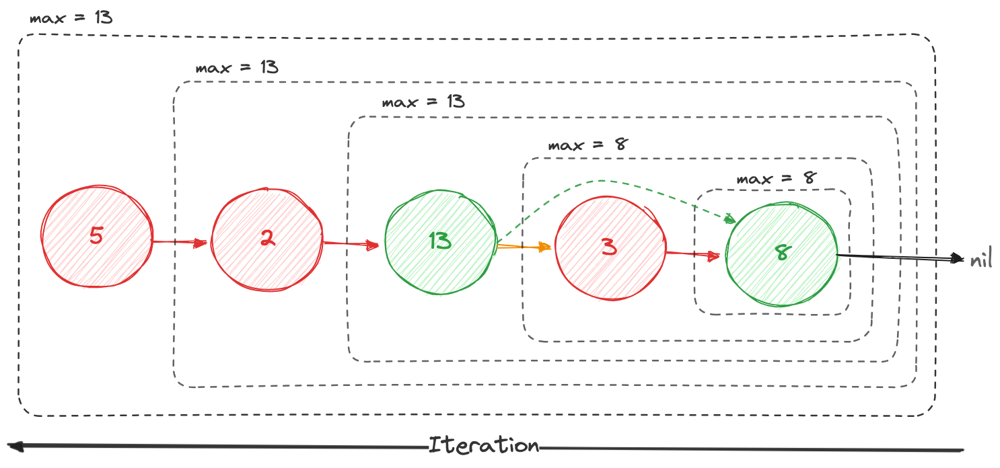

1. Solution 1: Stack (`O(n)` space complexity)
2. Solution 2: Two Pointers  (`O(1)` space complexity)
3. Solution 3: Recursion  (`O(n)` space complexity)

They all have `O(n)` time complexity.  
Solution 2 is the best (fastest and least space).

# Solution 1: Stack

Time: `O(n)`
Space: `O(n)`

For a better space complexity, see [Solution 2](#solution-2)

```go
// Time: O(n) + O(n) = O(2n) = O(n)
// Space: O(n)
func removeNodes(head *ListNode) *ListNode {
    if head == nil {
        return nil
    }

    // Space: O(n)
    var stack []*ListNode
    var current = head

    // Time: O(n)
    for current != nil {
        for len(stack) > 0 && current.Val > stack[len(stack)-1].Val {
            stack = stack[:len(stack)-1]
        }

        stack = append(stack, current)
        current = current.Next
    }

    var newHead *ListNode

    // Time: O(n/x) = O(n)
    for i := len(stack) - 1; i >= 0; i-- {
        stack[i].Next = newHead
        newHead = stack[i]
    }

    return newHead
}
```

With a custom data structure (same complexity):

```go
func removeNodes(head *ListNode) *ListNode {
	if head == nil {
		return nil
	}

	stack := NewStack()
	current := head

	for current != nil {
		for !stack.IsEmpty() && current.Val > stack.listNodes[stack.Size()-1].Val {
			stack.Pop()
		}

		stack.Push(current)
		current = current.Next
	}

	var newHead *ListNode
	for !stack.IsEmpty() {
		stack.listNodes[stack.Size()-1].Next = newHead
		newHead = stack.Pop()
	}

	return newHead
}

type Stack struct {
	listNodes []*ListNode
}

func NewStack() *Stack {
	return &Stack{}
}

func (s *Stack) Push(node *ListNode) {
	s.listNodes = append(s.listNodes, node)
}

func (s *Stack) Pop() *ListNode {
	if s.IsEmpty() {
		return nil
	}

	index := len(s.listNodes) - 1
	node := s.listNodes[index]
	s.listNodes = s.listNodes[:index]
	return node
}

func (s *Stack) IsEmpty() bool {
	return len(s.listNodes) == 0
}

func (s *Stack) Size() int {
	return len(s.listNodes)
}
```

# Solution 2: Two Pointers


Time: `O(n)`
Space: `O(1)`

## Code

```go
// Time: O(n) + O(n) + O(n) = O(3n) = O(n)
// Space: O(1)
func removeNodes(head *ListNode) *ListNode {
    // Time: O(n)
    head = reverse(head)

    currMax := 0

    // Time: O(n)
    var prev, curr *ListNode = nil, head
    for curr != nil {
        if curr.Val < currMax {
            if prev != nil {
               prev.Next = curr.Next
            }
        } else {
            prev = curr
            currMax = curr.Val
        }
        curr = curr.Next
    }

    // Time: O(n)
    return reverse(head)
}

// Time: O(n)
// Space: O(1)
func reverse(head *ListNode) *ListNode {
    var prev, curr *ListNode = nil, head
    for curr != nil {
        prev, curr, curr.Next = curr, curr.Next, prev
    }
    return prev
}

// Time: O(1)
// Space: O(1)
func max(x, y int) int {
    if x > y {
        return x
    }
    return y
}
```

## Explanation

Let's say we have this linked list:

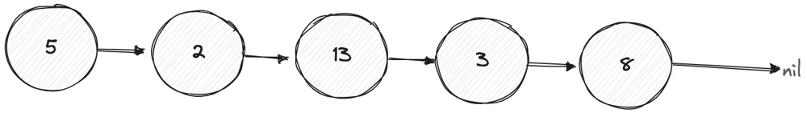

We want to reverse it (time: `O(n)`):

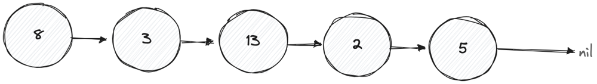

And we use two pointers to iterate on it. If the current node (`curr`) value (`curr.Val`) is bigger than the "current maximum (`currMax`), we change this "current maximum" and if it's not, we "remove it" by pointing the next "last/previous node that we wanted to keep" (`prev`) to the current next:

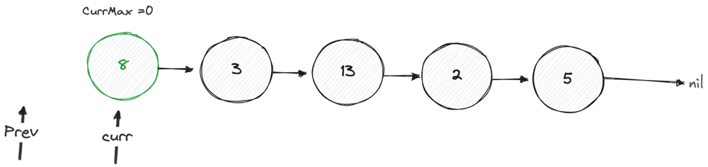

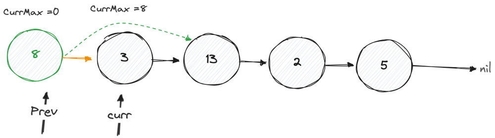

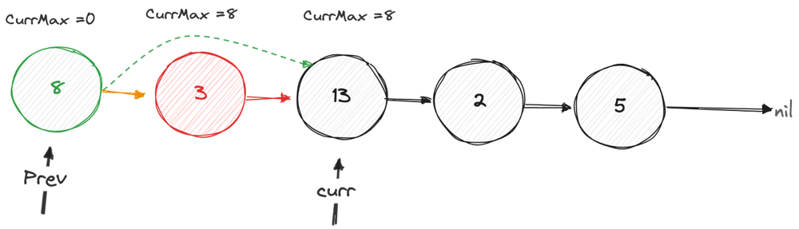

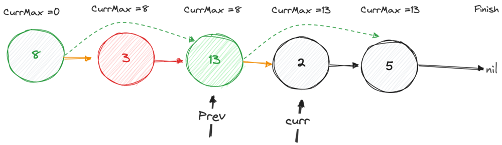

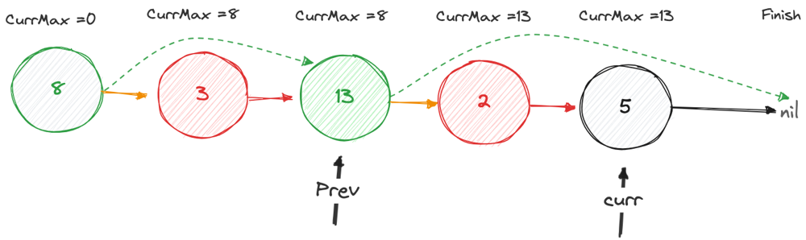

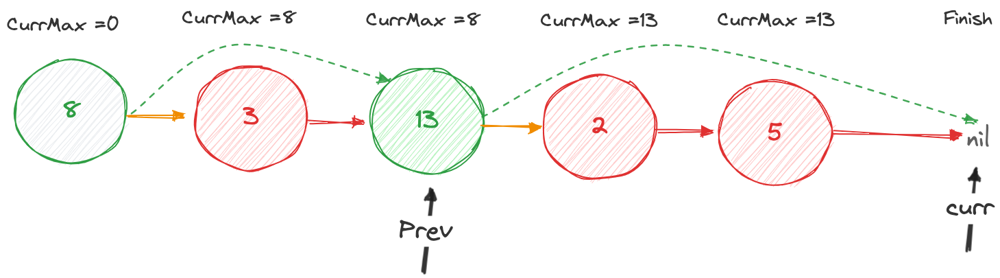

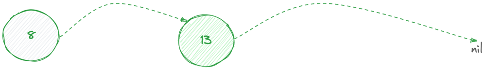

This iteration also take us `O(n)` in time complexity.

THis gives us our final linked list:

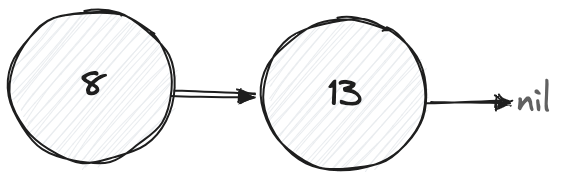

That we reverse a last time (`O(n)`):

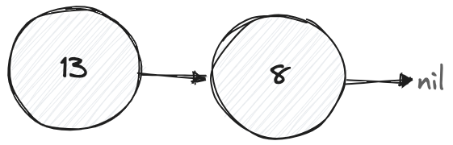

# Solution 3: Recursion

Time: `O(n)`
Space: `O(n)` (recursion call stack)

```go
func removeNodes(head *ListNode) *ListNode {
    if head.Next == nil {
        return head
    }

    head.Next = removeNodes(head.Next)
    if head.Val < head.Next.Val {
        return head.Next
    }
    
    return head
}
```

I hope it helped! =)

## Note

In the problem description:

> Remove every node which has a node with a strictly greater value anywhere to the right side of it.

[1,1,1,1] returns [1,1,1,1], but shouldnt it return [1] because 1 is not strictly greater than 1 ???

If I'm right, simply change `if curr.Val < currMax` to `if curr.Val <= currMax`