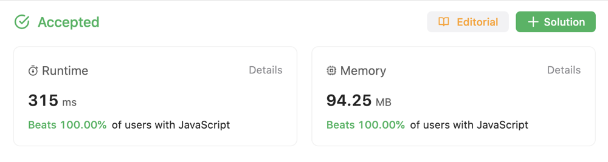

# JavaScript (Beats 100%) Two Pointers

**Author:** laurelton
**Votes:** 1
**Link:** [https://leetcode.com/problems/split-a-circular-linked-list/solutions/4218846/](https://leetcode.com/problems/split-a-circular-linked-list/solutions/4218846/)

---

# Intuition
<!-- Describe your first thoughts on how to solve this problem. -->
To solve this problem the first thing that we need to do is find the midpoint of the list. We then split the list in two, and point the tail of each list to it's respective head node. 

# Approach
<!-- Describe your approach to solving the problem. -->
We use a _fast_ and _slow_ pointer to find the middle node of the list. If the list did not contain a cycle, the _fast_ pointer would eventually become `null`, and the location of the _slow_ pointer would be the midpoint. Since this list contains a cycle the _fast_ pointer will never be `null`. Instead we'll use the `next` pointer of the _fast_ node to determine when we've reached the end of the list. When the `next` pointer points to the head node we have reached the end of the list. However, in a list with an odd number of nodes, the _fast_ node will itself be the head node when the _slow_ pointer reaches the middle note. To account for this situation we will use a `prev` pointer that is one node ahead of the fast pointer. If the `next` pointer of either the _prev_ or _fast_ pointer is the head of the list we have reached the end of the list, and can split the list.

# Complexity
- Time complexity:
<!-- Add your time complexity here, e.g. $$O(n)$$ -->
$$O(n)$$

- Space complexity:
<!-- Add your space complexity here, e.g. $$O(n)$$ -->
$$O(1)$$




# Code
```
/**
 * Definition for singly-linked list.
 * function ListNode(val, next) {
 *     this.val = (val===undefined ? 0 : val)
 *     this.next = (next===undefined ? null : next)
 * }
 */
/**
 * @param {ListNode} list
 * @return {ListNode[]}
 */
var splitCircularLinkedList = function(list) {
    const output = [];

    let frontHead = list;
    let frontTail;
    let rearHead;
    let rearTail;

    let slow = new ListNode(0, list);
    let prev;
    let fast = slow;

    while (!rearTail) {
        slow = slow.next;
        prev = fast.next;
        fast = prev.next;

        if (prev.next === frontHead || fast.next === frontHead) {
            rearTail = prev.next === frontHead ? prev : fast;
            frontTail = slow;
            rearHead = slow.next;
            
            frontTail.next = frontHead;
            rearTail.next = rearHead;

            output.push(frontHead, rearHead);
        }
    }

    return output;
};
```