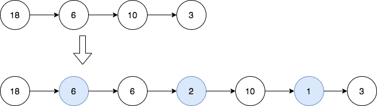

# [2807. Insert Greatest Common Divisors in Linked List](https://leetcode.com/problems/insert-greatest-common-divisors-in-linked-list/)

| Category | Difficulty | Likes | Dislikes |
| :------: | :--------: | :---: | :------: |
| Algorithms | Medium | 1122 | 36 |

**Tags:** [`linked-list`](https://leetcode.com/tag/linked-list), [`math`](https://leetcode.com/tag/math), [`number-theory`](https://leetcode.com/tag/number-theory)

**Companies:** `microsoft`

## Description

Given the head of a linked list `head`, in which each node contains an integer value.

Between every pair of adjacent nodes, insert a new node with a value equal to the **greatest common divisor** of them.

Return *the linked list after insertion*.

The **greatest common divisor** of two numbers is the largest positive integer that evenly divides both numbers.

 

**Example 1:**


```

Input: head = [18,6,10,3]
Output: [18,6,6,2,10,1,3]
Explanation: The 1st diagram denotes the initial linked list and the 2nd diagram denotes the linked list after inserting the new nodes (nodes in blue are the inserted nodes).
- We insert the greatest common divisor of 18 and 6 = 6 between the 1st and the 2nd nodes.
- We insert the greatest common divisor of 6 and 10 = 2 between the 2nd and the 3rd nodes.
- We insert the greatest common divisor of 10 and 3 = 1 between the 3rd and the 4th nodes.
There are no more adjacent nodes, so we return the linked list.

```

**Example 2:**


```

Input: head = [7]
Output: [7]
Explanation: The 1st diagram denotes the initial linked list and the 2nd diagram denotes the linked list after inserting the new nodes.
There are no pairs of adjacent nodes, so we return the initial linked list.

```

 

**Constraints:**

	- The number of nodes in the list is in the range `[1, 5000]`.

	- `1 <= Node.val <= 1000`

---

**Links:** [Submissions](https://leetcode.com/problems/insert-greatest-common-divisors-in-linked-list/) | [Solutions](https://leetcode.com/problems/insert-greatest-common-divisors-in-linked-list/)
