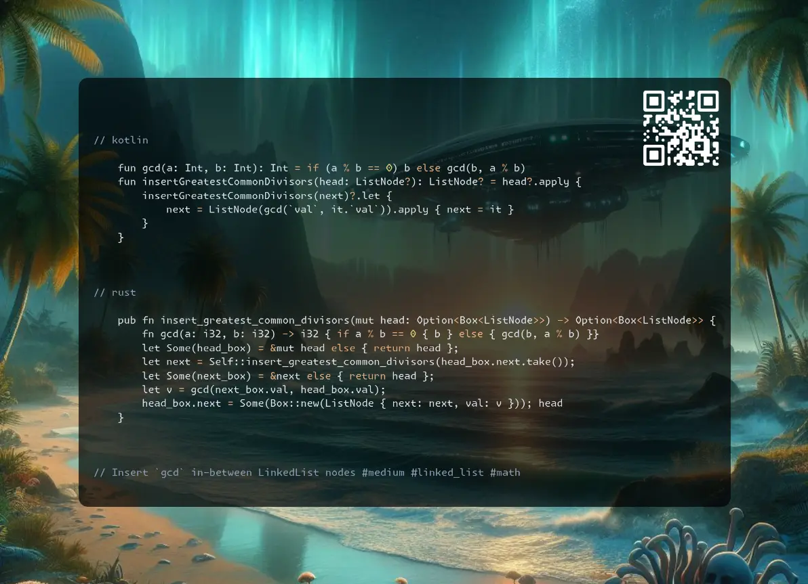

# Kotlin | Rust

**Author:** SamoylenkoDmitry
**Votes:** 1
**Link:** [https://leetcode.com/problems/insert-greatest-common-divisors-in-linked-list/solutions/5764441/](https://leetcode.com/problems/insert-greatest-common-divisors-in-linked-list/solutions/5764441/)

---



https://youtu.be/MWSGV_ia5bg

#### Join me on Telegram

https://t.me/leetcode_daily_unstoppable/730

#### Problem TLDR

Insert `gcd` in-between LinkedList nodes #medium #linked_list #math

#### Intuition

It's all about the implementation details.
The `gcd` is `if (a % b == 0) b else gcd(b, a % b)` or `if (!a) b else if (!b) a else gcd(abs(a - a), min(a, b))`.

#### Approach

Did you know:
* Rust have some different ways to approach `Option` - `?` takes ownership entirely and return early, `.and_then` gives nice lambda, `let Some(..) = &mut x` give a chance to reuse option `x` again.
* c++ have a built-in `gcd`

#### Complexity

- Time complexity:
$$O(n)$$

- Space complexity:
$$O(n)$$ for recursive, $$O(1)$$ for the iterative implementation

#### Code

```kotlin []

    fun gcd(a: Int, b: Int): Int = if (a % b == 0) b else gcd(b, a % b)
    fun insertGreatestCommonDivisors(head: ListNode?): ListNode? = head?.apply {
        insertGreatestCommonDivisors(next)?.let {
            next = ListNode(gcd(`val`, it.`val`)).apply { next = it }
        }
    }

```
```rust []

    pub fn insert_greatest_common_divisors(mut head: Option<Box<ListNode>>) -> Option<Box<ListNode>> {
        fn gcd(a: i32, b: i32) -> i32 { if a % b == 0 { b } else { gcd(b, a % b) }}
        let Some(head_box) = &mut head else { return head };
        let next = Self::insert_greatest_common_divisors(head_box.next.take());
        let Some(next_box) = &next else { return head };
        let v = gcd(next_box.val, head_box.val);
        head_box.next = Some(Box::new(ListNode { next: next, val: v })); head
    }

```
```c++ []

    ListNode* insertGreatestCommonDivisors(ListNode* head) {
        if (!head || !head->next) return head;
        ListNode* curr = head;
        while (curr && curr->next) {
            curr->next = new ListNode(gcd(curr->val, curr->next->val), curr->next);
            curr = curr->next->next;
        }
        return head;
    }

```