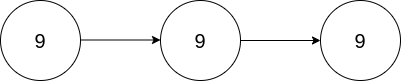

# [2816. Double a Number Represented as a Linked List](https://leetcode.com/problems/double-a-number-represented-as-a-linked-list/)

| Category | Difficulty | Likes | Dislikes |
| :------: | :--------: | :---: | :------: |
| Algorithms | Medium | 1258 | 31 |

**Tags:** [`linked-list`](https://leetcode.com/tag/linked-list), [`math`](https://leetcode.com/tag/math), [`stack`](https://leetcode.com/tag/stack)

**Companies:** `google`, `microsoft`, `amazon`

## Description

You are given the `head` of a **non-empty** linked list representing a non-negative integer without leading zeroes.

Return *the *`head`* of the linked list after **doubling** it*.

 

**Example 1:**


```

Input: head = [1,8,9]
Output: [3,7,8]
Explanation: The figure above corresponds to the given linked list which represents the number 189. Hence, the returned linked list represents the number 189 * 2 = 378.

```

**Example 2:**


```

Input: head = [9,9,9]
Output: [1,9,9,8]
Explanation: The figure above corresponds to the given linked list which represents the number 999. Hence, the returned linked list reprersents the number 999 * 2 = 1998. 

```

 

**Constraints:**

	- The number of nodes in the list is in the range `[1, 10^4]`

	- `0 <= Node.val <= 9`

	- The input is generated such that the list represents a number that does not have leading zeros, except the number `0` itself.

---

**Links:** [Submissions](https://leetcode.com/problems/double-a-number-represented-as-a-linked-list/) | [Solutions](https://leetcode.com/problems/double-a-number-represented-as-a-linked-list/)
