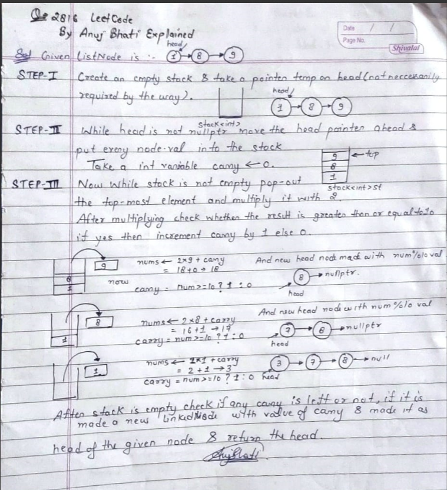

# 🔥✅✔️Easiest C++✅ Python3 🐍✅ Java ✅ C ✅C#🔥☠️Simple Stack Solution ✔️🔥👽beats 💯Images explained

**Author:** Edwards310
**Votes:** 8
**Link:** [https://leetcode.com/problems/double-a-number-represented-as-a-linked-list/solutions/4969767/](https://leetcode.com/problems/double-a-number-represented-as-a-linked-list/solutions/4969767/)

---

# Intuition
***Hiiii Guy's This is Anuj Bhati here With the Solution of Q - 2816.***
***I tried to explain that as much easiesr as possible no fancy methods pure Math's Logic and things gets sorted very easily.***

# IF YOU FIND MY SOLUTION USEFUL TO YOU THEN IT'S A HUMBLE REQUEST TO UPVOTE THIS SOLUTION SO THAT ALL OTHER'S CAN ALSO TAKE ADVANTAGE FROM THIS... THANKS




---
**Intution**
- ***Since multiplication is done from right --> left direction i.e from least Significant position to most significant position.***
- ***And we do not have a way to move backward in a Singly-Linked List from it's last node to it's head. So --***
1. **Step - 1 ::** ***We simply reverse the Linked List so that we can move from right --> left direction.***
2. ***multiply each node.val * 2 and check if it's product exceeding the 9 or not if it is increase the carry and bounds the product to less than 10 by using product %= 10.***
3. ***Similarly move pointer to it's next until it's become NULL and check carry and product and every node's value and finally return the new Head of the newly created Linked-List.***
---
> Explanations are provided as per the logic used in the problem _ Solving ...
***I'll Request you all to just look and that above explanation and then try to implement that by your own.***
```C++ []
/**
 * Definition for singly-linked list.
 * struct ListNode {
 *     int val;
 *     ListNode *next;
 *     ListNode() : val(0), next(nullptr) {}
 *     ListNode(int x) : val(x), next(nullptr) {}
 *     ListNode(int x, ListNode *next) : val(x), next(next) {}
 * };
 */
class Solution {
public:
    ListNode* reverse(ListNode* head) {
        ListNode *prev = nullptr, *curr = head;
        while (curr != nullptr) {
            ListNode* nxt = curr->next;
            curr->next = prev;
            prev = curr;
            curr = nxt;
        }
        return prev;
    }
    ListNode* doubleIt(ListNode* head) {
        head = reverse(head);
        int carry = 0;
        ListNode* temp = head;
        int product = (temp->val) << 1;
        if (product > 9) {
            carry = product / 10;
            product %= 10;
        }
        ListNode* dummyHead = new ListNode(product);
        ListNode *prev = dummyHead, *dummy_head = dummyHead;
        temp = temp->next;
        while (temp) {
            product = (temp->val) << 1;
            product += carry;
            carry = product / 10;
            if (product > 9) {
                product %= 10;
            }
            ListNode* newNode = new ListNode(product);
            prev->next = newNode;
            prev = newNode;
            temp = temp->next;
        }
        if (carry != 0) {
            ListNode* newNode = new ListNode(carry);
            prev->next = newNode;
            prev = newNode;
        }
        return reverse(dummy_head);
    }
};
```
```python3 []
# Definition for singly-linked list.
# class ListNode:
#     def __init__(self, val=0, next=None):
#         self.val = val
#         self.next = next
class Solution:
    def doubleIt(self, head: Optional[ListNode]) -> Optional[ListNode]:
        if head.val > 4:
            head = ListNode(0, head)
        node = head
        while node:
            node.val = (node.val * 2) % 10
            if node.next and node.next.val > 4:
                node.val += 1
            node = node.next
        return head
```
```C []
/**
 * Definition for singly-linked list.
 * struct ListNode {
 *     int val;
 *     struct ListNode *next;
 * };
 */
struct ListNode* reverse(struct ListNode* head) {
    struct ListNode *prev = NULL, *curr = head;
    while (curr) {
        struct ListNode* nxt = curr->next;
        curr->next = prev;
        prev = curr;
        curr = nxt;
    }
    return prev;
}
struct ListNode* new_ListNode(int data) {
    struct ListNode* newNode =
        (struct ListNode*)malloc(sizeof(struct ListNode));
    newNode->next = NULL;
    newNode->val = data;
    return newNode;
}
struct ListNode* doubleIt(struct ListNode* head) {
    head = reverse(head);
    int carry = 0;
    struct ListNode* temp = head;
    int product = (temp->val) << 1;
    if (product > 9) {
        carry = product / 10;
        product %= 10;
    }
    struct ListNode* dummyHead = new_ListNode(product);
    struct ListNode *prev = dummyHead, *dummy_head = dummyHead;
    temp = temp->next;
    while (temp) {
        product = (temp->val) << 1;
        product += carry;
        carry = product / 10;
        if (product > 9) {
            product %= 10;
        }
        struct ListNode* newNode = new_ListNode(product);
        prev->next = newNode;
        prev = newNode;
        temp = temp->next;
    }
    if (carry) {
        struct ListNode* newNode = new_ListNode(carry);
        prev->next = newNode;
        prev = newNode;
    }
    return reverse(dummy_head);
}
```
```java []
/**
 * Definition for singly-linked list.
 * public class ListNode {
 * int val;
 * ListNode next;
 * ListNode() {}
 * ListNode(int val) { this.val = val; }
 * ListNode(int val, ListNode next) { this.val = val; this.next = next; }
 * }
 */
class Solution {
    private ListNode reverse(ListNode head) {
        ListNode prev = null, curr = head;
        while (curr != null) {
            ListNode nxt = curr.next;
            curr.next = prev;
            prev = curr;
            curr = nxt;
        }
        return prev;
    }

    public ListNode doubleIt(ListNode head) {
        Stack<ListNode> st = new Stack<>();
        ListNode temp = head;
        while (temp != null) {
            st.push(temp);
            temp = temp.next;
        }
        int carry = 0;
        ListNode tmp = st.peek();
        st.pop();
        int product = (tmp.val) << 1;
        if (product > 9) {
            carry = product / 10;
            product %= 10;
        }
        ListNode dummyHead = new ListNode(product);
        ListNode prev = dummyHead;
        ListNode dummy_head = dummyHead;
        while (st.size() > 0) {
            ListNode temp1 = st.peek();
            st.pop();
            product = (temp1.val) << 1;
            product += carry;
            carry = product / 10;
            if (product > 9) {
                product %= 10;
            }
            ListNode newNode = new ListNode(product);
            prev.next = newNode;
            prev = newNode;
        }
        if (carry != 0) {
            ListNode newNode = new ListNode(carry);
            prev.next = newNode;
            prev = newNode;
        }
        return reverse(dummy_head);
    }
}
```
```C++ []
/**
 * Definition for singly-linked list.
 * struct ListNode {
 *     int val;
 *     ListNode *next;
 *     ListNode() : val(0), next(nullptr) {}
 *     ListNode(int x) : val(x), next(nullptr) {}
 *     ListNode(int x, ListNode *next) : val(x), next(next) {}
 * };
 */
class Solution {
public:
    ListNode* doubleIt(ListNode* head) {
        stack<int> st;
        int d = 0;

        while (head) {
            st.push(head->val);
            head = head->next;
        }
        while (!st.empty()) {
            int num = 2 * st.top() + d;
            st.pop();
            d = num >= 10 ? 1 : 0;
            head = new ListNode(num % 10, head);
        }
        if (d == 1)
            head = new ListNode(d, head);

        return head;
    }
};
```
```python []
# Definition for singly-linked list.
# class ListNode(object):
#     def __init__(self, val=0, next=None):
#         self.val = val
#         self.next = next
class Solution(object):
    def doubleIt(self, head):
        """
        :type head: Optional[ListNode]
        :rtype: Optional[ListNode]
        """
        add = False
        if head.val >= 5:
            add = True
        p = head
        while p:
            p.val = (p.val * 2) % 10 
            if p.next:
                if p.next.val >= 5:
                    p.val = p.val + 1
            p = p.next
        if add:
            return  ListNode(1, head)
        return head
```
```C# []
/**
 * Definition for singly-linked list.
 * public class ListNode {
 *     public int val;
 *     public ListNode next;
 *     public ListNode(int val=0, ListNode next=null) {
 *         this.val = val;
 *         this.next = next;
 *     }
 * }
 */
public class Solution {
    public ListNode DoubleIt(ListNode head) {
        var node = head = new ListNode(0, head);
        for (; node.next != null; node = node.next){
            node.val += node.next.val * 2 / 10;
            node.next.val = node.next.val * 2 % 10;
        }
        return head.val == 0 ? head.next : head;
    }
}
```
```C++ []
// ***Space Optimized + Easy - Fast***
/**
 * Definition for singly-linked list.
 * struct ListNode {
 *     int val;
 *     ListNode *next;
 *     ListNode() : val(0), next(nullptr) {}
 *     ListNode(int x) : val(x), next(nullptr) {}
 *     ListNode(int x, ListNode *next) : val(x), next(next) {}
 * };
 */
class Solution {
public:
    ListNode* doubleIt(ListNode* head) {
        vector<int> ans;
        while (head) {
            ans.push_back(head->val);
            head = head->next;
        }
        delete (head);
        int carry = 0;
        for (int i = ans.size() - 1; i >= 0; --i) {
            ans[i] = (ans[i] << 1) + carry;
            carry = 0;
            while (ans[i] >= 10) {
                ans[i] = (ans[i] - 10);
                carry++;
            }
        }
        ListNode* prev = nullptr;
        for (int i = ans.size() - 1; i >= 0; i--) {
            ListNode* head2 = new ListNode(ans[i], prev);
            prev = head2;
        }
        if (carry != 0) {
            ListNode* head2 = new ListNode(carry, prev);
            prev = head2;
        }
        ans.clear();
        return prev;
    }
};

```
<!-- Describe your first thoughts on how to solve this problem. -->

# Approach
<!-- Describe your approach to solving the problem. -->

# Complexity
- Time complexity:
<!-- Add your time complexity here, e.g. $$O(n)$$ -->
      O(n)
- Space complexity:
<!-- Add your space complexity here, e.g. $$O(n)$$ -->
      O(1)
# Code
```
# Definition for singly-linked list.
# class ListNode:
#     def __init__(self, val=0, next=None):
#         self.val = val
#         self.next = next
class Solution:
    def doubleIt(self, head: Optional[ListNode]) -> Optional[ListNode]:
        if head.val > 4:
            head = ListNode(0, head)
        node = head
        while node:
            node.val = (node.val * 2) % 10
            if node.next and node.next.val > 4:
                node.val += 1
            node = node.next
        return head
```
# Please upvote and keep supporting

