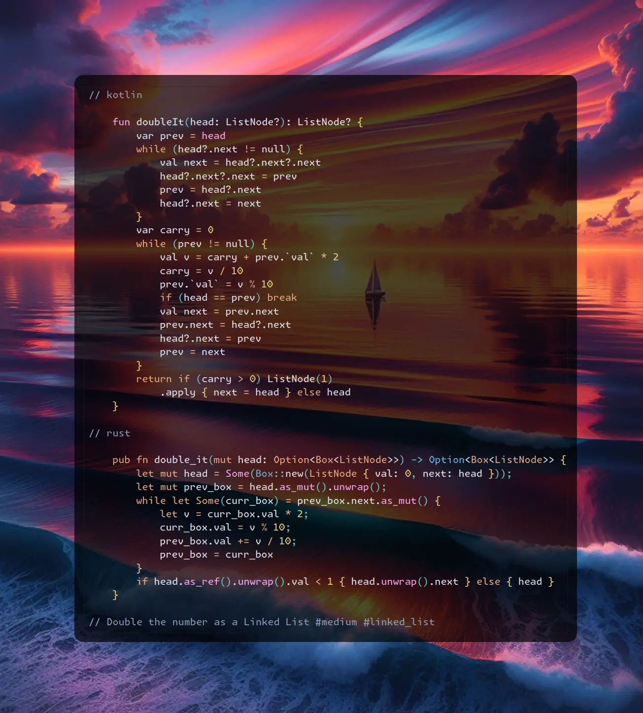

# Kotlin | Rust

**Author:** SamoylenkoDmitry
**Votes:** 3
**Link:** [https://leetcode.com/problems/double-a-number-represented-as-a-linked-list/solutions/5123665/](https://leetcode.com/problems/double-a-number-represented-as-a-linked-list/solutions/5123665/)

---


https://youtu.be/vI0nTJNt5hU
#### Join me on Telegram

https://t.me/leetcode_daily_unstoppable/595

#### Problem TLDR

Double the number as a Linked List #medium #linked_list

#### Intuition

The trivial solution is to reverse the list and iterate from the back. However, there is a more clever solution (not mine): add sentinel head and compute always the `next` node.

#### Approach

* For the Rust: notice how to use `head` with `as_mut` and `as_ref` - without them it will not compile as borrow will occur twice.
* For the Kotlin solution: let's use a single extra variable, just for fun.

#### Complexity

- Time complexity:
$$O(n)$$

- Space complexity:
$$O(1)$$

#### Code

```kotlin []

    fun doubleIt(head: ListNode?): ListNode? {
        var prev = head
        while (head?.next != null) {
            val next = head?.next?.next
            head?.next?.next = prev
            prev = head?.next
            head?.next = next
        }
        var carry = 0
        while (prev != null) {
            val v = carry + prev.`val` * 2
            carry = v / 10
            prev.`val` = v % 10
            if (head == prev) break
            val next = prev.next
            prev.next = head?.next
            head?.next = prev
            prev = next
        }
        return if (carry > 0) ListNode(1)
            .apply { next = head } else head
    }

```
```rust []

    pub fn double_it(mut head: Option<Box<ListNode>>) -> Option<Box<ListNode>> {
        let mut head = Some(Box::new(ListNode { val: 0, next: head }));
        let mut prev_box = head.as_mut().unwrap();
        while let Some(curr_box) = prev_box.next.as_mut() {
            let v = curr_box.val * 2;
            curr_box.val = v % 10;
            prev_box.val += v / 10;
            prev_box = curr_box
        }
        if head.as_ref().unwrap().val < 1 { head.unwrap().next } else { head }
    }

```