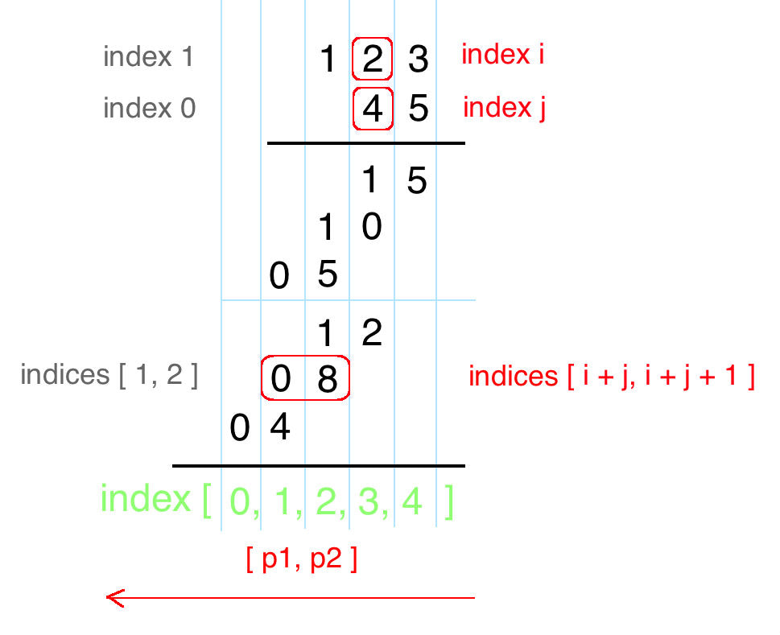

# The most voted java solution rewritten in JavaScript (with graph explanation)

**Author:** murzabulatov
**Votes:** 52
**Link:** [https://leetcode.com/problems/multiply-strings/solutions/671503/](https://leetcode.com/problems/multiply-strings/solutions/671503/)

---

Start from right to left, perform multiplication on every pair of digits, and add them together. Let's draw the process! From the following draft, we can immediately conclude:

 `num1[i] * num2[j]` will be placed at indices `[i + j`, `i + j + 1]` 
 
 

 

Here is JavaScript solution:
```
var multiply = function(num1, num2) {
    if (num1 === '0' || num2 === '0') return '0'
    
    const m = num1.length, n = num2.length, res = new Array(m+n).fill(0)
    
    for (let i=m-1; i>=0; i--) {
        for (let j=n-1; j>=0; j--) {
            const p1=i+j, p2=i+j+1
            let sum = res[p2] + Number(num1[i]) * Number(num2[j])
            res[p2] = sum%10
            res[p1] += Math.floor(sum/10)
        }
    }
    if (res[0] === 0) res.shift()
    return res.join('')
    
}
```