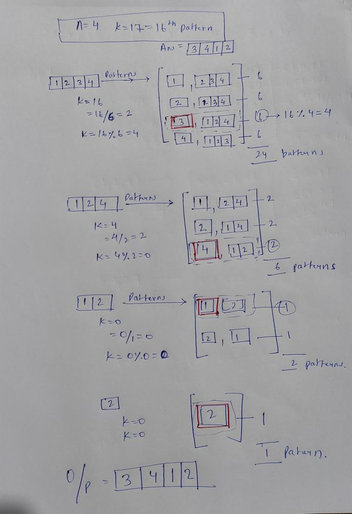
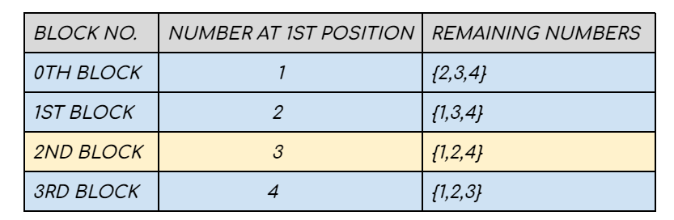
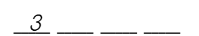
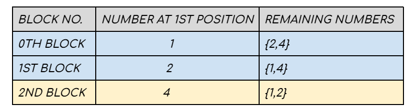
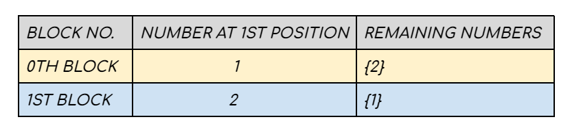
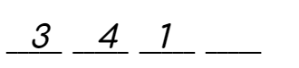
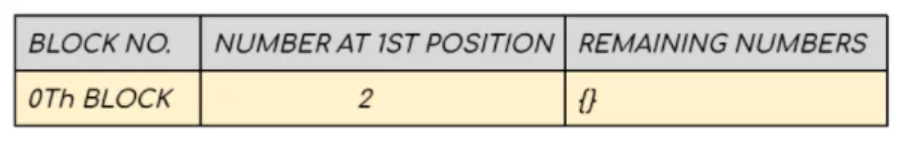
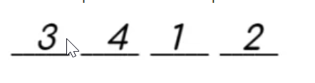
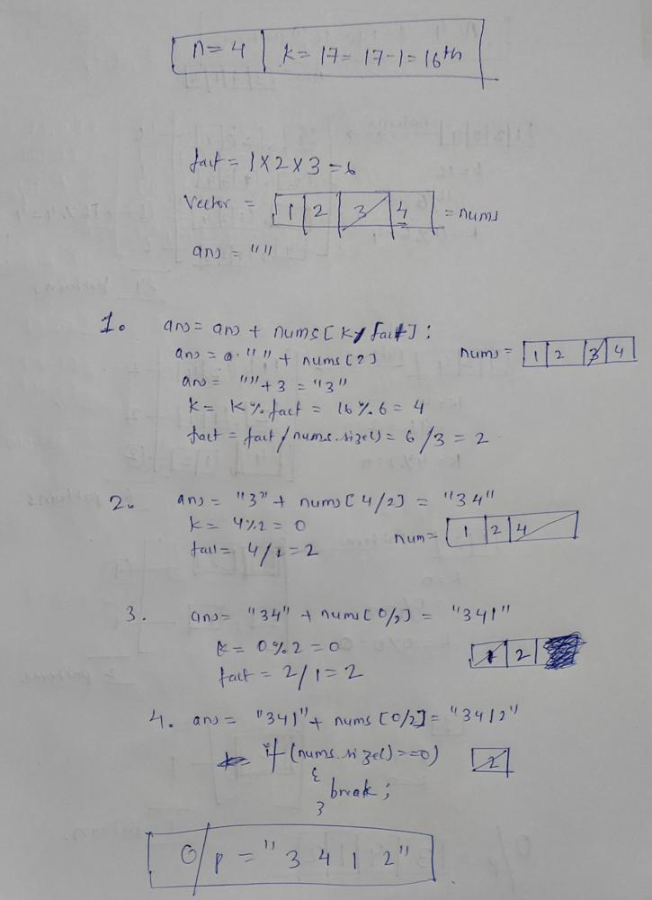

# ✔️C++🔥100%✅Fastest solution || Best approach with good explanation || Easy to understand. 1

**Author:** Pranjal9424
**Votes:** 97
**Link:** [https://leetcode.com/problems/permutation-sequence/solutions/2502436/](https://leetcode.com/problems/permutation-sequence/solutions/2502436/)

---

**Intution:-**

Since this is permutaion we can assume that there are four positions that need to be filled using the four numbers of the sequence. First, we need to decide which number is to be placed at the first index. Once the number at the first index is decided we have three more positions and three more numers. Now the problem is shorter. We can repeat the technique that was used previously untl all the positions are filled.

**On Paper Dry run:-**




**Approach**

**STEP 1:**

Mathematically speaking there can be 4 variations while generating the permutation. We can have our permutation starting with either 1 or 2 or 3 or 4. If the first position is already occupied by one number there are three more positions left. The remaining three numbers can be permuted among themselves while filling the 3 positions and will generate 3! = 6 sequences. Hence each block will have 6 permutations adding up to a total of 6*4 = 24 permutations. If we consider the sequences as 0-based and in the sorted form we observe:- 

* The 0th \u2013 5th permutation will start with 1 
* The 6th \u2013 11th permutation will start with 2
* The 12th \u2013 17th permutation will start with 3 
* The 18th \u2013 23rd permutation will start with 4.

	(For better understanding refer to the picture below.) 


We make K = 17-1 considering 0-based indexing. Since each of the four blocks illustrated above comprises 6 permutations, therefore, the 16th permutation will lie in (16 / 6 ) = 2nd block, and our answer is the (16 % 6) = 4th sequence from the 2nd block. Therefore 3 occupies the first position of the sequence and K = 4.


**STEP 2:**

Our new search space comprises three elements {1,2,4} where K = 4 . Using the previous technique we can consider the second position to be occupied can be any one of these 3 numbers. Again one block can start with 1, another can start with 2 and the last one can start with 4 . Since one position is fixed, the remaining two numbers of each block can form 2! = 2  sequences. In sorted order :

* The 0th \u2013 1st sequence starts with 1 
* The 2nd \u2013 3rd sequence starts with 2 
* The 4th \u2013 5th sequence starts with 4



The 4th permutation will lie in (4/2) = 2nd block and our answer is the 4%2 = 0th sequence from the 2nd block. Therefore 4 occupies the second position and K = 0.


**STEP 3:**

The new search space will have two elements {1 ,2} and K = 0. One block starts with 1 and the other block starts with 2. The other remaining number can form only one 1! = 1 sequence. In sorted form \u2013

* The  0th sequence starts with 1 
* The  1st sequence. starts with 2



The 0th permutation will lie in the (0/1) = 0th block and our answer is the 0%1 = 0th sequence from the 0th block. Therefore 1 occupies the 3rd position and K = 0.



**STEP 4:** 

Now the only block has 2 in the first position and no remaining number is present.

This is the point where we place 2 in the last position and stop.

**The final answer is 3412.**

**Code:-**
```
class Solution {
public:
    string getPermutation(int n, int k) {
        int fact=1;
        vector<int> nums;
        for(int i=1;i<n;i++){
            fact=fact*i;
            nums.push_back(i);
        }
        nums.push_back(n);
        k=k-1;
        string ans="";
        while(true){
            ans=ans+to_string(nums[k/fact]);
            nums.erase(nums.begin()+k/fact);
            if(nums.size()==0){
                break;
            }
            k=k%fact;
            fact=fact/nums.size();
        }
        return ans;
    }
};
```

**Code Dry run:-**

