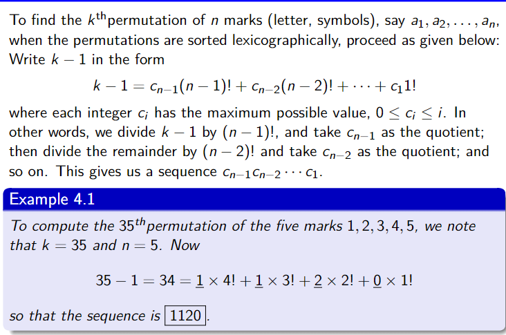
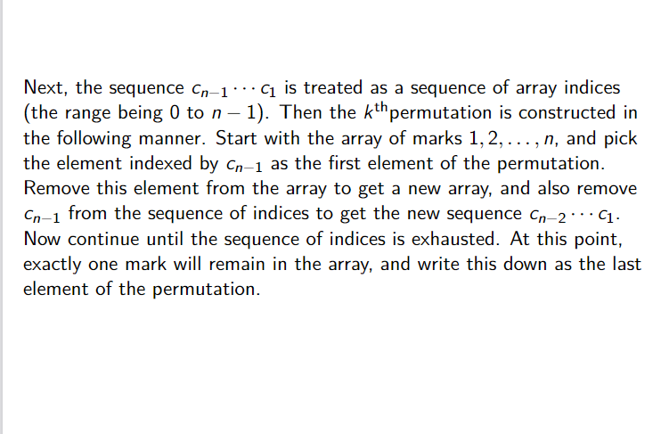

# Beats 100% in both space and time. Mathematical Solution based on Lexicographical order.

**Author:** UtkarshDubey_19
**Votes:** 2
**Link:** [https://leetcode.com/problems/permutation-sequence/solutions/4600114/](https://leetcode.com/problems/permutation-sequence/solutions/4600114/)

---

# Intuition
I think we all have the intution to solve this sort of problem but we did not think far about how can we connect the dots to solve the problem.So I think we should focus more on the approach.
# Approach
You can come up with the solution with various hand runs. But it is better if we know what we want to do beforehand. See the attached images to understand easily. 


To implement the above algorithm we surely need to use a lot of brain. But it is a very good exercise.Upvote if this solution helped you or opened your mind.

# Complexity
- Time complexity and Space complexity: Both O(n)
It actually does not matter in solving such problem with n from 1 to 9.
So the time complexity being O(n) or O(n^2) does not matter here.
The GetPermuation function could also be written in O(n^2) which barely affects the runtime in such case.
# Code
```
void GetFactorial(int* factorial, int n) {
    factorial[0] = 1;
    for (int i = 1; i <= n; i++) {
        factorial[i] = factorial[i - 1] * i;
    }
}
void GetIndexArray(int* factorial, int* index, int n, int k){
    for (int i = 0; i < n - 1; i++) {
        index[i] = k / factorial[n - i - 1];
        k = k % factorial[n - i - 1]; 
        printf("%d ",index[i]);
    }
}
void GetPermutation(int* index, char* perm, int n) {
    int used[n + 1];
    for (int i = 1; i <= n; i++) {
        used[i] = 0;
    }

    for (int i = 0; i < n - 1; i++) {
        int count = 0;
        for (int j = 1; j <= n; j++) {
            if (!used[j]) {
                if (count == index[i]) {
                    perm[i] = '0' + j;
                    used[j] = 1;
                    break;
                }
                count++;
            }
        }
    }

    for (int i = 1; i <= n; i++) {
        if (!used[i]) {
            perm[n - 1] = '0' + i;
            break;
        }
    }

    perm[n] = '\\0';
}
char* getPermutation(int n, int k) {
    char* perm = (char*)malloc((n + 1)* sizeof(char));
    int index [n];
    int factorial[n + 1]; // factorial[i] is factorial of i.

    GetFactorial(factorial, n);
    
    GetIndexArray(factorial, index, n, k - 1);

    GetPermutation(index, perm, n);
    return perm;
}
```