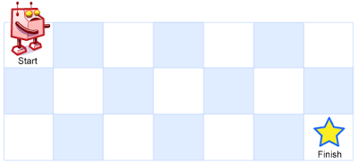

# [62. Unique Paths](https://leetcode.com/problems/unique-paths/)

| Category | Difficulty | Likes | Dislikes |
| :------: | :--------: | :---: | :------: |
| Algorithms | Medium | 18050 | 487 |

**Tags:** [`math`](https://leetcode.com/tag/math), [`dynamic-programming`](https://leetcode.com/tag/dynamic-programming), [`combinatorics`](https://leetcode.com/tag/combinatorics)

**Companies:** `google`, `facebook`, `amazon`, `microsoft`, `goldman-sachs`, `bloomberg`, `nvidia`, `flipkart`, `akamai`, `coupang`, `tcs`, `adobe`, `visa`, `oracle`, `de-shaw`, `accenture`, `virtusa`

## Description

There is a robot on an `m x n` grid. The robot is initially located at the **top-left corner** (i.e., `grid[0][0]`). The robot tries to move to the **bottom-right corner** (i.e., `grid[m - 1][n - 1]`). The robot can only move either down or right at any point in time.

Given the two integers `m` and `n`, return *the number of possible unique paths that the robot can take to reach the bottom-right corner*.

The test cases are generated so that the answer will be less than or equal to `2 * 10^9`.

 

**Example 1:**


```

Input: m = 3, n = 7
Output: 28

```

**Example 2:**

```

Input: m = 3, n = 2
Output: 3
Explanation: From the top-left corner, there are a total of 3 ways to reach the bottom-right corner:
1. Right -&gt; Down -&gt; Down
2. Down -&gt; Down -&gt; Right
3. Down -&gt; Right -&gt; Down

```

 

**Constraints:**

	- `1 <= m, n <= 100`

---

**Links:** [Submissions](https://leetcode.com/problems/unique-paths/) | [Solutions](https://leetcode.com/problems/unique-paths/)
