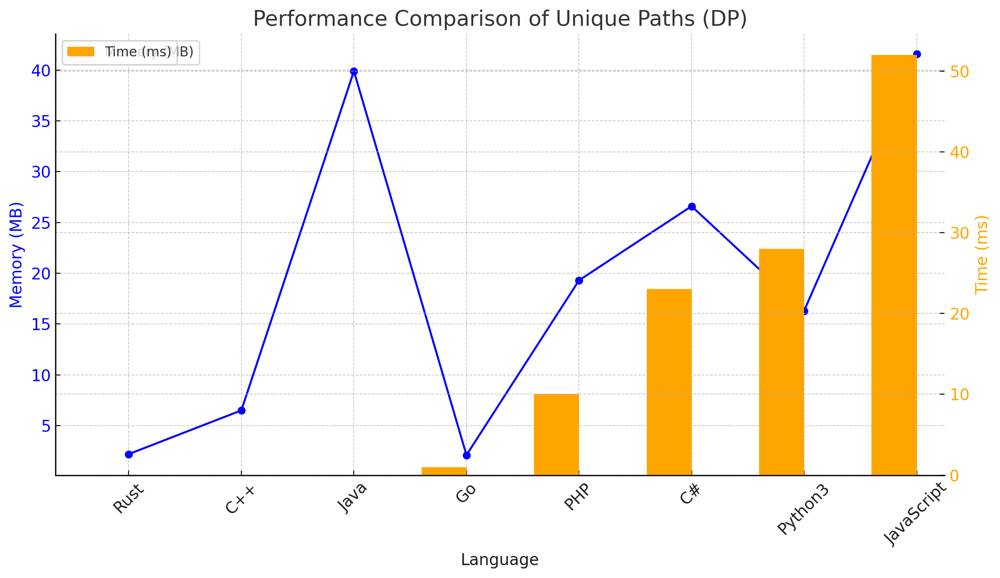
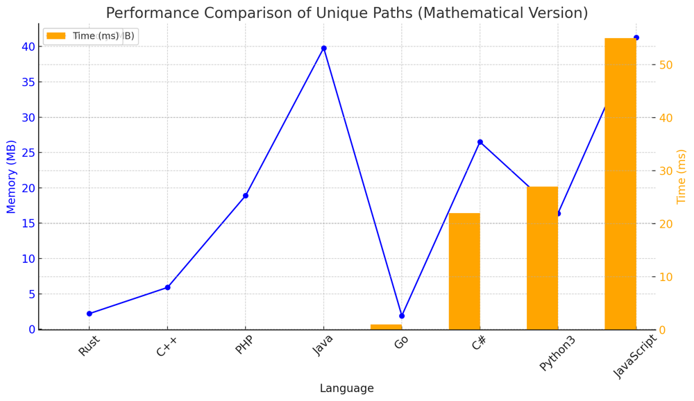

# ✅ 98.83% Easy DP & Math

**Author:** vanAmsen
**Votes:** 182
**Link:** [https://leetcode.com/problems/unique-paths/solutions/3994523/](https://leetcode.com/problems/unique-paths/solutions/3994523/)

---

# Interview Guide - Unique Paths in a Grid

## Problem Understanding

The problem describes a robot situated on a $$ m \	imes n $$ grid, starting at the top-left corner (i.e., $$ \	ext{grid}[0][0] $$). The robot can move either to the right or downwards at any given time, and the objective is to reach the bottom-right corner of the grid. The challenge is to find the number of unique paths the robot can take to reach this goal.

### Key Points to Consider

1. **Grid Dimensions**:  
   The grid dimensions are $$ m $$ (rows) and $$ n $$ (columns), with $$ 1 \\leq m, n \\leq 100 $$.
  
2. **Movement Constraints**:  
   The robot can only move either down or to the right at any given point. It cannot move diagonally or backwards.

3. **Dynamic Programming and Combinatorial Mathematics**:  
   The problem can be solved using either a Dynamic Programming approach or using Combinatorial Mathematics.

---

## Live Coding & More - 3 Solutions
https://youtu.be/-0OSF4u0cjQ?si=zup18xLotShahabI

## Solution #1: Dynamic Programming

### Intuition and Logic Behind the Solution

The idea behind this approach is to use a 2D Dynamic Programming (DP) array to store the number of unique paths to each cell. A cell $$ (i, j) $$ can be reached either from $$ (i-1, j) $$ or $$ (i, j-1) $$, and thus the number of unique paths to $$ (i, j) $$ is the sum of the number of unique paths to these two cells.

### Step-by-step Explanation

1. **Initialization**: 
    - Create a $$ m \	imes n $$ DP array, initializing the first row and first column to 1 because there's only one way to reach those cells from the starting point.

2. **Main Algorithm**:  
    - Iterate over the DP array starting from cell $$ (1, 1) $$.
    - For each cell $$ (i, j) $$, set $$ \	ext{dp}[i][j] = \	ext{dp}[i-1][j] + \	ext{dp}[i][j-1] $$.

### Complexity Analysis

- **Time Complexity**: $$ O(m \	imes n) $$ \u2014 We iterate through each cell once.
- **Space Complexity**: $$ O(m \	imes n) $$ \u2014 For the DP array.

---

## Solution #2: Memory-Optimized Dynamic Programming

### Intuition and Logic Behind the Solution

The original DP solution used a $$ m \	imes n $$ array to store the number of unique paths to each cell. However, since we only need information from the previous row and the current row to compute the number of unique paths for a given cell, we can optimize the solution to use only two rows at a time. This reduces the space complexity from $$ O(m \	imes n) $$ to $$ O(n) $$.

### Transitioning from $$ O(m \	imes n) $$ to $$ O(n) $$

In the original $$ O(m \	imes n) $$ approach, we used a 2D array `dp` where $$ \	ext{dp}[i][j] $$ represented the number of unique paths to reach cell $$ (i, j) $$. To optimize this to $$ O(n) $$, we can maintain only two 1D arrays: `prev_row` and `curr_row`, each of length $$ n $$.

- `prev_row[j]` will represent $$ \	ext{dp}[i-1][j] $$, the number of unique paths to reach the cell in the previous row and $$ j $$-th column.
- `curr_row[j]` will represent $$ \	ext{dp}[i][j] $$, the number of unique paths to reach the cell in the current row and $$ j $$-th column.

### Step-by-step Explanation

1. **Initialization**:  
   - Initialize two 1D arrays `curr_row` and `prev_row` with $$ n $$ elements, setting all elements to 1.

2. **Main Algorithm**:  
   - Iterate over the rows starting from 1 (the second row).
   - For each cell $$ (i, j) $$, set  `curr_row[j] = curr_row[j-1] + prev_row[j]` .
   - Swap `curr_row` and `prev_row` for the next iteration.

### Complexity Analysis

- **Time Complexity**: $$ O(m \	imes n) $$ \u2014 We still iterate through each cell once.
- **Space Complexity**: $$ O(n) $$ \u2014 For the two 1D arrays.

---

## Solution #3: Combinatorial Mathematics

### Intuition

The number of unique paths can be seen as the number of ways to choose $$ m-1 $$ downs and $$ n-1 $$ rights, regardless of the order. In combinatorial terms, this is equivalent to $$ \\binom{m+n-2}{m-1} $$.

### Algorithm

1. **Use the Combinatorial Formula**:  
   $$ \\binom{m+n-2}{m-1} $$ or $$ \\binom{m+n-2}{n-1} $$ to calculate the number of unique paths.

2. **Python's Math Library**:  
   Python provides a built-in function $$ \	ext{math.comb(n, k)} $$ to calculate $$ \\binom{n}{k} $$ efficiently.

### Complexity Analysis

- **Time Complexity**: $$ O(m) $$ or $$ O(n) $$ \u2014 For calculating the combination.
- **Space Complexity**: $$ O(1) $$ \u2014 Constant space.

---

# Performance
### Dynamic Programming

| Language  | Time (ms) | Memory (MB) |
|-----------|-----------|-------------|
| Rust      | 0 ms      | 2.2 MB      |
| C++       | 0 ms      | 6.5 MB      |
| Java      | 0 ms      | 39.9 MB     |
| Go        | 1 ms      | 2.1 MB      |
| PHP       | 10 ms     | 19.3 MB     |
| C#        | 23 ms     | 26.6 MB     |
| Python3 (1D)   | 26 ms     | 16.3 MB     |
| Python3 (2D)  | 28 ms     | 16.3 MB     |
| JavaScript| 52 ms     | 41.6 MB     |




## Combinatorial Mathematics

| Language  | Time (ms) | Memory (MB) |
|-----------|-----------|-------------|
| Rust      | 0 ms      | 2.2 MB      |
| C++       | 0 ms      | 5.9 MB      |
| PHP       | 0 ms      | 18.9 MB     |
| Java      | 0 ms      | 39.8 MB     |
| Go        | 1 ms      | 1.9 MB      |
| C#        | 22 ms     | 26.5 MB     |
| Python3   | 27 ms     | 16.4 MB     |
| JavaScript| 55 ms     | 41.3 MB     |



# Code Math
``` Python []
class Solution:
    def uniquePaths(self, m: int, n: int) -> int:
        return math.comb(m+n-2, m-1)
```
``` Rust []
impl Solution {
    pub fn unique_paths(m: i32, n: i32) -> i32 {
        let mut ans: i64 = 1;
        for i in 1..=m as i64 - 1 {
            ans = ans * (n as i64 - 1 + i) / i;
        }
        ans as i32
    }
}
```
``` Go []
func uniquePaths(m int, n int) int {
    ans := 1
    for i := 1; i <= m - 1; i++ {
        ans = ans * (n - 1 + i) / i
    }
    return ans
}
```
``` C++ []
#include <cmath>
class Solution {
public:
    int uniquePaths(int m, int n) {
        long long ans = 1;
        for (int i = 1; i <= m - 1; ++i) {
            ans = ans * (n - 1 + i) / i;
        }
        return (int)ans;
    }
};
```
``` Java []
public class Solution {
    public int uniquePaths(int m, int n) {
        long ans = 1;
        for (int i = 1; i <= m - 1; i++) {
            ans = ans * (n - 1 + i) / i;
        }
        return (int)ans;
    }
}
```
``` C# []
public class Solution {
    public int UniquePaths(int m, int n) {
        long ans = 1;
        for (int i = 1; i <= m - 1; i++) {
            ans = ans * (n - 1 + i) / i;
        }
        return (int)ans;
    }
}
```
``` PHP []
class Solution {
    function uniquePaths($m, $n) {
        $ans = 1;
        for ($i = 1; $i <= $m - 1; ++$i) {
            $ans = $ans * ($n - 1 + $i) / $i;
        }
        return (int)$ans;
    }
}
```
``` JavaScript []
/**
 * @param {number} m
 * @param {number} n
 * @return {number}
 */
var uniquePaths = function(m, n) {
    let ans = 1;
    for (let i = 1; i <= m - 1; i++) {
        ans = ans * (n - 1 + i) / i;
    }
    return ans;
};
```
# Code DP - 2D
``` Python []
class Solution:
    def uniquePaths(self, m: int, n: int) -> int:
        dp = [[1 if i == 0 or j == 0 else 0 for j in range(n)] for i in range(m)]
        
        for i in range(1, m):
            for j in range(1, n):
                dp[i][j] = dp[i-1][j] + dp[i][j-1]
                
        return dp[-1][-1]
```
``` C++ []
class Solution {
public:
    int uniquePaths(int m, int n) {
        vector<vector<int>> dp(m, vector<int>(n, 0));
        
        for (int i = 0; i < m; ++i) {
            dp[i][0] = 1;
        }
        for (int j = 0; j < n; ++j) {
            dp[0][j] = 1;
        }
        
        for (int i = 1; i < m; ++i) {
            for (int j = 1; j < n; ++j) {
                dp[i][j] = dp[i-1][j] + dp[i][j-1];
            }
        }
        
        return dp[m-1][n-1];
    }
};
```
``` Java []
public class Solution {
    public int uniquePaths(int m, int n) {
        int[][] dp = new int[m][n];
        
        for (int i = 0; i < m; i++) {
            dp[i][0] = 1;
        }
        for (int j = 0; j < n; j++) {
            dp[0][j] = 1;
        }
        
        for (int i = 1; i < m; i++) {
            for (int j = 1; j < n; j++) {
                dp[i][j] = dp[i-1][j] + dp[i][j-1];
            }
        }
        
        return dp[m-1][n-1];
    }
}
```
``` Rust []
impl Solution {
    pub fn unique_paths(m: i32, n: i32) -> i32 {
        let mut dp: Vec<Vec<i32>> = vec![vec![1; n as usize]; m as usize];
        
        for i in 1..m as usize {
            for j in 1..n as usize {
                dp[i][j] = dp[i-1][j] + dp[i][j-1];
            }
        }
        
        dp[(m-1) as usize][(n-1) as usize]
    }
}
```
``` Go []
func uniquePaths(m int, n int) int {
    dp := make([][]int, m)
    for i := range dp {
        dp[i] = make([]int, n)
    }
    
    for i := 0; i < m; i++ {
        dp[i][0] = 1
    }
    for j := 0; j < n; j++ {
        dp[0][j] = 1
    }
    
    for i := 1; i < m; i++ {
        for j := 1; j < n; j++ {
            dp[i][j] = dp[i-1][j] + dp[i][j-1]
        }
    }
    
    return dp[m-1][n-1]
}
```
``` C# []
public class Solution {
    public int UniquePaths(int m, int n) {
        int[,] dp = new int[m, n];
        
        for (int i = 0; i < m; i++) {
            dp[i, 0] = 1;
        }
        for (int j = 0; j < n; j++) {
            dp[0, j] = 1;
        }
        
        for (int i = 1; i < m; i++) {
            for (int j = 1; j < n; j++) {
                dp[i, j] = dp[i-1, j] + dp[i, j-1];
            }
        }
        
        return dp[m-1, n-1];
    }
}
```
``` PHP []
class Solution {
    function uniquePaths($m, $n) {
        $dp = array_fill(0, $m, array_fill(0, $n, 0));
        
        for ($i = 0; $i < $m; ++$i) {
            $dp[$i][0] = 1;
        }
        for ($j = 0; $j < $n; ++$j) {
            $dp[0][$j] = 1;
        }
        
        for ($i = 1; $i < $m; ++$i) {
            for ($j = 1; $j < $n; ++$j) {
                $dp[$i][$j] = $dp[$i-1][$j] + $dp[$i][$j-1];
            }
        }
        
        return $dp[$m-1][$n-1];
    }
}
```
``` JavaScript []
/**
 * @param {number} m
 * @param {number} n
 * @return {number}
 */
var uniquePaths = function(m, n) {
    const dp = Array.from({ length: m }, () => Array(n).fill(0));
    
    for (let i = 0; i < m; ++i) {
        dp[i][0] = 1;
    }
    for (let j = 0; j < n; ++j) {
        dp[0][j] = 1;
    }
    
    for (let i = 1; i < m; ++i) {
        for (let j = 1; j < n; ++j) {
            dp[i][j] = dp[i-1][j] + dp[i][j-1];
        }
    }
    
    return dp[m-1][n-1];
};
```
# Code DP - 1D
``` Python []
class Solution:
    def uniquePaths(self, m: int, n: int) -> int:
        curr_row = [1] * n
        prev_row = [1] * n

        for i in range(1, m):
            for j in range(1, n):
                curr_row[j] = curr_row[j - 1] + prev_row[j]    
            curr_row, prev_row = prev_row, curr_row
        
        return prev_row[-1]
```

## Final Thoughts

Both solutions are valid for the given problem constraints. The Dynamic Programming approach is more general and can be extended to more complex scenarios, such as when some cells are blocked. On the other hand, the Combinatorial Mathematics approach is more efficient for this specific problem.

Tackling this problem offers a deep dive into Dynamic Programming and Combinatorial Mathematics. Whether you use a dynamic table or mathematical combinations, each approach is a lesson in computational thinking. This isn't just a problem; it's a tool for honing your optimization and math skills. So dive in and advance your algorithm mastery. \uD83D\uDE80\uD83D\uDC68\u200D\uD83D\uDCBB\uD83C\uDF1F