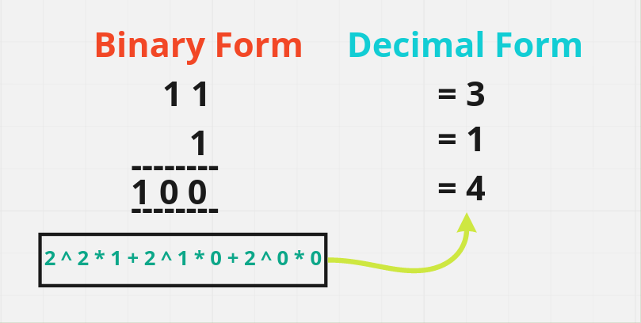
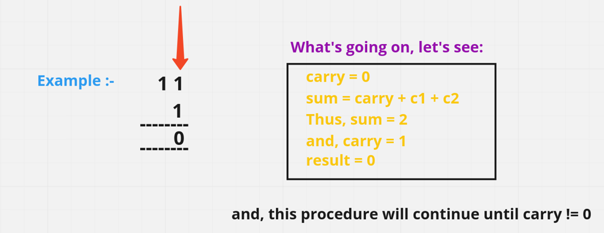

# 🤯 Well Detailed Explaination [Java , C++, Python] || Easy for mind to Accept it

**Author:** hi-malik
**Votes:** 972
**Link:** [https://leetcode.com/problems/add-binary/solutions/1679423/](https://leetcode.com/problems/add-binary/solutions/1679423/)

---

```
													# IMPORTANT INFO FOR YOU
```
* If, you are preperaing for `FACEBOOK interview` or will prepare. Then according to `LeetCode premium` it is no.4 most asked Question by **Facebook** as per now.

**So Ladies n Gentlemen without any further due let's start,**
`What question saying is, Given two binary strings a and b, return their sum as a binary string.`

**Approach Explained :**

**Summary of Below Explanation :**

*The overall idea is to make up the short two strings with 00 to make the two strings have the same length, and then traverse and calculate from the end to get the final result.*

Let's understand with an **example** : Addition of **1 and 1** will lead to **carry 1** and **print 0** , Addition of **1 and 0** give us **1 as carry** will lead **print 0** , Addition of last remaning **carry 1** with no body will lead to **print 1** , So, we get something like **"1 0 0"** as answer
One **key point** total addition will be 3 then print 1 and carry will remain 1

**Detailed Explaination :**

So, first do we understand how do we perform **binary addition**. **Take an example**, given two numbers **"11" + "1"** where **"11"** is representing **"3"** & **"1"** is **"1"**, in decimal form. 
Now let's perform **binary addition** it's very **similar to the decimal addition** that we do. In decimal what we do we add 2 numbers & if it goes beyond 9 we **take a carry**. And here also we have a **number in range 0 - 1**, **2 values over here** & in **Decimal range is 0 - 9**, **10 values** are there. So, in binary what it means is if result more **than 1**, there **is a carry** otherwise **no carry**.
Let me show you in diagram:



* So, what's going in diagram is **intially carry is "0"** we **add 1 + 1** we **get 2** which is more **then 1**, so there is a **carry of 1** and **result is 0**. Now we have **carry of 1**, **again 1 + 1 is 0**, and still left with **carry of 1**. And the **last carry** one will be **return as it is**. 
* So, if you see this binary number it is **[2^2 * 1 + 2^1 * 0 + 2^0 * 0]** and this is the decimal coversion of **[1 0 0]** which **is 4**. 



**Hope you got the point **

*Now, let's code it up:*
**code, each lne explained :** `Similar for C++, Java, Python` **{Only synatx difference}** approach is same

* Step 1:
```
{
// First, create result name string and intially it is empty & in the end we gonna return it as our aswer
        StringBuilder res = new StringBuilder(); 
        int i = a.length() - 1; // we crete i pointer for string a and we have to start adding from right to left 
        int j = b.length() - 1; // similar pointer j for string b
        int carry = 0; // we create a carry, as we have to consider it as well
```
* Step 2:
```
// iterate over the loop until the both condition become false
        while(i >= 0 || j >= 0){ 
            int sum = carry; // intialise our sum with carry;
            
            // Now, we subtract by '0' to convert the numbers from a char type into an int, so we can perform operations on the numbers
            if(i >= 0) sum += a.charAt(i--) - '0';
            if(j >= 0) sum += b.charAt(j--) - '0';
            // taking carry;
            carry = sum > 1 ? 1 : 0; // getting carry depend on the quotient we get by dividing sum / 2 that will be our carry. Carry could be either 1 or 0 
			// if sum is 0 res is 1 & then carry would be 0;
            // if sum is 1 res is 1 & carry would be 0
            // if sum is 2 res is 0 & carry would be 1
            // if sum is 3 res is 1 & carry would be 1
            res.append(sum % 2); // just moduling the sum so, we can get remainder and add it into our result
        }
```
* Final Step:
```
if(carry != 0) res.append(carry); // we gonna add it into res until carry becomes 0;
        return res.reverse().toString(); // revese the answer we get & convt to string and return by the help of result;
```
* Let's combine each line of code


**Java**
```
class Solution {
    public String addBinary(String a, String b) {
        StringBuilder res = new StringBuilder();
        int i = a.length() - 1;
        int j = b.length() - 1;
        int carry = 0;
        while(i >= 0 || j >= 0){
            int sum = carry;
            if(i >= 0) sum += a.charAt(i--) - '0';
            if(j >= 0) sum += b.charAt(j--) - '0';
            carry = sum > 1 ? 1 : 0;
            res.append(sum % 2);
        }
        if(carry != 0) res.append(carry);
        return res.reverse().toString();
    }
}
```
**C++**
```
class Solution {
public:
    string addBinary(string a, string b) {
        string res;
        int i = a.length() - 1;
        int j = b.length() - 1;
        int carry = 0;
        while(i >= 0 || j >= 0){
            int sum = carry;
            if(i >= 0) sum += a[i--] - '0';
            if(j >= 0) sum += b[j--] - '0';
            carry = sum > 1 ? 1 : 0;
            res += to_string(sum % 2);
        }
        if(carry) res += to_string(carry);
        reverse(res.begin(), res.end());
        return res;
    }
};
```
**Python**
```
class Solution:
    def addBinary(self, a: str, b: str) -> str:
        res = ""
        i, j, carry = len(a) - 1, len(b) - 1, 0
        while i >= 0 or j >= 0:
            sum = carry;
            if i >= 0 : sum += ord(a[i]) - ord('0') # ord is use to get value of ASCII character
            if j >= 0 : sum += ord(b[j]) - ord('0')
            i, j = i - 1, j - 1
            carry = 1 if sum > 1 else 0;
            res += str(sum % 2)

        if carry != 0 : res += str(carry);
        return res[::-1]
```
ANALYSIS :-
* **Time Complexity :-** BigO(max(M, N)), M & N is the length of string a, b;

* **Space Complexity :-** BigO(max(M, N)), which is the size of "res" object

**Guy's if you find this solution helpful \uD83D\uDE0A, PLEASE do UPVOTE. By doing that it motivate's me to create more better post like this \u270D\uFE0F**
`If you have some \uD83E\uDD14 doubts feel free to bug me`