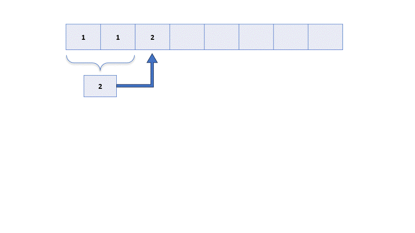

# 0ms ✅| Very Easy✅| Beginner Friendly Code 💯 faster💥| All Three Approaches

**Author:** areetrahalder
**Votes:** 63
**Link:** [https://leetcode.com/problems/climbing-stairs/solutions/4211515/](https://leetcode.com/problems/climbing-stairs/solutions/4211515/)

---

# Proof
> Upvote if you are watching the proof


# Intuition - PLEASE READ
<!-- Describe your first thoughts on how to solve this problem. -->
* You are climbing a staircase. Each time you can either climb 1 or 2 steps. When you take one step, the value of n will be reduced to n-1 and similarly if you take 2 steps it will reduce to n-2. Thus finding the number of ways becomes same as the finding the nth fibonacci number.
* The dynamic programming approach to solving the climbing stairs problem works by breaking down the problem into smaller subproblems, and then solving the smaller subproblems recursively. The solution to the original problem is then calculated by combining the solutions to the smaller subproblems. 

# Approach 1: Memoization
<!-- Describe your approach to solving the problem. -->
1) Initialize an array of size n+1 and fill with default values that can never be the answer. Or you can take a hashmap accordingly. 
2) Initialize the base conditions of the recursion function. If there are no steps involved, the no. of ways will be only 1. Similarly if there is only one step involved the no. of ways will be 1 too.
3) The solution to the original problem is then calculated by adding the number of ways to climb n-1 stairs to the number of ways to climb n-2 stairs.
   
# Complexity
- Time complexity: $$O(n)$$
<!-- Add your time complexity here, e.g. $$O(n)$$ -->

- Space complexity: $$O(n)$$
<!-- Add your space complexity here, e.g. $$O(n)$$ -->

# Code
```Java []
class Solution {
    public int climbStairs(int n) {
        int[] dp = new int[n+1];
        Arrays.fill(dp,-1);
        int k = climbStairsHelper(n,dp);
        return k;
    }
    public int climbStairsHelper(int n, int[] dp){
        if(n <= 1) return 1;
        if(dp[n] != -1) return dp[n];
        dp[n] = climbStairsHelper(n-1,dp) + 
                climbStairsHelper(n-2,dp);
        return dp[n];
    }
}
```
```C []
int climbStairs(int n) {
    if (n <= 1) return 1;
    
    int dp[n + 1];
    for (int i = 0; i <= n; i++) {
        dp[i] = -1;
    }
    
    return climbStairsHelper(n, dp);
}

int climbStairsHelper(int n, int dp[]) {
    if (n <= 1) return 1;
    if (dp[n] != -1) return dp[n];
    
    dp[n] = climbStairsHelper(n - 1, dp) + climbStairsHelper(n - 2, dp);
    return dp[n];
}
```
```C++ []
class Solution {
public:
    int climbStairs(int n) {
        if (n <= 1) return 1;

        vector<int> dp(n + 1, -1);
        return climbStairsHelper(n, dp);
    }

    int climbStairsHelper(int n, vector<int>& dp) {
        if (n <= 1) return 1;
        if (dp[n] != -1) return dp[n];

        dp[n] = climbStairsHelper(n - 1, dp) + climbStairsHelper(n - 2, dp);
        return dp[n];
    }
};
```
```C# []
public class Solution {
    public int ClimbStairs(int n) {
        int[] dp = new int[n + 1];
        Array.Fill(dp, -1);
        int k = ClimbStairsHelper(n, dp);
        return k;
    }

    public int ClimbStairsHelper(int n, int[] dp) {
        if (n <= 1) return 1;
        if (dp[n] != -1) return dp[n];
        dp[n] = ClimbStairsHelper(n - 1, dp) + 
                ClimbStairsHelper(n - 2, dp);
        return dp[n];
    }
}

```
```Python []
class Solution(object):
    def climbStairs(self, n):
        if n <= 1:
            return 1
        
        dp = [-1] * (n + 1)
        return self.climbStairsHelper(n, dp)
    
    def climbStairsHelper(self, n, dp):
        if n <= 1:
            return 1
        if dp[n] != -1:
            return dp[n]
        
        dp[n] = self.climbStairsHelper(n - 1, dp) + self.climbStairsHelper(n - 2, dp)
        return dp[n]

```
```Python3 []
class Solution:
    def climbStairs(self, n: int) -> int:
        dp = [-1] * (n + 1)
        def climbStairsHelper(n):
            if n <= 1:
                return 1
            if dp[n] != -1:
                return dp[n]
            dp[n] = climbStairsHelper(n - 1) + climbStairsHelper(n - 2)
            return dp[n]
        return climbStairsHelper(n)
```
```Javascript []
/**
 * @param {number} n
 * @return {number}
 */
var climbStairs = function(n) {
    if (n <= 1) {
        return 1;
    }
    
    let dp = new Array(n + 1).fill(-1);
    return climbStairsHelper(n, dp);
};

function climbStairsHelper(n, dp) {
    if (n <= 1) {
        return 1;
    }
    if (dp[n] !== -1) {
        return dp[n];
    }
    
    dp[n] = climbStairsHelper(n - 1, dp) + climbStairsHelper(n - 2, dp);
    return dp[n];
}
```
```Typescript []
function climbStairs(n: number): number {
    if (n <= 1) {
        return 1;
    }

    const dp: number[] = new Array(n + 1).fill(-1);
    return climbStairsHelper(n, dp);
}

function climbStairsHelper(n: number, dp: number[]): number {
    if (n <= 1) {
        return 1;
    }
    if (dp[n] !== -1) {
        return dp[n];
    }

    dp[n] = climbStairsHelper(n - 1, dp) + climbStairsHelper(n - 2, dp);
    return dp[n];
}
```        

---

# Approach 2: Tabulation


<!-- Describe your approach to solving the problem. -->
The table is initialized with the solutions to the smallest subproblems, which are the following:

    tab[0] = 1; 
    #There is only one way to climb 0 stairs, which is to do nothing.

    tab[1] = 1; 
    #There is only one way to climb 1 stair, which is to take one step.
For all other values of i, the solution to the subproblem is calculated as follows:

    tab[i] = tab[i - 1] + tab[i - 2]
This is because there are two ways to climb i stairs: either take one step from the current stair, or take two steps from the current stair.

Once the table has been populated with the solutions to all of the subproblems, the solution to the original problem can be calculated by simply looking up the value in the table at the index n, where n is the number of stairs.

This approach is efficient because it avoids solving the same subproblems multiple times. The table stores the solutions to all of the subproblems, so that they can be reused when solving the larger subproblems.

# Complexity
- Time complexity: $$O(n)$$
<!-- Add your time complexity here, e.g. $$O(n)$$ -->

- Space complexity: $$O(n)$$
<!-- Add your space complexity here, e.g. $$O(n)$$ -->

# Code
```Java []
class Solution {
    public int climbStairs(int n) {
        int[] tab = new int[n+1];
        if(tab.length > 0) tab[0] = 1;
        if(tab.length > 1) tab[1] = 1;
        for(int i = 2; i < tab.length; i++) 
            tab[i] = tab[i-1] + tab[i-2];
        return tab[n];
    }
}
```
```C []
int climbStairs(int n) {
    int tab[n+1];
    if (n >= 0) tab[0] = 1;
    if (n >= 1) tab[1] = 1;
    for (int i = 2; i <= n; i++) 
        tab[i] = tab[i-1] + tab[i-2];
    return tab[n];
}
```
```C++ []
class Solution {
public:
    int climbStairs(int n) {
        vector<int> tab(n + 1, 0);
        if (n >= 0) tab[0] = 1;
        if (n >= 1) tab[1] = 1;
        for (int i = 2; i <= n; i++) 
            tab[i] = tab[i-1] + tab[i-2];
        return tab[n];
    }
};
```
```C# []
public class Solution
{
    public int ClimbStairs(int n)
    {
        int[] tab = new int[n + 1];
        if (tab.Length > 0) tab[0] = 1;
        if (tab.Length > 1) tab[1] = 1;
        for (int i = 2; i < tab.Length; i++) 
            tab[i] = tab[i - 1] + tab[i - 2];
        return tab[n];
    }
}
```
```Python []
class Solution:
    def climbStairs(self, n):
        """
        :type n: int
        :rtype: int
        """
        tab = [0] * (n + 1)
        if n >= 0:
            tab[0] = 1
        if n >= 1:
            tab[1] = 1
        for i in range(2, n + 1):
            tab[i] = tab[i-1] + tab[i-2]
        return tab[n]

```
```Python3 []
class Solution:
    def climbStairs(self, n) -> int:
        tab = [0] * (n + 1)
        if tab: tab[0] = 1
        if len(tab) > 1: tab[1] = 1
        for i in range(2, len(tab)):
            tab[i] = tab[i - 1] + tab[i - 2]
        return tab[n]
```
```Javascript []
/**
 * @param {number} n
 * @return {number}
 */
var climbStairs = function(n) {
    var tab = new Array(n + 1).fill(0);
    if (n >= 0) tab[0] = 1;
    if (n >= 1) tab[1] = 1;
    for (var i = 2; i <= n; i++) 
        tab[i] = tab[i-1] + tab[i-2];
    return tab[n];
};
```
```Typescript []
function climbStairs(n: number): number {
    const tab: number[] = new Array(n + 1).fill(0);
    if (n >= 0) tab[0] = 1;
    if (n >= 1) tab[1] = 1;
    for (let i = 2; i <= n; i++) 
        tab[i] = tab[i-1] + tab[i-2];
    return tab[n];
}
```
---
# Approach 3: Space Optimization
<!-- Describe your approach to solving the problem. -->
Lets observe the pattern in Tabulation. 
* The newer is always the summation of the previous two values.
* The older values are then never utilized. Thus the space is wasted in longer run.
* We can achieve similar effect with just three variables and shifting the values once calculated.


# Complexity
- Time complexity: $$O(n)$$
<!-- Add your time complexity here, e.g. $$O(n)$$ -->

- Space complexity: $$O(1)$$
<!-- Add your space complexity here, e.g. $$O(n)$$ -->

# Code
```Java []
class Solution {
    public int climbStairs(int n) {
        if(n <= 1) return 1;
        int firstNum = 1, secondNum = 1, thirdNum = 0;
        for(int i = 2; i < n + 1; i++){
            thirdNum = firstNum + secondNum;
            firstNum = secondNum;
            secondNum = thirdNum;
        }
        return thirdNum;
    }
}
```
```C []
int climbStairs(int n) {
    if (n <= 1) return 1;
    int firstNum = 1, secondNum = 1, thirdNum = 0;
    for (int i = 2; i < n + 1; i++) {
        thirdNum = firstNum + secondNum;
        firstNum = secondNum;
        secondNum = thirdNum;
    }
    return thirdNum;
}
```
```C++ []
class Solution {
public:
    int climbStairs(int n) {
        if (n <= 1) return 1;
        int firstNum = 1, secondNum = 1, thirdNum = 0;
        for (int i = 2; i < n + 1; i++) {
            thirdNum = firstNum + secondNum;
            firstNum = secondNum;
            secondNum = thirdNum;
        }
        return thirdNum;
    }
};
```
```C# []
public class Solution
{
    public int ClimbStairs(int n)
    {
        if (n <= 1) return 1;
        int firstNum = 1, secondNum = 1, thirdNum = 0;
        for (int i = 2; i < n + 1; i++)
        {
            thirdNum = firstNum + secondNum;
            firstNum = secondNum;
            secondNum = thirdNum;
        }
        return thirdNum;
    }
}
```
```Python []
class Solution(object):
    def climbStairs(self, n):
        """
        :type n: int
        :rtype: int
        """
        if n <= 1:
            return 1
        firstNum, secondNum, thirdNum = 1, 1, 0
        for i in range(2, n + 1):
            thirdNum = firstNum + secondNum
            firstNum, secondNum = secondNum, thirdNum
        return thirdNum

```
```Python3 []
class Solution:
    def climbStairs(self, n: int) -> int:
        if n <= 1: return 1
        firstNum = 1
        secondNum = 1
        thirdNum = 0
        for i in range(2, n + 1):
            thirdNum = firstNum + secondNum
            firstNum = secondNum
            secondNum = thirdNum

        return thirdNum

```
```Javascript []
/**
 * @param {number} n
 * @return {number}
 */
var climbStairs = function(n) {
    if (n <= 1) return 1;
    let firstNum = 1, secondNum = 1, thirdNum = 0;
    for (let i = 2; i <= n; i++) {
        thirdNum = firstNum + secondNum;
        firstNum = secondNum;
        secondNum = thirdNum;
    }
    return thirdNum;
};
```
```Typescript []
function climbStairs(n: number): number {
    if (n <= 1) return 1;
    let firstNum: number = 1, secondNum: number = 1, thirdNum: number = 0;
    for (let i: number = 2; i <= n; i++) {
        thirdNum = firstNum + secondNum;
        firstNum = secondNum;
        secondNum = thirdNum;
    }
    return thirdNum;
}
```
---
# Upvote


