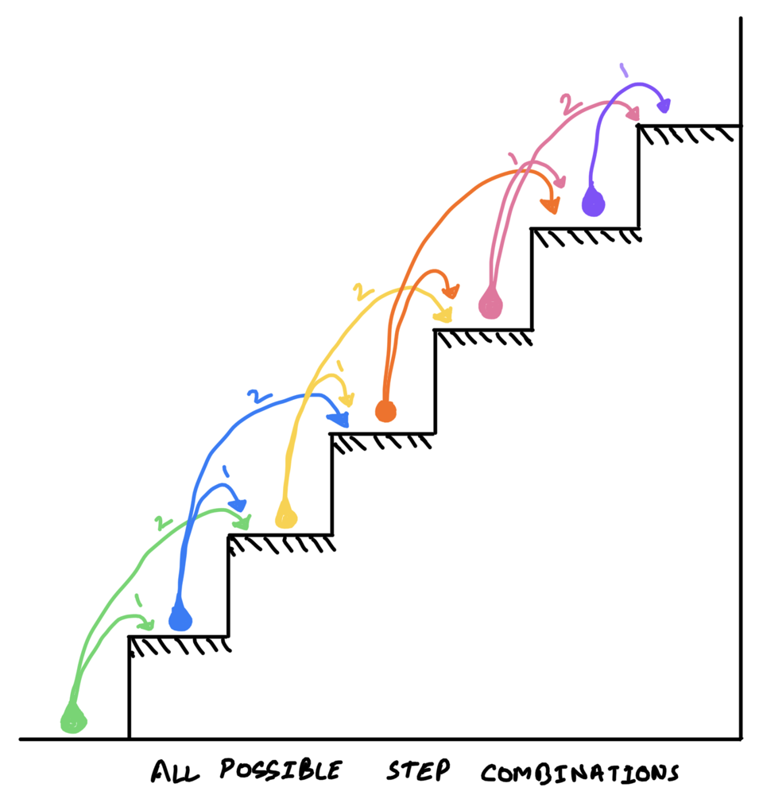
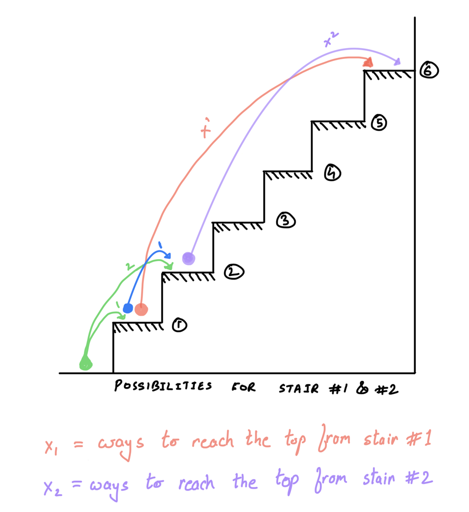
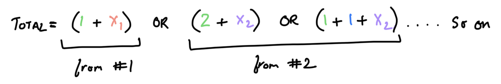
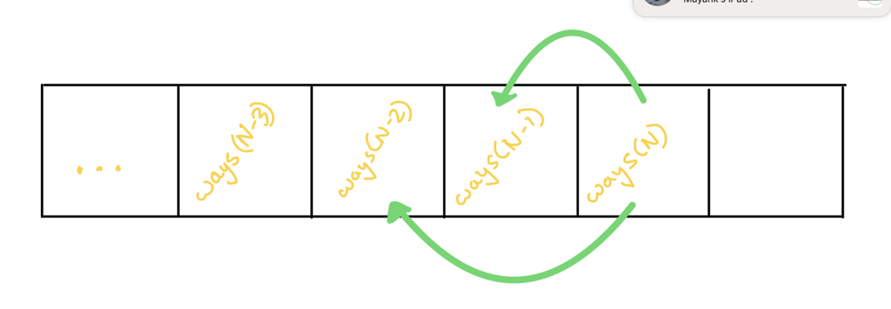
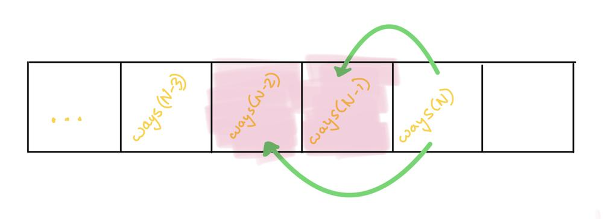

# 4 Ways to solve (with detailed DIAGRAMS). No memoization (Beats 100% time & memory).

**Author:** mayankagarwal2402
**Votes:** 74
**Link:** [https://leetcode.com/problems/climbing-stairs/solutions/2810612/](https://leetcode.com/problems/climbing-stairs/solutions/2810612/)

---

For the lazy one's... here's your solution:

# Hackers Approach:
```go
func climbStairs(n int) int {
    next, secondNext := 0, 1
    for ; n > 0; n-- {
        next, secondNext = secondNext, next + secondNext
    }
    return secondNext
}
```

But for the more curious types read below for the detailed explaination...


# Intuition
*Some much necessary research to come up with the solution:*







Sample runs:
```
1 stairs --> [(1)] --> 1 way
2 stairs --> [(1,1); (2)] --> 2 ways
3 stairs --> [(1,1,1);(2,1); (1,2)] --> 3 ways
4 stairs --> [(1,1,1,1);(2,1,1);(1,2,1); (1,1,2);(2,2)] --> 5 ways
... so on
```
we see a pattern, let's try to reverse engineer the logic...
```
ways(1) = 1
ways(2) = 2
ways(3) = 3 = 2+1 = [1step first => ways(2)] + [2steps first => ways(1)]
ways(4) = 5 = 3+2 = [1step first => ways(3)] + [2steps first => ways(2)]
... and so on ...
ways(n) = ways(n-1) + ways(n-2)
```
> the ways to climb N stairs is sum total of ways to climb (N-1) stairs plus (N-2) stairs


Now let's appreciate the fact that we've all solved a **fibonacci** before and this is not much different.


# Recursive Approach
Based on our intuition, we come up with the following algo:

***Recursive solution: O(2^n) time and O(n) space for call stack***
```go
func climbStairs(n int) int {
    if n == 1 {
        return 1
    } else if n == 2 {
        return 2
    }
    
    return climbStairs(n-1) + climbStairs(n-2)    
}
```

> However...
the above solution would result in TLE(time limit exceeded) as we will keep on calculating some already calculated values again and again. So, maybe we could store the previous results. Memoization to the rescue.
We can achieve this by modifying the above implementation, like so:

# DP Approach
***Dynamic Programming solution: O(n) time and O(n) space***


```
var mem map[int]int = map[int]int{}

func climbStairs(n int) int {
    if n == 1 {
        return 1
    } else if n == 2 {
        return 2
    } else if val, ok := mem[n]; ok {
        return val
    }

    res := climbStairs(n-1) + climbStairs(n-2)
    mem[n] = res
    return res
}
```

> However...
this is just waste of space. At any given point, all we need is the previous two calculated results, not all. 

Not to mention the extra space needed for the recursion call stack. We can avoid an O(2n) space by getting rid of the recursion and unused memoized values in the above implementation, like so:


# Iterative Approach
***Iterative Solution: O(n) time and O(1) space***


```
func climbStairs(n int) int {
    res := 0
    
    secondNext := 0
    next := 0
    for i := 1; i <= n; i++ {
        if i == 1 {
            res = 1
        } else if i == 2 {
            res = 2
        } else {
            res = secondNext + next
        }
        
        next = secondNext
        secondNext = res
    }
    
    return res
}
```

> a few more hacks to slim down this code above and you'll end up with the concise code shared at the top...

---
### \uD83D\uDD25 Bonus Section:
> Now if you are wondering, could we not come up with this algo directly, without needing to build upon all the iterations discussed above. Then yes, it's possible if we think a little differently (bottom-up). 
Let's answer a few questions for that and we'll end up with the code:

_Q: How many ways are there to climb up to the floor?_
_A: Duh! Zero_

_Q: How many ways can I climb up to the first step?_
_A: One. Yeah just One._

_Q: How many ways can I climb up to the 2nd step?_
_A: Uhmm! Either I take 2 steps from the floor or, I take 1 step from the 1st step._

_Q: So how many ways is that?_
_A: Two_

_Q: Cool, now how many ways can I climb up to the 3rd step?_
_A: 2 Ways. Either I take 2 steps from the 1st step or, I take 1 step from the 2nd step._

_Q: Nope, to take 1 step from the 2nd step, you need to first reach the 2nd step, and there are more than 1 ways to reach. We need to consider all those ways too. We already calculated it earlier. So how many now?_
_A: X ways to reach 1st step + Y ways to reach 2nd step_
_That should be `1 + 2 = 3`_

_Q: Great, Now to reach 4th step...?_
_A: 1 step from the 3rd step or 2 steps from the 2nd step_
_that is, `ways to reach 3rd step + ways to reach 2nd step = 3 + 2 = 5`_

_Q: Awesome, can we generalize it?_
_A: Yes, `ways to reach given step = ways to reach last step + ways to reach second-last step`_

_Q: How can we find ways to reach the `N-th` step?_
_A: Simple, we use the result from previous 2 runs and repeat this process N times._

_Q: So, where do we start from?_
_A: from the floor. lol. `secondLast=0` and `last=1`._

_Q: Can we write the code now?_
_A: Ofcourse_
```go
func climbStairs(n int) int {
    secondLast, last := 0, 1
    for i:=1; i<=n; i++ {
        secondLast, last = last, secondLast + last
    }
    return last
}
```

---

#### \uD83D\uDE4F Please upvote if you liked the explanation and appreciate my effort, helps it reach others who need it. Thanks :)
Stay motivated \uD83D\uDCAA

---


