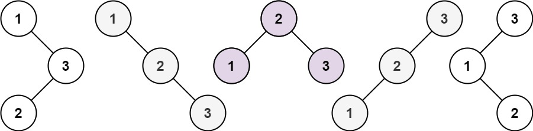

# [96. Unique Binary Search Trees](https://leetcode.com/problems/unique-binary-search-trees/)

| Category | Difficulty | Likes | Dislikes |
| :------: | :--------: | :---: | :------: |
| Algorithms | Medium | 10902 | 442 |

**Tags:** [`math`](https://leetcode.com/tag/math), [`dynamic-programming`](https://leetcode.com/tag/dynamic-programming), [`tree`](https://leetcode.com/tag/tree), [`binary-search-tree`](https://leetcode.com/tag/binary-search-tree), [`binary-tree`](https://leetcode.com/tag/binary-tree)

**Companies:** `amazon`, `facebook`, `clari`, `bloomberg`, `google`, `oracle`, `microsoft`, `tiktok`, `zoho`, `snapchat`

## Description

Given an integer `n`, return *the number of structurally unique **BST'**s (binary search trees) which has exactly *`n`* nodes of unique values from* `1` *to* `n`.

 

**Example 1:**


```

Input: n = 3
Output: 5

```

**Example 2:**

```

Input: n = 1
Output: 1

```

 

**Constraints:**

	- `1 <= n <= 19`

---

**Links:** [Submissions](https://leetcode.com/problems/unique-binary-search-trees/) | [Solutions](https://leetcode.com/problems/unique-binary-search-trees/)
