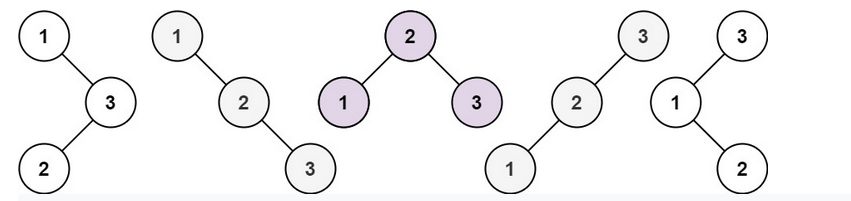

# Detailed Analysis : 3 different approaches explained

**Author:** thisisakshat
**Votes:** 167
**Link:** [https://leetcode.com/problems/unique-binary-search-trees/solutions/1109205/](https://leetcode.com/problems/unique-binary-search-trees/solutions/1109205/)

---

Let `C(i)` denote the number of nodes on left side of `root` 
-> `C(n-i-1)` denotes the number of nodes on right side of `root`
Hence the total number of **BST** possible will be : `C(i) * C(n-i-1)` **for a given root** 
->Total number of BST possible will be : `m * C(i) * C(n-i-1)` , where `m`: number of different root configurations
So, for example , the various *BST* for n=3:


`C(0)*C(2)  +  C(2)*C(0) + C(1)* C(1)` --> **This is known as Catalan number**
Hence, the given question is asking us to find the **Catalan Number** `C` of a number `n`:
`C(n)= C(i) * C(n-i-1)` => `i` varies from `0` to `n-1`

It can be found in three ways:

**1.) Recursion:** Worst approach (results in TLE)
```
class Solution {
public:
    int numTrees(int n) {
        int result=0;
        if(n==1 || n==0)
            return 1;
        for(int i=0;i<n;i++)
            result+=numTrees(i)*numTrees(n-i-1);
        return result;
    }
};
```
*Time Complexity: O(3^n)*
*For more details on this, visit this:* [https://stackoverflow.com/questions/27371612/catalan-numbers-recursive-function-time-complexity](http://)

**2.) Dynamic Programming:** Better than Recursion
Concept: Instead of doing recursive calls to calculate `C(n-2).....C(1)` every time, we store the results of previous iteration in an array `result` . Doing so results in making only one call per function as we already know the value of `C(n-1)`,reducing overall runtime

```
class Solution {
public:
    int numTrees(int n) {
        vector<int>result(n+1,0); //Initializing vector with 0
        result[1]=result[0]=1;
        for(int i=2;i<=n;i++)
        {
            for(int j=0;j<i;j++)
            {
                result[i]+=result[j]*result[i-j-1]; //Calculating C(i) to use for C(i+1) and storing it in result
            }
        }
        return result[n]; //return answer
    }
};
```
*Time Complexity : O(n^2)
Space Complexity : O(n)*

**3.) Binomial Coefficient:** Best approach
Concept: Instead of doing it again and again like in DP and recursion, there is a well known formula to calculate Catalan Number, which is

						`C(n)=Ci(2n,n)/n+1`
where `Ci`: Binomial Coefficient

*For those interested in proof of this, visit this link:* [https://en.wikipedia.org/wiki/Catalan_number](http://) 
```
class Solution {
public:
    long CalculateCoeff(int n,int k) //Function to calculate Ci(n.k)
    {
        long res=1;
        if(k>n-k)
            k=n-k;                    //Since Ci(n,k)=Ci(n,n-k), property of binomial coefficients
        for(int i=0;i<k;i++)
        {
            res*=(n-i);
            res/=(i+1);
        }
        return res;
    }
    int numTrees(int n) {
        return CalculateCoeff(2*n,n)/(n+1);
    }
};
```
*Time Complexity : O(n)
Space Complexity : O(n)*
***Runtime** in both Approach 2 and Approach 3 is **0ms***

I hope this article helped some of you, I tried my best to eplain everything 
If you like, please **UPVOTE**
Happy Coding :)