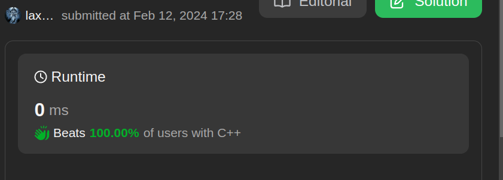

# Dynamic Programming Approach for Counting Unique Binary Search Trees

**Author:** CS_MONKS
**Votes:** 13
**Link:** [https://leetcode.com/problems/unique-binary-search-trees/solutions/4715425/](https://leetcode.com/problems/unique-binary-search-trees/solutions/4715425/)

---

# Intuition
Intuition: The code aims to count the number of unique binary search trees (BSTs) possible with n nodes.
Approach: It utilizes dynamic programming to avoid redundant calculations, recursively computing the number of unique BSTs for each number of nodes.
Recursion: The solve function calculates the number of BSTs by considering each number as a root and multiplying the counts of left and right subtrees.
Memoization: Results are memoized in an array to optimize the recursive approach and avoid recomputation of overlapping subproblems.
Result: The numTrees function initializes the memoization array and returns the computed count for n nodes.

# Approach
<!-- Describe your approach to solving the problem. -->

# Complexity
- Time complexity:
<!-- Add your time complexity here, e.g. $$O(n)$$ -->

- Space complexity:
<!-- Add your space complexity here, e.g. $$O(n)$$ -->



# Code
```c []
int solve(int n, int* dp);

int numTrees(int n) {
    // Initialize dynamic programming array
    int* dp = (int*)malloc((n + 1) * sizeof(int));
    for (int i = 0; i <= n; i++) {
        dp[i] = -1;
    }
    // Call the solve function and return the result
    int result = solve(n, dp);
    free(dp);
    return result;
}

int solve(int n, int* dp) {
    // Base case: If n is 0 or 1, return 1
    if (n <= 1)
        return 1;
    // If the result is already computed, return it
    if (dp[n] != -1) {
        return dp[n];
    }
    // Initialize answer variable
    int ans = 0;
    // Iterate through all possible roots
    for (int i = 1; i <= n; i++) {
        // Calculate the number of unique BSTs for left and right subtrees
        ans += solve(i - 1, dp) * solve(n - i, dp);
    }
    // Memoize the result and return
    dp[n] = ans;
    return dp[n];
}

```
```c++ []
class Solution {
public:
    int solve(int n,vector<int>& dp){
        if(n<=1)
            return 1;
        if(dp[n]!=-1){
            return dp[n];
        }
        int ans=0;
        for(int i=1;i<=n;i++){
            ans += solve(i-1,dp)*solve(n-i,dp);
        }
        return dp[n]=ans;
    }
    int numTrees(int n) {
        vector<int>dp(n+1,-1);
        return solve(n,dp);
    }
};
```
```java []
class Solution {
    public int solve(int n, int[] dp) {
        if (n <= 1)
            return 1;
        if (dp[n] != -1) {
            return dp[n];
        }
        int ans = 0;
        for (int i = 1; i <= n; i++) {
            ans += solve(i - 1, dp) * solve(n - i, dp);
        }
        return dp[n] = ans;
    }

    public int numTrees(int n) {
        int[] dp = new int[n + 1];
        Arrays.fill(dp, -1);
        return solve(n, dp);
    }
}

```
```python []
class Solution:
    def solve(self, n, dp):
        if n <= 1:
            return 1
        if dp[n] != -1:
            return dp[n]
        ans = 0
        for i in range(1, n + 1):
            ans += self.solve(i - 1, dp) * self.solve(n - i, dp)
        dp[n] = ans
        return dp[n]

    def numTrees(self, n):
        dp = [-1] * (n + 1)
        return self.solve(n, dp)

```
```python3 []
class Solution:
    def solve(self, n, dp):
        if n <= 1:
            return 1
        if dp[n] != -1:
            return dp[n]
        ans = 0
        for i in range(1, n + 1):
            ans += self.solve(i - 1, dp) * self.solve(n - i, dp)
        dp[n] = ans
        return dp[n]

    def numTrees(self, n):
        dp = [-1] * (n + 1)
        return self.solve(n, dp)

```
``` javascript []
class Solution {
    // Function to recursively calculate the number of unique BSTs
    solve(n, dp) {
        // Base case: If n is 0 or 1, return 1
        if (n <= 1)
            return 1;
        // If the result is already computed, return it
        if (dp[n] !== -1) {
            return dp[n];
        }
        // Initialize answer variable
        let ans = 0;
        // Iterate through all possible roots
        for (let i = 1; i <= n; i++) {
            // Calculate the number of unique BSTs for left and right subtrees
            ans += this.solve(i - 1, dp) * this.solve(n - i, dp);
        }
        // Memoize the result and return
        return dp[n] = ans;
    }

    // Function to get the total number of unique BSTs
    numTrees(n) {
        // Initialize dynamic programming array
        const dp = Array(n + 1).fill(-1);
        // Call the solve function and return the result
        return this.solve(n, dp);
    }
}

```
```c# []
public class Solution {
    // Function to recursively calculate the number of unique BSTs
    public int Solve(int n, int[] dp) {
        // Base case: If n is 0 or 1, return 1
        if (n <= 1)
            return 1;
        // If the result is already computed, return it
        if (dp[n] != -1) {
            return dp[n];
        }
        // Initialize answer variable
        int ans = 0;
        // Iterate through all possible roots
        for (int i = 1; i <= n; i++) {
            // Calculate the number of unique BSTs for left and right subtrees
            ans += Solve(i - 1, dp) * Solve(n - i, dp);
        }
        // Memoize the result and return
        return dp[n] = ans;
    }

    // Function to get the total number of unique BSTs
    public int NumTrees(int n) {
        // Initialize dynamic programming array
        int[] dp = new int[n + 1];
        for (int i = 0; i < dp.Length; i++) {
            dp[i] = -1;
        }
        // Call the solve function and return the result
        return Solve(n, dp);
    }
}

```
```kotlin []
class Solution {
    // Function to recursively calculate the number of unique BSTs
    fun solve(n: Int, dp: Array<Int>): Int {
        // Base case: If n is 0 or 1, return 1
        if (n <= 1)
            return 1
        // If the result is already computed, return it
        if (dp[n] != -1) {
            return dp[n]
        }
        // Initialize answer variable
        var ans = 0
        // Iterate through all possible roots
        for (i in 1..n) {
            // Calculate the number of unique BSTs for left and right subtrees
            ans += solve(i - 1, dp) * solve(n - i, dp)
        }
        // Memoize the result and return
        dp[n] = ans
        return dp[n]
    }

    // Function to get the total number of unique BSTs
    fun numTrees(n: Int): Int {
        // Initialize dynamic programming array
        val dp = Array(n + 1) { -1 }
        // Call the solve function and return the result
        return solve(n, dp)
    }
}

```
```swift []
class Solution {
    // Function to recursively calculate the number of unique BSTs
    func solve(_ n: Int, _ dp: inout [Int]) -> Int {
        // Base case: If n is 0 or 1, return 1
        if n <= 1 {
            return 1
        }
        // If the result is already computed, return it
        if dp[n] != -1 {
            return dp[n]
        }
        // Initialize answer variable
        var ans = 0
        // Iterate through all possible roots
        for i in 1...n {
            // Calculate the number of unique BSTs for left and right subtrees
            ans += solve(i - 1, &dp) * solve(n - i, &dp)
        }
        // Memoize the result and return
        dp[n] = ans
        return dp[n]
    }

    // Function to get the total number of unique BSTs
    func numTrees(_ n: Int) -> Int {
        // Initialize dynamic programming array
        var dp = [Int](repeating: -1, count: n + 1)
        // Call the solve function and return the result
        return solve(n, &dp)
    }
}

```

