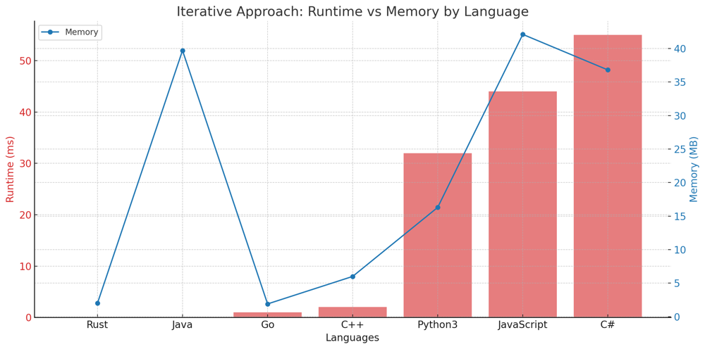
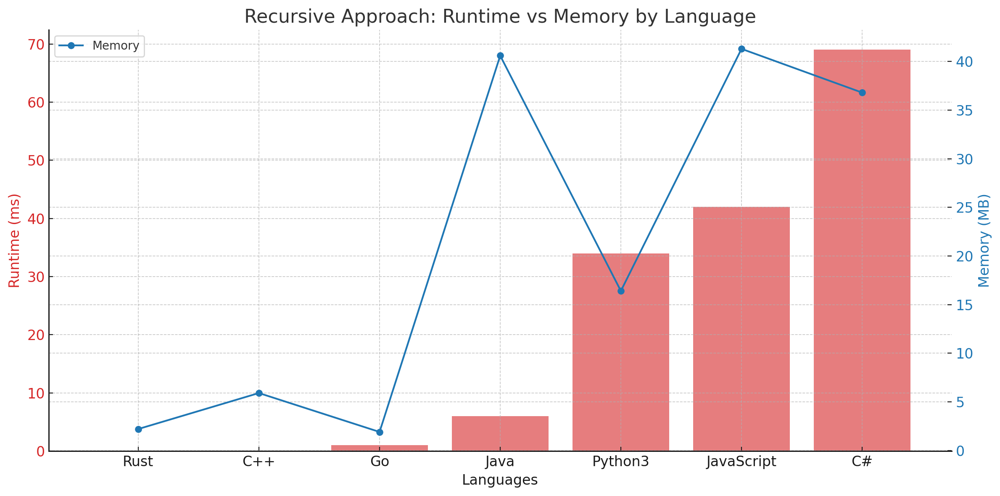

# ✅ 100% Recursive & Iterative 2-Approaches

**Author:** vanAmsen
**Votes:** 77
**Link:** [https://leetcode.com/problems/excel-sheet-column-title/solutions/3943071/](https://leetcode.com/problems/excel-sheet-column-title/solutions/3943071/)

---

# Problem Understanding

In the "Excel Sheet Column Title" problem, we are given an integer representing a column number. The task is to return its corresponding column title as it appears in an Excel sheet, where the letters range from A to Z for the numbers 1 to 26, and then AA to AZ, BA to BZ, and so on.

For instance, given the input 28, the output should be "AB".

**Input**: columnNumber = 28
**Output**: "AB"

---

# Live Coding Iterative & Recursive:
https://youtu.be/Vlu300w6HbY

- [Coding in Python \uD83D\uDC0D](https://youtu.be/Vlu300w6HbY)
- [Coding in Rust \uD83E\uDD80](https://youtu.be/nutdEPmd3kM)

---

# Approach 1: Iterative

To solve the "Excel Sheet Column Title" problem using the iterative approach, we continuously divide the given number by 26 and determine the remainder. This remainder gives us the current character of the Excel title, starting from the least significant character.

## Key Data Structures:
- **List (result)**: Used to store the characters of the Excel title.

## Enhanced Breakdown:

1. **Initialization**:
   - Create an empty list named `result`.
   
2. **Processing Each Number**:
   - While `columnNumber` is not zero:
     - Use the `divmod` function to get the quotient and remainder of `columnNumber` when divided by 26.
     - Decrement the `columnNumber` by 1 and append the corresponding character to the `result` list.
     
3. **Wrap-up**:
   - Reverse the `result` list and join the characters to form the final Excel title.

## Example:

Given the input 701:

**Iterative Approach:**

- First iteration: remainder = 24, quotient = 26; result = ["Y"]
- Second iteration: remainder = 25, quotient = 0; result = ["Y", "Z"]
- No further iterations since quotient is now 0; final result = "ZY"

---

# Approach 2: Recursive

To tackle this problem recursively, we adopt a top-down approach, determining the most significant character first and then recursively determining the rest.

## Key Data Structures:
- **String**: As this is a recursive approach, we construct the Excel title directly as a string.

## Enhanced Breakdown:

1. **Base Case**:
   - If `columnNumber` is zero, return an empty string.
   
2. **Recursive Call**:
   - Use the `divmod` function to determine the quotient and remainder of `columnNumber` divided by 26.
   - Construct the current character of the Excel title using the remainder.
   - Recursively call the function with the quotient to determine the preceding characters of the Excel title.

3. **Wrap-up**:
   - Concatenate the result of the recursive call with the current character to form the current state of the Excel title.

## Example:

Given the input 701:

**Recursive Approach:**

- First call: remainder = 24, quotient = 26; current character = "Y"
- Second call: remainder = 25, quotient = 0; current character = "Z"
- No further recursive calls as quotient is now 0; final result = "ZY"

(Note: The order of the recursive approach's results is due to the nature of recursion, where the deeper levels of recursion resolve first.)

---

# Complexity:

**Time Complexity for Both Approaches:** 
- The time complexity is $$O(\\log_{26} n)$$ for both methods, where $$n$$ is the given `columnNumber`. This is because we're continuously dividing the number by 26 until it becomes zero.

**Space Complexity for Iterative Approach:** 
- The space complexity is $$O(\\log_{26} n)$$ due to the list we use to store the Excel title characters.

**Space Complexity for Recursive Approach:** 
- The space complexity is also $$O(\\log_{26} n)$$ due to the recursive call stack.

---

# Performance:

**Iterative Approach:**

| Language   | Runtime (ms) | Runtime Beat (%) | Memory (MB) | Memory Beat (%) |
|------------|--------------|------------------|-------------|-----------------|
| Rust       | 0 ms         | 100%             | 2 MB        | 86.84%          |
| Java       | 0 ms         | 100%             | 39.7 MB     | 61.65%          |
| Go         | 1 ms         | 74.84%           | 1.9 MB      | 94.34%          |
| C++        | 2 ms         | 49.78%           | 6 MB        | 37.93%          |
| Python3    | 32 ms        | 93.98%           | 16.3 MB     | 23.11%          |
| JavaScript | 44 ms        | 93.13%           | 42.1 MB     | 11.16%          |
| C#         | 55 ms        | 97.28%           | 36.8 MB     | 15.65%          |




**Recursive Approach:**

| Language   | Runtime (ms) | Runtime Beat (%) | Memory (MB) | Memory Beat (%) |
|------------|--------------|------------------|-------------|-----------------|
| Rust       | 0 ms         | 100%             | 2.2 MB      | 23.68%          |
| C++        | 0 ms         | 100%             | 5.9 MB      | 37.93%          |
| Go         | 1 ms         | 74.84%           | 1.9 MB      | 94.34%          |
| Java       | 6 ms         | 34.8%            | 40.6 MB     | 5.65%           |
| Python3    | 34 ms        | 88.27%           | 16.4 MB     | 23.11%          |
| JavaScript | 42 ms        | 96.14%           | 41.3 MB     | 86.70%          |
| C#         | 69 ms        | 51.2%            | 36.8 MB     | 15.65%          |




---

# Code Iterative
``` Python []
class Solution:
    def convertToTitle(self, columnNumber: int) -> str:
        result = []
        while columnNumber:
            columnNumber, remainder = divmod(columnNumber - 1, 26)
            result.append(chr(65 + remainder))
        return ''.join(reversed(result))
```
``` C++ []
class Solution {
public:
    string convertToTitle(int columnNumber) {
        string result = "";
        while (columnNumber) {
            columnNumber--;
            char c = 'A' + columnNumber % 26;
            result = c + result;
            columnNumber /= 26;
        }
        return result;
    }
};
```
``` Rust []
impl Solution {
    pub fn convert_to_title(column_number: i32) -> String {
        let mut result = String::new();
        let mut number = column_number;
        while number > 0 {
            number -= 1;
            let char_code = ((number % 26) as u8) + b'A';
            result.insert(0, char_code as char);
            number /= 26;
        }
        result
    }
}
```
``` Go []
func convertToTitle(columnNumber int) string {
    var result string
    for columnNumber > 0 {
        columnNumber--
        charCode := 'A' + rune(columnNumber % 26)
        result = string(charCode) + result
        columnNumber /= 26
    }
    return result
}
```
``` Java []
public class Solution {
    public String convertToTitle(int columnNumber) {
        StringBuilder result = new StringBuilder();
        while (columnNumber > 0) {
            columnNumber--;
            char c = (char) ('A' + columnNumber % 26);
            result.insert(0, c);
            columnNumber /= 26;
        }
        return result.toString();
    }
}
```
``` C# []
public class Solution {
    public string ConvertToTitle(int columnNumber) {
        string result = "";
        while (columnNumber > 0) {
            columnNumber--;
            char c = (char) ('A' + columnNumber % 26);
            result = c + result;
            columnNumber /= 26;
        }
        return result;
    }
}
```
``` JavaScript []
/**
 * @param {number} columnNumber
 * @return {string}
 */
var convertToTitle = function(columnNumber) {
    let result = "";
    while (columnNumber > 0) {
        columnNumber--;
        let charCode = 'A'.charCodeAt(0) + columnNumber % 26;
        result = String.fromCharCode(charCode) + result;
        columnNumber = Math.floor(columnNumber / 26);
    }
    return result;
};
```

# Code Recusrive
``` Python []
class Solution:
    def convertToTitle(self, columnNumber: int) -> str:
        if not columnNumber:
            return ""
        columnNumber, remainder = divmod(columnNumber - 1, 26)
        return self.convertToTitle(columnNumber) + chr(65 + remainder)
```
``` C++ []
class Solution {
public:
    string convertToTitle(int columnNumber) {
        if (columnNumber == 0) return "";
        columnNumber--;
        char c = 'A' + columnNumber % 26;
        return convertToTitle(columnNumber / 26) + c;
    }
};
```
``` Rust []
impl Solution {
    pub fn convert_to_title(column_number: i32) -> String {
        if column_number == 0 {
            return String::new();
        }
        let mut number = column_number;
        number -= 1;
        let char_code = ((number % 26) as u8) + b'A';
        let prev = Self::convert_to_title(number / 26);
        return format!("{}{}", prev, char_code as char);
    }
}
```
``` Go []
func convertToTitle(columnNumber int) string {
    if columnNumber == 0 {
        return ""
    }
    columnNumber--
    charCode := 'A' + rune(columnNumber%26)
    return convertToTitle(columnNumber/26) + string(charCode)
}
```
``` Java []
public class Solution {
    public String convertToTitle(int columnNumber) {
        if (columnNumber == 0) return "";
        columnNumber--;
        char c = (char) ('A' + columnNumber % 26);
        return convertToTitle(columnNumber / 26) + c;
    }
}
```
``` C# []
public class Solution {
    public string ConvertToTitle(int columnNumber) {
        if (columnNumber == 0) return "";
        columnNumber--;
        char c = (char) ('A' + columnNumber % 26);
        return ConvertToTitle(columnNumber / 26) + c;
    }
}
```
``` JavaScript []
/**
 * @param {number} columnNumber
 * @return {string}
 */
var convertToTitle = function(columnNumber) {
    if (columnNumber === 0) return "";
    columnNumber--;
    let charCode = 'A'.charCodeAt(0) + columnNumber % 26;
    return convertToTitle(Math.floor(columnNumber / 26)) + String.fromCharCode(charCode);
};
```

# Live Coding in Rust:
https://youtu.be/nutdEPmd3kM

This problem provides an elegant demonstration of how to convert base-10 numbers to another base, in this case, base-26. It's a great reminder that sometimes algorithmic problems can be rooted in simple number base conversions. \uD83D\uDCA1\uD83C\uDF20\uD83D\uDC69\u200D\uD83D\uDCBB\uD83D\uDC68\u200D\uD83D\uDCBB