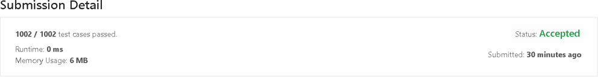

# ✅ C++ || 4 Lines || Easy To UnderStand || 0ms || 100%

**Author:** knockcat
**Votes:** 454
**Link:** [https://leetcode.com/problems/excel-sheet-column-number/solutions/1790101/](https://leetcode.com/problems/excel-sheet-column-number/solutions/1790101/)

---

# 171. Excel Sheet Column Number
**KNOCKCAT**
* **Someone is intentionally downvoting answer , if you cannot support please dont spread hate**

```
1. Easy C++
2. Line by Line Explanation with Comments.
3. Detailed Explanation \u2705
4. 4 Lines 0ms , 100 % faster.
5. Please Upvote if it helps\u2B06\uFE0F
6. Link to my Github Profile contains a repository of Leetcode with all my Solutions. \u2B07\uFE0F
	// \uD83D\uDE09If you Like the repository don't foget to star the repository\uD83D\uDE09 
```


[LeetCode](https://github.com/knockcat/Leetcode)                 **Link to LeetCode Repository**

Please upvote my comment so that i get to win the 2022 giveaway and motivate to make such discussion post.
**Happy new Year 2023 to all of you**
**keep solving keep improving**
Link To comment
[Leetcode Give away comment](https://leetcode.com/discuss/general-discussion/2946993/2022-Annual-Badge-and-the-Giveaway/1734919)




* **EXPLANATION**
```
1. There are 26 letters in our alphabet and we start counting from 1, not zero.
   So 'Z' is 26.
2. The rest of the combinations start from a base 26

AA --> 26*1+ 1 = 27 (A == 1)
AB --> 26*1+ 2 = 28 (B == 2)
AC -->26*1 + 3 = 29 (C == 3)
.....

So we can write like this:

result = 0
d = s[i](char) - 'A' + 1 (we used  s[i] -  'A' to convert the letter to a number like it's going to be C)
result = result* 26 + d

If the given input is only one letter, it will automatically take the value s[i] - 'A' + 1 as the first result is 0.
```

* **Some More Explanation**

```
1. For every additional digit of the string, we multiply the value of the digit by 26^n
2. here n is the number of digits it is away from the one's place.
3. This is similar to how the number 254 could be broken down as this:
	 (2 x 10 x 10) + (5 x 10) + (4).
4. The reason we use 26 instead of 10 is because 26 is our base.

For s = "BCM" the final solution would be (2 x 26 x 26) + (3 x 26) + (13)

We could do this process iteratively. Start at looking at the first digit "B". Add the int equivalent of "B" to the running sum and continue. 
Every time we look at the following digit multiply our running sum by 26 before adding the next digit to signify we are changing places. Example below:

"B" = 2
"BC" = (2)26 + 3
"BCM" = (2(26) + 3)26 + 13
```

* **Time Complexity : O(n)**       *one scan of string , n is number of characters in the string* 

* **CODE WITH EXPLANATION**
```
							// \uD83D\uDE09\uD83D\uDE09\uD83D\uDE09\uD83D\uDE09Please upvote if it helps \uD83D\uDE09\uD83D\uDE09\uD83D\uDE09\uD83D\uDE09
class Solution {
public:
    int titleToNumber(string columnTitle) {
        int result = 0;
        for(char c : columnTitle)
        {
			//d = s[i](char) - 'A' + 1 (we used  s[i] -  'A' to convert the letter to a number like it's going to be C)

            int d = c - 'A' + 1;
            result = result * 26 + d;
        }
        return result;
    }
};
```