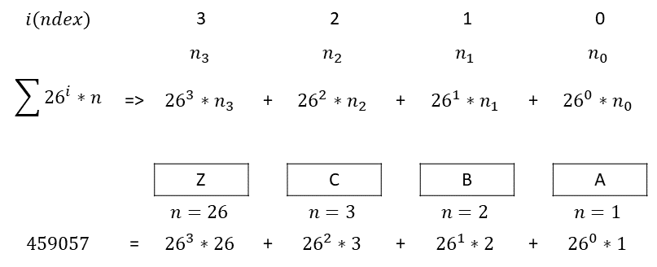

# Elixir Explanation and Solution, Two Approaches

**Author:** bpfaust
**Votes:** 1
**Link:** [https://leetcode.com/problems/excel-sheet-column-number/solutions/1790228/](https://leetcode.com/problems/excel-sheet-column-number/solutions/1790228/)

---

# Approach
Two solutions are explored below. The first making use of a recursive function with pattern matching, and the second more directly taking place in the main `title_to_number\\1` function alone as a single line (also in part to see if it can be done). 

Both codes make use of "codepoints," specifically relying upon the in-built Elixir function `String.to_charlist\\1` to output a list containing the integer codepoints of each letter in the `column_title` string. 

The codepoint of "A" is 65, and increasingly steps through each letter up to "Z" with a codepoint of 90. Deducting 64 from the integer codepoint allows us to represent A to Z as 1 to 26. 

Allowing this value to represent `n` and considering `i` as the index of the letter increasing from right to left, starting at 0 at the right-most position, the resultant integer representation of the `column_title` can be represented as a summation following the below formula and visualization. An example using a `column_title` of "ZCBA" is also shown. 



# Solution
## Using Extra Function with Pattern Matching
Runtime of 484 ms, with a memory usage of 51.2 MB. 
```
defmodule Solution do
  @spec title_to_number(column_title :: String.t) :: integer
  def title_to_number(column_title) do
    column_title
    |> String.reverse()
    |> String.to_charlist()
    |> digest(0, 0)
  end
    
  def digest([], _index, sum) do
    sum
  end
  
  def digest([head | tail], index, sum) do
    digest(tail, index + 1, sum + Integer.pow(26, index) * (head - 64))
  end
end
```

## Single Line Using Comprehension with Reduction
Runtime of 499 ms, with a memory usage of 49.9 MB. 
```
defmodule Solution do
  @spec title_to_number(column_title :: String.t) :: integer
  def title_to_number(column_title) do
    (for c <- String.to_charlist(column_title), reduce: [], do: (acc -> [Integer.pow(26, String.length(column_title) - length(acc) - 1) * (c - 64) | acc])) |> Enum.sum()
  end
end
```

# Testcases
```
"A"
"AB"
"ZY"
"FXSHRXW"
```