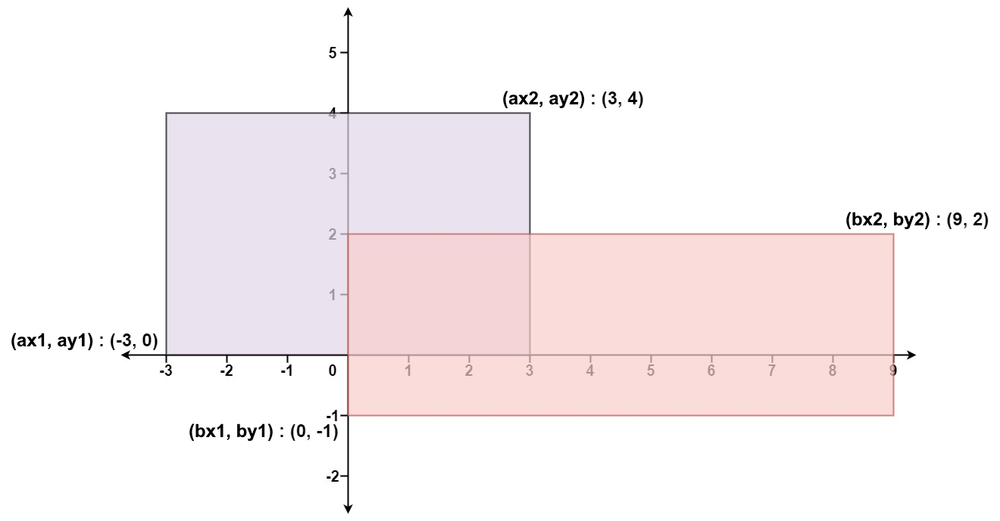

# [223. Rectangle Area](https://leetcode.com/problems/rectangle-area/)

| Category | Difficulty | Likes | Dislikes |
| :------: | :--------: | :---: | :------: |
| Algorithms | Medium | 2120 | 1662 |

**Tags:** [`math`](https://leetcode.com/tag/math), [`geometry`](https://leetcode.com/tag/geometry)

**Companies:** `google`, `facebook`, `microsoft`, `nvidia`

## Description

Given the coordinates of two **rectilinear** rectangles in a 2D plane, return *the total area covered by the two rectangles*.

The first rectangle is defined by its **bottom-left** corner `(ax1, ay1)` and its **top-right** corner `(ax2, ay2)`.

The second rectangle is defined by its **bottom-left** corner `(bx1, by1)` and its **top-right** corner `(bx2, by2)`.

 

**Example 1:**


```

Input: ax1 = -3, ay1 = 0, ax2 = 3, ay2 = 4, bx1 = 0, by1 = -1, bx2 = 9, by2 = 2
Output: 45

```

**Example 2:**

```

Input: ax1 = -2, ay1 = -2, ax2 = 2, ay2 = 2, bx1 = -2, by1 = -2, bx2 = 2, by2 = 2
Output: 16

```

 

**Constraints:**

	- `-10^4 <= ax1 <= ax2 <= 10^4`

	- `-10^4 <= ay1 <= ay2 <= 10^4`

	- `-10^4 <= bx1 <= bx2 <= 10^4`

	- `-10^4 <= by1 <= by2 <= 10^4`

---

**Links:** [Submissions](https://leetcode.com/problems/rectangle-area/) | [Solutions](https://leetcode.com/problems/rectangle-area/)
