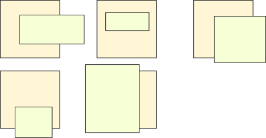
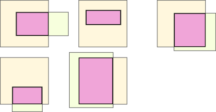

# Easy explanation with visual help (C++, Java, Python, JavaScript, Golang)

**Author:** scio
**Votes:** 3
**Link:** [https://leetcode.com/problems/rectangle-area/solutions/2463810/](https://leetcode.com/problems/rectangle-area/solutions/2463810/)

---

**Intuition**
If the rectangles do not overlap, then the answer is obvious: add the areas of both. If they do overlap, then we are adding the overlapping part twice. In that case, we could find out the relative configuration of both rectangles, break the common figure into smaller rectangles accordingly, and then add the smaller parts together. However, there are multiple configurations, and each one would have to be treated differently:
<br>

<br>
<br>
A better solution would be to add the two rectangles and simply substract the common part that was added twice:



 It is always a rectangle limited by the *rightmost left* line, the *higher bottom*, the *leftmost right* and the *lower top*.
<br>
**Solution:**
This can be solved in one line but it would be a very hacky solution that would paint a poor image in an interview ("the candidate shows little regard for readability / maintainability"). On the other hand, we could do the opposite:
<br>

**C++**
```
class Solution {
public:
    int computeArea(int ax1, int ay1, int ax2, int ay2, int bx1, int by1, int bx2, int by2) {
        int first  = area(ax1, ay1, ax2, ay2);
        int second = area(bx1, by1, bx2, by2);
        
        int leftOverlap  = max(ax1, bx1);
        int downOverlap  = max(ay1, by1);
        
        int rightOverlap = min(ax2, bx2);
        int upOverlap    = min(ay2, by2);

        int overlap = area(leftOverlap, downOverlap, rightOverlap, upOverlap);

        return first + second - overlap;
    }

private:
    // Returns 0 if right < left or up < down
    int area(int left, int down, int right, int up) {
        
        if (left > right || down > up) {
            return 0;
        }
        
        return (right - left) * (up - down);
            
    }
};
```
<br>

**Java**
```
class Solution {
    public int computeArea(int ax1, int ay1, int ax2, int ay2, int bx1, int by1, int bx2, int by2) {
        int first  = area(ax1, ay1, ax2, ay2);
        int second = area(bx1, by1, bx2, by2);
        
        int leftOverlap  = Math.max(ax1, bx1);
        int downOverlap  = Math.max(ay1, by1);
        
        int rightOverlap = Math.min(ax2, bx2);
        int upOverlap    = Math.min(ay2, by2);

        int overlap = area(leftOverlap, downOverlap, rightOverlap, upOverlap);

        return first + second - overlap;
    }
    
    
    // Returns 0 if right < left or up < down
    private int area(int left, int down, int right, int up) {
        
        if (left > right || down > up) {
            return 0;
        }
        
        return (right - left) * (up - down);
            
    }
}
```
<br>

**Python**
```
class Solution(object):
    def computeArea(self, ax1, ay1, ax2, ay2, bx1, by1, bx2, by2):
	
        first  = self.area(ax1, ay1, ax2, ay2)
        second = self.area(bx1, by1, bx2, by2)

        leftOverlap  = max(ax1, bx1)
        downOverlap  = max(ay1, by1)

        rightOverlap = min(ax2, bx2)
        upOverlap    = min(ay2, by2)

        overlap = self.area(leftOverlap, downOverlap, rightOverlap, upOverlap)

        return first + second - overlap
		
    # Returns 0 if right < left or up < down
    def area(self, left, down, right, up):
	
        if left > right or down > up:
            return 0
        
        return (right - left) * (up - down)
    
    
```
<br>

**JavaScript**
```
var computeArea = function(ax1, ay1, ax2, ay2, bx1, by1, bx2, by2) {
    let first  = area(ax1, ay1, ax2, ay2);
    let second = area(bx1, by1, bx2, by2);

    let leftOverlap  = Math.max(ax1, bx1);
    let downOverlap  = Math.max(ay1, by1);

    let rightOverlap = Math.min(ax2, bx2);
    let upOverlap    = Math.min(ay2, by2);

    let overlap = area(leftOverlap, downOverlap, rightOverlap, upOverlap);

    return first + second - overlap;
};

// Returns 0 if right < left or up < down
function area(left, down, right, up) {
        
    if (left > right || down > up) {
        return 0;
    }

    return (right - left) * (up - down);
    
}
```
<br>

**Golang**
```
func computeArea(ax1 int, ay1 int, ax2 int, ay2 int, bx1 int, by1 int, bx2 int, by2 int) int {
    
    first  := area(ax1, ay1, ax2, ay2)
    second := area(bx1, by1, bx2, by2)
    
    leftOverlap  := max(ax1, bx1)
    downOverlap  := max(ay1, by1)
    
    rightOverlap := min(ax2, bx2)
    upOverlap    := min(ay2, by2)
    
    overlap := area(leftOverlap, downOverlap, rightOverlap, upOverlap)
    
    return first + second - overlap
    
}

// Returns 0 if right < left or up < down
func area(left, down, right, up int) int {
    if left > right || down > up {
        return 0
    }
    return (right - left) * (up - down)
}

// math.Max accepts and returns floats and makes a mess
func max(a, b int) int {
    if a > b {
        return a
    }
    return b
}

func min(a, b int) int {
    if a < b {
        return a
    }
    return b
}
```