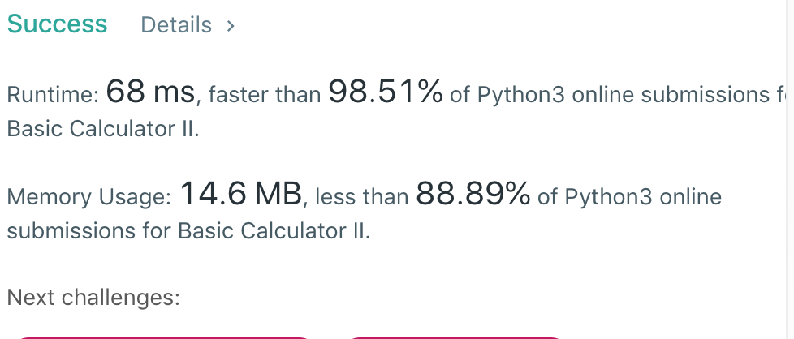

# python stack

**Author:** JefferyZZY
**Votes:** 82
**Link:** [https://leetcode.com/problems/basic-calculator-ii/solutions/443590/](https://leetcode.com/problems/basic-calculator-ii/solutions/443590/)

---



```
def calculate(self, s: str) -> int:
        num = 0
        res = 0
        pre_op = '+'
        s+='+'
        stack = []
        for c in s:
            if c.isdigit():
                num = num*10 + int(c)
            elif c == ' ':
                    pass
            else:
                if pre_op == '+':
                    stack.append(num)
                elif pre_op == '-':
                    stack.append(-num)
                elif pre_op == '*':
                    operant = stack.pop()
                    stack.append((operant*num))
                elif pre_op == '/':
                    operant = stack.pop()
                    stack.append(math.trunc(operant/num))
                num = 0
                pre_op = c
        return sum(stack)
```
