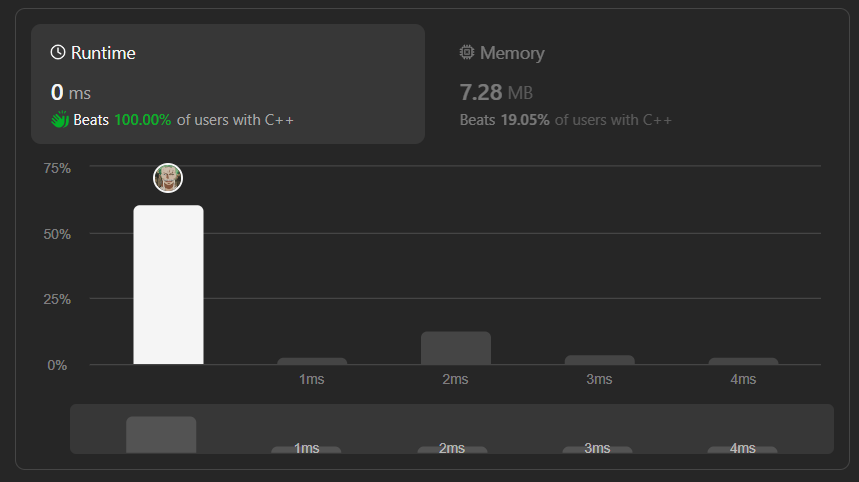

# ✅☑8 Approaches || [C++/Java/Python/JavaScript] || EXPLAINED🔥

**Author:** MarkSPhilip31
**Votes:** 313
**Link:** [https://leetcode.com/problems/power-of-two/solutions/4748857/](https://leetcode.com/problems/power-of-two/solutions/4748857/)

---

# DO GIVE IT A LIKE IF THAT WAS HELPFUL\uD83E\uDEE1\uD83D\uDC47


---



---

**Approach 1(Power function)** -  `O(1)`
**Approach 2(Dividing by 2)** -  `O(logn)`
**Approach 3(left shift)** - `O(logn)`
**Approach 4(Ceil and Floor)** -  `O(1)`
**Approach 5(And operator)** - `O(1)`
**Approach 6(Counting 1's)** - `O(logn)`
**Approach 7(Modulo with n)** -  `O(1)`
**Approach 8(Recursion)** - `O(logn)`

---

# Approaches
(Also explained in the code)

#### ***Approach 1(Using Power Function)***

1. Generating all possible numbers in the range.
1. Using pow() function for calculating power of 2.
1. If n is equal to `ans`, return true else will return false after the loop end.


# Complexity
- Time complexity:
   $$O(1)$$
    

- Space complexity:
   $$O(1)$$
    


# Code
```C++ []
class Solution {
public:
    bool isPowerOfTwo(int n) {

        
        for(int i =0;i<31;i++){
        int ans = pow(2,i);
            
            if(ans == n)return true;

        }
        return false;
    }
};
```
```Java []
public class Solution {
    public boolean isPowerOfTwo(int n) {
        for (int i = 0; i < 31; i++) {
            int ans = (int) Math.pow(2, i);
            if (ans == n) {
                return true;
            }
        }
        return false;
    }
}
```
```python3 []
class Solution:
    def isPowerOfTwo(self, n: int) -> bool:
        for i in range(31):
            ans = 2 ** i
            if ans == n:
                return True
        return False
```
```javascript []
class Solution {
    isPowerOfTwo(n) {
        for (let i = 0; i < 31; i++) {
            let ans = Math.pow(2, i);
            if (ans === n) {
                return true;
            }
        }
        return false;
    }
}
```
---

#### ***Approach 2(Dividing n by 2)***
1. If n is divisible by 2 , every time we will encounter 1 at the end.
1. And at any point if n isn't divisible by 2 we will return false.

# Complexity
- Time complexity:
   $$O(logn)$$
    

- Space complexity:
   $$O(1)$$
    


# Code
```C++ []
class Solution {
public:
    bool isPowerOfTwo(int n) {
        if(n==0)return false;
        
        while(n>0){
            if(n==1)return true;
            if(n %2 !=0)break;
            n /=2;
        }
        return false;
    }
};
```
```Java []
public class Solution {
    public boolean isPowerOfTwo(int n) {
        if (n == 0) return false;
        
        while (n > 0) {
            if (n == 1) return true;
            if (n % 2 != 0) break;
            n /= 2;
        }
        return false;
    }
}
```
```python3 []
class Solution:
    def isPowerOfTwo(self, n: int) -> bool:
        if n == 0:
            return False
        
        while n > 0:
            if n == 1:
                return True
            if n % 2 != 0:
                break
            n //= 2
        return False
```
```javascript []
class Solution {
    isPowerOfTwo(n) {
        if (n === 0) return false;
        
        while (n > 0) {
            if (n === 1) return true;
            if (n % 2 !== 0) break;
            n /= 2;
        }
        return false;
    }
}
```
---

#### ***Approach 3(Left Shift)***
1. If n is 0 or less will never enter the loop and will return false.
1. taking x = 1.
2. example : `let n = 8`
    which be represented as 1000
    now we will left left shift x until it get equals to n or exceed it.

    1st left shift: `x<<1 => 10`
    2nd left shift: `x<<1 => 100`
    3rd left shift: `x<<1 => 1000`

1. now n is equal to x (`1000 = 1000`) which implies it is divisible by 2 because numbers divisible by 2 will only have a single 1 in their binary representation.


# Complexity
- Time complexity:
   $$O(logn)$$
    

- Space complexity:
   $$O(1)$$
    


# Code
```C++ []
class Solution {
public:
    bool isPowerOfTwo(int n) {
        int x =1;
        while(x<=n){
            if(x==n)return true;
            if(x > INT_MAX /2)break;
            x = x<<1;
        }
        return false;
    }
};
```
```Java []
public class Solution {
    public boolean isPowerOfTwo(int n) {
        int x = 1;
        while (x <= n) {
            if (x == n) return true;
            if (x > Integer.MAX_VALUE / 2) break;
            x = x << 1;
        }
        return false;
    }
}
```
```python3 []
class Solution:
    def isPowerOfTwo(self, n: int) -> bool:
        x = 1
        while x <= n:
            if x == n:
                return True
            if x > 2 ** 30:
                break
            x = x << 1
        return False
```
```javascript []
class Solution {
    isPowerOfTwo(n) {
        let x = 1;
        while (x <= n) {
            if (x === n) return true;
            if (x > Math.pow(2, 30)) break;
            x = x << 1;
        }
        return false;
    }
}
```
---
#### ***Approach 4(Ceil and floor)***

1. **Ceil() = rounds up to the nearest integer.
floot() = rounds down to the nearest integer.**

1. example 1 : 
`ceil(log2(5)) = 2` 
`floor(log2(5)) = 3`

1. example 2 : 
`ceil(log2(8)) = 3` 
`floor(log2(8)) = 3`

1. Incase of number multiple of 2 ceil and floor will always be equal.

# Complexity
- Time complexity:
   $$O(1)$$
    

- Space complexity:
   $$O(1)$$
    
# Code
```C++ []
class Solution {
public:
    bool isPowerOfTwo(int n) {
        if(n==0)return false;

        return floor(log2(n)) == ceil(log2(n)) ? true : false;
    }
};
```
```Java []
public class Solution {
    public boolean isPowerOfTwo(int n) {
        if (n == 0) return false;
        return Math.floor(Math.log(n) / Math.log(2)) == Math.ceil(Math.log(n) / Math.log(2));
    }
}
```
```python3 []
import math
class Solution:
    def isPowerOfTwo(self, n: int) -> bool:
        if n == 0:
            return False
        return math.floor(math.log2(n)) == math.ceil(math.log2(n))
```
```javascript []
class Solution {
    isPowerOfTwo(n) {
        if (n === 0) return false;
        return Math.floor(Math.log2(n)) === Math.ceil(Math.log2(n));
    }
}
```
---
#### ***Approach 5(And Operator)***

1. And operation between multiple of 2 and next lower number will always give 0 and other wise it will never be 0.
1. example 1:  `8 & 7`
 `1000(8) & 0111(7) => 0000(0)`

1. example 1: = `10 & 9`
 `1010(10) & 1001(9) => 1000(8) `

# Complexity
- Time complexity:
   $$O(1)$$
    

- Space complexity:
   $$O(1)$$
    


# Code
```C++ []
class Solution {
public:
    bool isPowerOfTwo(int n) {
        
        return  (n>0 && (n & (n-1))==0) ? true:false;
    }
};
```
```Java []
public class Solution {
    public boolean isPowerOfTwo(int n) {
        return (n > 0) && ((n & (n - 1)) == 0);
    }
}
```
```python3 []
class Solution:
    def isPowerOfTwo(self, n: int) -> bool:
        return n > 0 and (n & (n - 1)) == 0
```
```javascript []
class Solution {
    isPowerOfTwo(n) {
        return n > 0 && (n & (n - 1)) === 0;
    }
}
```
---
#### ***Approach 6(Counting 1's)***

1. As we know multuple of 2 will only have a single 1 in their binary representation.
1. So counting it with the help of built-in function.

# Complexity
- Time complexity:
   $$O(logn)$$
    

- Space complexity:
   $$O(1)$$
    
# Code
```C++ []
class Solution {
public:
    bool isPowerOfTwo(int n) {
        if(n<=0)return false;
        int cnt = __builtin_popcount(n);
        return  (cnt==1) ? true:false;
    }
};
```
```Java []
public class Solution {
    public boolean isPowerOfTwo(int n) {
        if (n <= 0) return false;
        int cnt = Integer.bitCount(n);
        return cnt == 1;
    }
}
```
```python3 []
class Solution:
    def isPowerOfTwo(self, n: int) -> bool:
        if n <= 0:
            return False
        cnt = bin(n).count('1')
        return cnt == 1
```
```javascript []
class Solution {
    isPowerOfTwo(n) {
        if (n <= 0) return false;
        const cnt = (n).toString(2).split('1').length - 1;
        return cnt === 1;
    }
}
```
---
#### ***Approach 7(Modulo with n)***

1. multiple of 2 will always divide 2^30.
1. example :
`16 % 8 = 0`
`36 % 2 = 0`


# Complexity
- Time complexity:
   $$O(1)$$
    

- Space complexity:
   $$O(1)$$
    


# Code
```C++ []
class Solution {
public:
    bool isPowerOfTwo(int n) {
        if(n<=0)return false;
        return ((1<<30) % n == 0)? true:false;
    }
};
```
```Java []
public class Solution {
    public boolean isPowerOfTwo(int n) {
        if (n <= 0) return false;
        return (1 << 30) % n == 0;
    }
}
```
```python3 []
class Solution:
    def isPowerOfTwo(self, n: int) -> bool:
        if n <= 0:
            return False
        return (1 << 30) % n == 0
```
```javascript []
class Solution {
    isPowerOfTwo(n) {
        if (n <= 0) return false;
        return (1 << 30) % n === 0;
    }
}
```
---
#### ***Approach 8(Recursion)***
1. Recursively divide n by 2, if we reach 1 then it means it is multiple of 2  and will return true else it will be false.

# Complexity
- Time complexity:
   $$O(logn)$$
    

- Space complexity:
   $$O(logn)$$
    


# Code
```C++ []
class Solution {
public:
    bool isPowerOfTwo(int n) {
        if(n<=0)return false;
        if(n==1)return true;
        return (n%2 ==0 && isPowerOfTwo(n/2));
    }
};
```
```Java []
public class Solution {
    public boolean isPowerOfTwo(int n) {
        if (n <= 0) return false;
        if (n == 1) return true;
        return (n % 2 == 0) && isPowerOfTwo(n / 2);
    }
}
```
```python3 []
class Solution:
    def isPowerOfTwo(self, n: int) -> bool:
        if n <= 0:
            return False
        if n == 1:
            return True
        return (n % 2 == 0) and self.isPowerOfTwo(n // 2)
```
```javascript []
class Solution {
    isPowerOfTwo(n) {
        if (n <= 0) return false;
        if (n === 1) return true;
        return (n % 2 === 0) && this.isPowerOfTwo(n / 2);
    }
}
```
---


# DO GIVE IT A LIKE IF THAT WAS HELPFUL\uD83E\uDEE1\uD83D\uDC47

---
---


---