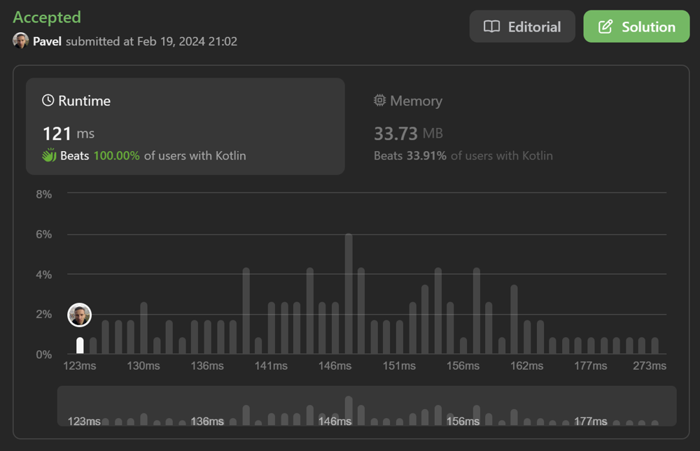

# New way to check if n is power of two: Math O(1)

**Author:** naXa777
**Votes:** 5
**Link:** [https://leetcode.com/problems/power-of-two/solutions/4751774/](https://leetcode.com/problems/power-of-two/solutions/4751774/)

---

# Intuition

thanks NeetCode for the idea  (start watching at 8:51)
https://youtu.be/H2bjttEV4Vc?t=531

Int values range from $$2^{-31}$$ to $$2^{31}-1$$, which makes $$2^{30}$$ the largest possible power of two in this problem. It should be dividable by other powers of two without a remainder.

Note: this solution exploits limitations of a signed 32 bit integer. Should be adjusted if you want to use it with other input types (UInt, Long, ...).

# Approach

Do the math.

# Complexity

- Time complexity: $$O(1)$$
- Space complexity: $$O(1)$$

# Code
```kt
const val TWO_POW_30 = 1_073_741_824

class Solution {
    fun isPowerOfTwo(n: Int): Boolean = n > 0 && TWO_POW_30 % n == 0
}
```

# Screenshot



