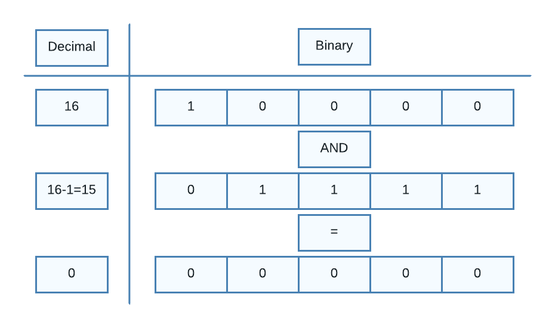

# Bit Minuplation: Beats 99.9% submissions

**Author:** sarvesh_mankar
**Votes:** 13
**Link:** [https://leetcode.com/problems/power-of-two/solutions/3858949/](https://leetcode.com/problems/power-of-two/solutions/3858949/)

---

# Intuition
<!-- Describe your first thoughts on how to solve this problem. -->
The first thought is just by keep dividing the number by 2 until we cannot and check if the number is 1. If the number at the last is 1 return True otherwise false. This takes O(logn) time complexity.

# Approach
<!-- Describe your approach to solving the problem. -->
We can minimize the solution by using bitwise operators.
Let's assume that n is power of two, it will have 1 only at the most significant bit and all others are 0. The number n-1 will have 1 digit less than n.
So if we perform AND operation of n and n-1 we will get answer as 0 as the only digit in n which is 1 will ANDed with 0.




# Complexity
- Time complexity: O(1)

- Space complexity: O(1)

# Code
```python []
class Solution:
    def isPowerOfTwo(self, n: int) -> bool:
        return n > 0 and n & (n - 1) == 0
```

```Java []
class Solution {
    public boolean isPowerOfTwo(int n) {
        return n > 0 && (n & (n - 1)) == 0;
    }
}
```

```C++ []
class Solution {
    public:
    bool isPowerOfTwo(int n) {
        return n > 0 && (n & (n - 1)) == 0;
    }
};
```

```PHP []
class Solution {

    /**
     * @param Integer $n
     * @return Boolean
     */
    function isPowerOfTwo($n) {
        return $n > 0 && ($n & ($n - 1)) === 0;
    }
}
```

