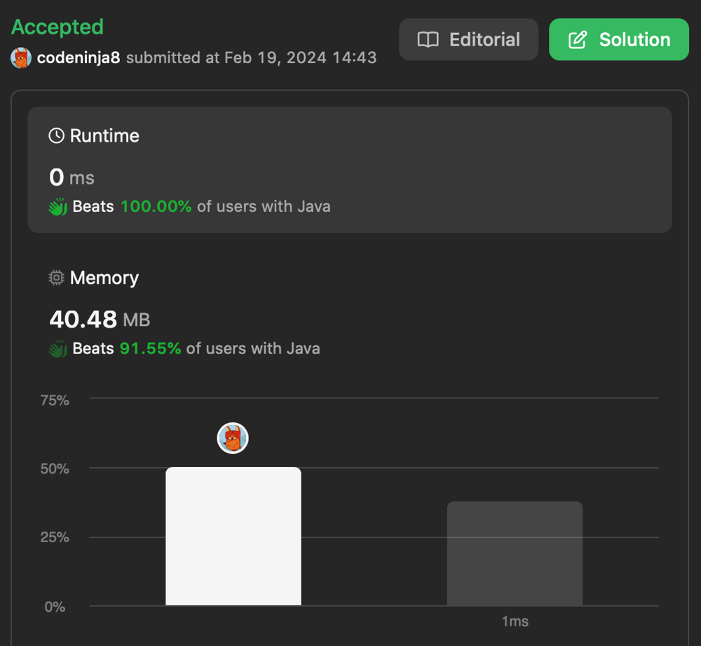

# ✅bit magic explained Java || C || JavaScript || Python || Ruby || Go || PHP || Racket👍

**Author:** codeninja8
**Votes:** 3
**Link:** [https://leetcode.com/problems/power-of-two/solutions/4751553/](https://leetcode.com/problems/power-of-two/solutions/4751553/)

---

$$2^n$$ is always 100000... in binary form
$$2^n-1$$ is 11111111...

so $$2^n \\wedge 2^n-1 = 0$$ where $$\\wedge$$ stands for bitwise *and*

for example
$$4 = 100$$
$$4-1 = 11$$
therefore $$100 \\wedge 011 = 0$$


# Code
``` java []
class Solution {
    public boolean isPowerOfTwo(int n) {
        return n > 0 && (n & (n - 1)) == 0;        
    }
}
```
``` c []
bool isPowerOfTwo(int n) {
    return n > 0 && (n & (n - 1)) == 0; 
}
```
``` javascript []
var isPowerOfTwo = function(n) {
    return n > 0 && (n & (n - 1)) == 0; 
};
```
``` golang []
func isPowerOfTwo(n int) bool {
    return n > 0 && (n & (n - 1)) == 0; 
}
```
``` python3 []
class Solution:
    def isPowerOfTwo(self, n: int) -> bool:
        return n > 0 and (n & (n - 1)) == 0; 
        
```
``` ruby []
def is_power_of_two(n)
    n > 0 and (n & (n - 1)) == 0; 
end
```
``` php []
class Solution {
    function isPowerOfTwo($n) {
        return $n > 0 && ($n & ($n - 1)) == 0; 
    }
}
```
``` racket []
(define (is-power-of-two n)
    (and (> n 0) (= 0 (bitwise-and n (sub1 n)))))
```

like \uD83D\uDC4D


