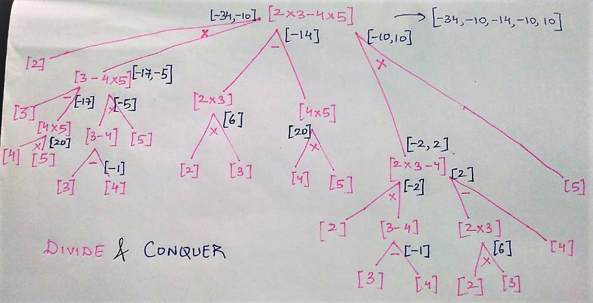

# Divide and Conquer solution with image explanation/illustration in C++

**Author:** prayag_vaibhav
**Votes:** 21
**Link:** [https://leetcode.com/problems/different-ways-to-add-parentheses/solutions/2369098/](https://leetcode.com/problems/different-ways-to-add-parentheses/solutions/2369098/)

---

For explanation to a bunch of selected leetcode problems - https://github.com/vaibhavpandeyprayag/cp-dsa (work in progress)

# 241. Different Ways To Add Parentheses (medium)

_Given a string expression of numbers and operators, return all possible results from computing all the different possible ways to group numbers and operators. You may return the answer in any order.
The test cases are generated such that the output values fit in a 32-bit integer and the number of different results does not exceed 10<sup>4</sup>._

### **Constraints:**

_1 <= expression.length <= 20  
Expression consists of digits and the operator '+', '-', and '\\*'.  
All the integer values in the input expression are in the range [0, 99]._

### **Testcases:**

Example 1:

- Input: expression = "2-1-1"  
  Output: [0,2]  
  Explanation:  
  ((2-1)-1) = 0  
  (2-(1-1)) = 2

Example 2:

- Input: expression = "2\\*3-4\\*5"  
  Output: [-34,-14,-10,-10,10]  
  Explanation:  
  (2*(3-(4\\*5))) = -34  
  ((2*3)-(4\\*5)) = -14  
  ((2\\*(3-4))\\*5) = -10  
  (2\\*((3-4)\\*5)) = -10  
  (((2\\*3)-4)\\*5) = 10

## Approach:

According to _BODMAS_, parentheses (or brackets) mean that some operations have higher priority than others. e.g. **_(a \\* (b - c))_** implies that subtraction needs to be done first and then the difference is multiplied with **_a_**. Whereas **_((a \\* b) - c)_** implies that the multiplication will take place first and then **_c_** will be subtracted from the product. Different occurrences of parentheses can set different priorities.

An important observation here is that parentheses can change priorities only when used around operators. If we have a simple expression like **(2 - 4 \\* 1 + 8)**. Iterating from the beginning ->

**(2 - (4 \\* 1 + 8))** is now serated into 2 parts around minus sign. We can recursively iterate over both the separated part two set parentheses.

**(2 - ((4 \\* 1) + 8))** gives ans = **-10**  
returning to previous recursion call and setting parentheses around another operator  
**(2 - (4 \\* (1 + 8)))** gives ans = **-34**  
returning to previous recursion call and doing the same thing  
**((2 - 4) \\* (1 + 8))** ...  
**((2 - 4 \\* 1) + 8)** ...

So we iterate the expression from left side  
whenever an operator is encountered, the expression is recusively divided around the operator into 2 sub-expressions (sub-expression **left** and sub-expression **right**). This recursive division occurs until **left** and **right** both have only single number (i.e. no operator). All answers from a particular sub-expressions are returned in a list called **result**. The **result** of left sub-expression is returned in **left** and so is the case with **right**. Then all the answers from **left** and **right** are iterated and are operated upon.

The approach is known as **_"Divide and Conquer"_**. The problem is divided into subproblems, and those subproblems are further divided into sub-problems. The solution to subproblems helps to find solution for parent problem. If some subproblems are repeated, we can memoize solution to every subproblem and use it whenever the same subproblem reoccurs. This method is called **_Dynamic Programming_**.




## Code:

```cpp
class Solution {
public:
    int operate(int x, int y, char op) {
        if(op == '+') return x + y;
        if(op == '-') return x - y;
        if(op == '*') return x * y;
        return 0;
    }

    vector<int> diffWaysToCompute(string expression) {
        vector<int> results;
        bool isEntirelyNumber = true;

        for (int i = 0; i < expression.length(); i++) {
            if (!isdigit(expression[i])) {
                isEntirelyNumber = false;

                vector<int> left = diffWaysToCompute(expression.substr(0, i));
                vector<int> right = diffWaysToCompute(expression.substr(i + 1, expression.length()));

                for (int x: left) {
                    for (int y: right) results.push_back(operate(x, y, expression[i]));
                }
            }
        }

        if (isEntirelyNumber) results.push_back(stoi(expression));
        return results;
    }
};
```

##### ***Kindly upvote the post if you found it useful. Thanks!***