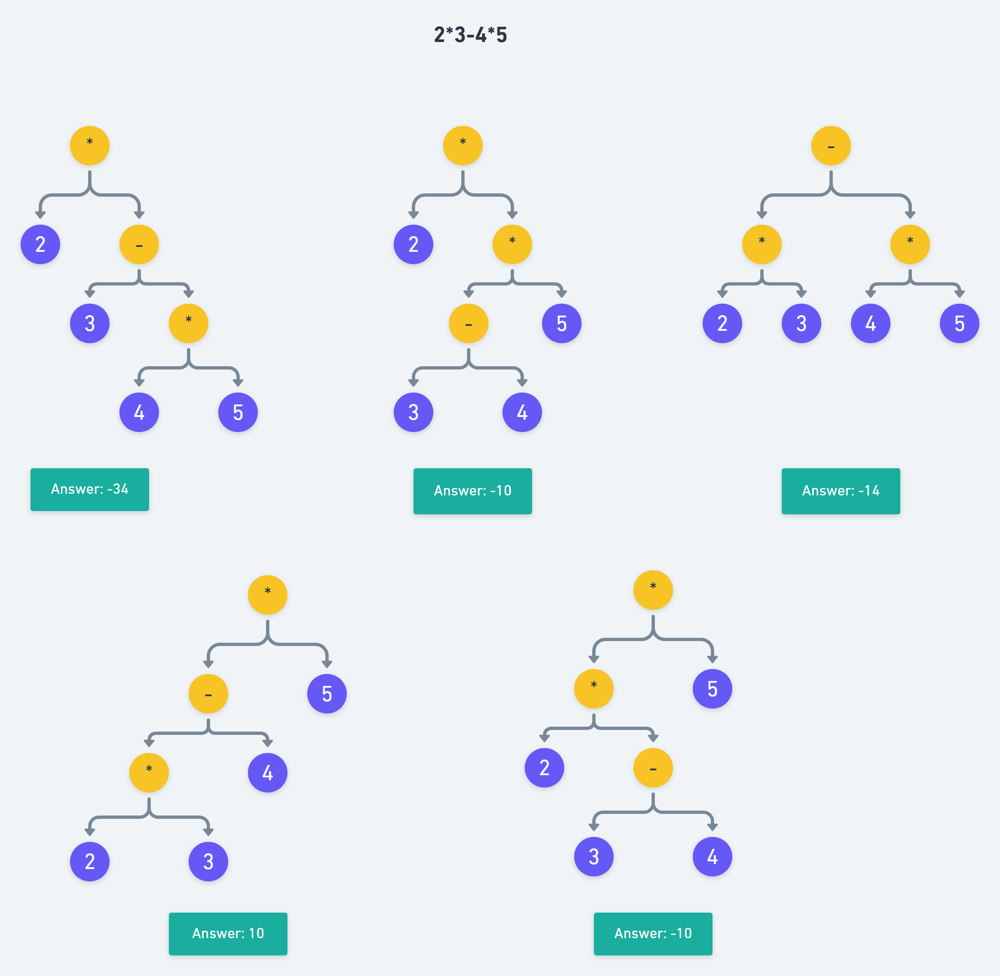

# C++ Recursive Solution | Using Expression Trees

**Author:** vishal2720
**Votes:** 498
**Link:** [https://leetcode.com/problems/different-ways-to-add-parentheses/solutions/1294189/](https://leetcode.com/problems/different-ways-to-add-parentheses/solutions/1294189/)

---

* The problem becomes easier when we think about these expressions as expression trees.
* We can traverse over the experssion and whenever we encounter an operator, we recursively divide the expression into left and right part and evaluate them seperately until we reach a situation where our expression is purely a number and in this case we can simply return that number.
* Since there can be multiple ways to evaluate an expression (depending on which operator you take first) we will get a list of reults from left and the right part.
* Now that we have all the possible results from the left and the right part, we can use them to find out all the possible results for the current operator.


The following image shows all the possible expression trees for the expression `"2*3-4*5"`



**Time Complexity:** O(2^N)


C++ Implementation:
```
class Solution {
public:
    // function to get the result of the operation
    int perform(int x, int y, char op) {
        if(op == '+') return x + y;
        if(op == '-') return x - y;
        if(op == '*') return x * y;
        return 0;
    }
    
    vector<int> diffWaysToCompute(string exp) {
        
        vector<int> results;
        bool isNumber = 1;
    
        for(int i = 0; i < exp.length(); i++) {
            // check if current character is an operator
            if(!isdigit(exp[i])) {
                
                // if current character is not a digit then
                // exp is not purely a number
                isNumber = 0;
                
                // list of first operands
                vector<int> left = diffWaysToCompute(exp.substr(0, i));
                
                // list of second operands
                vector<int> right = diffWaysToCompute(exp.substr(i + 1));
                
                // performing operations
                for(int x : left) {
                    for(int y : right) {
                        int val = perform(x, y, exp[i]);
                        results.push_back(val);
                    }
                }
                
            }
        }
        
        if(isNumber == 1) results.push_back(stoi(exp));
        return results;
    }
};


```
