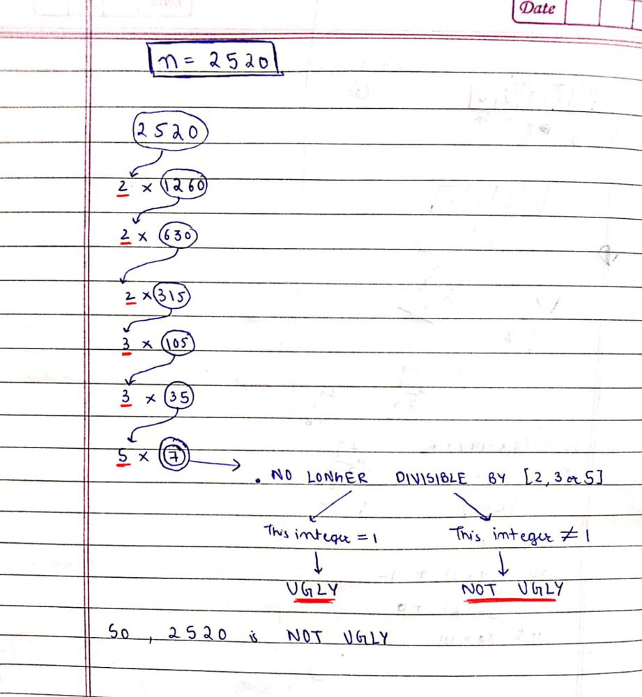

# C++ || Easy to understand || Explained

**Author:** MohakHarjani
**Votes:** 104
**Link:** [https://leetcode.com/problems/ugly-number/solutions/2825523/](https://leetcode.com/problems/ugly-number/solutions/2825523/)

---



```
class Solution {
public:
    bool isUgly(int n) 
    {
        if (n <= 0) return false;
        while(n > 1)
        {
            if (n % 2 == 0) n = n / 2;
            else if (n % 3 == 0) n = n / 3;
            else if (n % 5 == 0) n = n / 5;
            else break;
        }
        return (n == 1);
    }
};
```