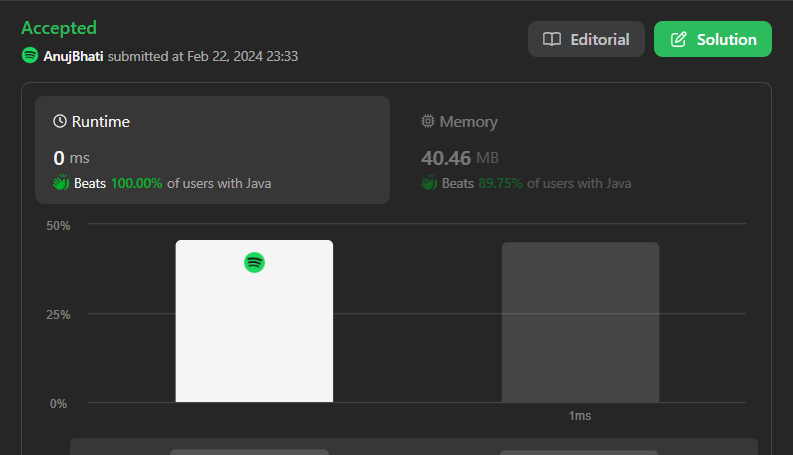
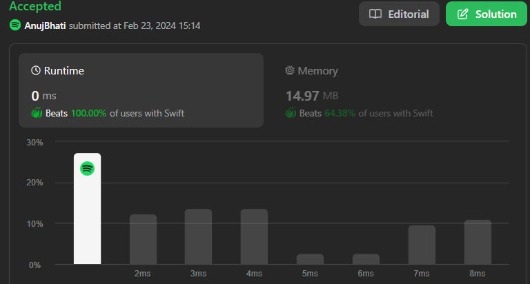

# ☠💀💯Faster✅💯Lesser🧠🎯C++✅Python3✅Java✅C✅Python✅C#✅PHP✅Swift✅JavaScript✅💥🔥💫🔥 Beats 💯

**Author:** Edwards310
**Votes:** 4
**Link:** [https://leetcode.com/problems/ugly-number/solutions/4769077/](https://leetcode.com/problems/ugly-number/solutions/4769077/)

---

# Intuition



***Also Checkout my Solution for Q - 264 Ugly Number - || .***
https://leetcode.com/problems/ugly-number-ii/solutions/4944674/my-solution-is-faster-than-the-fastest-c-python3-c-java-c-python-beats
```javascript []
/**
 * @param {number} n
 * @return {boolean}
 */
var isUgly = function (n) {
    if (n == 0)
        return false;
    while (n % 2 == 0)
        n /= 2;
    while (n % 3 == 0)
        n /= 3;
    while (n % 5 == 0)
        n /= 5;
    return n == 1;
};
```
```python []
class Solution(object):
    def isUgly(self, n):
        """
        :type n: int
        :rtype: bool
        """
        if n == 0:
            return False
        while n % 2 == 0:
            n //= 2
        while n % 3 == 0:
            n //= 3
        while n % 5 == 0:
            n //= 5
        return n == 1
```
```C# []
public class Solution {
    public bool IsUgly(int n) {
        if (n == 0)
            return false;
        while (n % 2 == 0)
            n /= 2;
        while (n % 3 == 0)
            n /= 3;
        while (n % 5 == 0)
            n /= 5;
        return n == 1;
    }
}
```
```Typescript []
function isUgly(n: number): boolean {
    if (n == 0)
        return false;
    while (n % 2 == 0)
        n /= 2;
    while (n % 3 == 0)
        n /= 3;
    while (n % 5 == 0)
        n /= 5;
    return n == 1;
};
```
```python3 []
class Solution:
    def isUgly(self, n: int) -> bool:
        if n == 0:
            return False
        while n % 2 == 0:
            n //= 2
        while n % 3 == 0:
            n //= 3
        while n % 5 == 0:
            n //= 5
        return n == 1
```
```C++ []
class Solution {
public:
    bool isUgly(int n) {
        if (n == 0)
            return false;
        while (n % 2 == 0)
            n /= 2;
        while (n % 3 == 0)
            n /= 3;
        while (n % 5 == 0)
            n /= 5;
        return n == 1;
    }
};
```
```Swift []
class Solution {
    func isUgly(_ n: Int) -> Bool {
        if n == 0 { return false }
        var n = n
        while n > 1 {
            if n % 2 == 0 { n /= 2 }
            else if n % 3 == 0 { n /= 3 }
            else if n % 5 == 0 { n /= 5 }
            else { return false }
        }
        return n == 1
    }
}
```
``` PHP []
class Solution {

    /**
     * @param Integer $n
     * @return Boolean
     */
    function isUgly($n) {
        if ($n == 0)
            return false;
        while ($n % 2 == 0)
            $n /= 2;
        while ($n % 3 == 0)
            $n /= 3;
        while ($n % 5 == 0)
            $n /= 5;
        return $n == 1;
    }
}
```
``` Java []
class Solution {
    public boolean isUgly(int n) {
        if (n == 0)
            return false;
        while (n % 2 == 0)
            n /= 2;
        while (n % 3 == 0)
            n /= 3;
        while (n % 5 == 0)
            n /= 5;
        return n == 1;
    }
}
```
``` C []
bool isUgly(int n) {
    if (n == 0)
        return false;
    while (n % 2 == 0)
        n /= 2;
    while (n % 3 == 0)
        n /= 3;
    while (n % 5 == 0)
        n /= 5;
    return n == 1;
}
```
<!-- Describe your first thoughts on how to solve this problem. -->

# Approach
<!-- Describe your approach to solving the problem. -->

# Complexity
- Time complexity:
<!-- Add your time complexity here, e.g. $$O(n)$$ -->
    O(l)
- Space complexity:
<!-- Add your space complexity here, e.g. $$O(n)$$ -->
    O(1)
# Code
```
class Solution {
    public boolean isUgly(int n) {
        if (n == 0)
            return false;
        while (n % 2 == 0)
            n /= 2;
        while (n % 3 == 0)
            n /= 3;
        while (n % 5 == 0)
            n /= 5;
        return n == 1;
    }
}
```