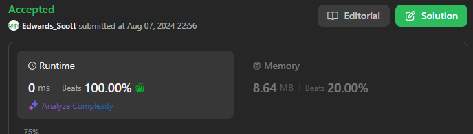
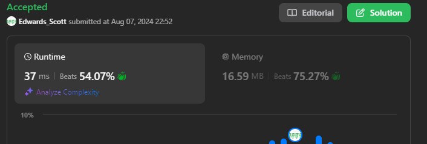
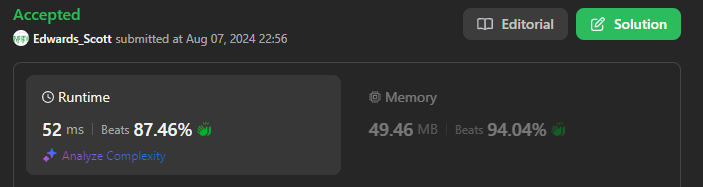
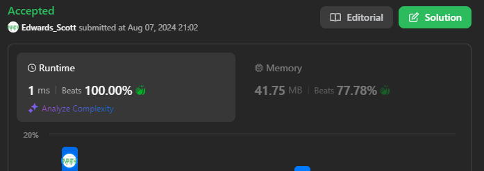

# 💢☠💫Easiest👾Faster✅💯 Lesser🧠 🎯 C++✅Python3🐍✅Java✅C✅Python🐍✅C#✅💥🔥💫Explained☠💥🔥 Beats 💯

**Author:** Edwards310
**Votes:** 8
**Link:** [https://leetcode.com/problems/integer-to-english-words/solutions/5603525/](https://leetcode.com/problems/integer-to-english-words/solutions/5603525/)

---

# Intuition





```javascript []
const lessThan20 = [
    "", "One", "Two", "Three", "Four", "Five", "Six", "Seven", "Eight", "Nine", "Ten",
    "Eleven", "Twelve", "Thirteen", "Fourteen", "Fifteen", "Sixteen", "Seventeen",
    "Eighteen", "Nineteen"
];

const tens = [
    "", "", "Twenty", "Thirty", "Forty", "Fifty", "Sixty", "Seventy", "Eighty", "Ninety"
];

const thousands = [
    "", "Thousand", "Million", "Billion"
];

/**
 * @param {number} num
 * @return {string}
 */
var numberToWords = function (num) {
    if (num === 0) return "Zero";

    let i = 0;
    let words = '';

    while (num > 0) {
        if (num % 1000 !== 0) {
            words = helper(num % 1000) + thousands[i] + ' ' + words;
        }
        num = Math.floor(num / 1000);
        i++;
    }

    return words.trim();
}

function helper(num) {
    if (num === 0) return '';
    else if (num < 20) return lessThan20[num] + ' ';
    else if (num < 100) return tens[Math.floor(num / 10)] + ' ' + helper(num % 10);
    else return lessThan20[Math.floor(num / 100)] + ' Hundred ' + helper(num % 100);
}
```
```Python3 []
class Solution:
    def numberToWords(self, num: int) -> str:
        def number_to_words_helper(num):
            digit_string = ["Zero", "One", "Two",   "Three", "Four", "Five", "Six", "Seven", "Eight", "Nine"]
            teens_string = ["Ten", "Eleven",  "Twelve",  "Thirteen", "Fourteen", "Fifteen", "Sixteen", "Seventeen", "Eighteen", "Nineteen"]
            ty_string = ["", "", "Twenty",  "Thirty", "Forty", "Fifty", "Sixty", "Seventy", "Eighty", "Ninety"]
            res = ""
            if num > 99:
                res += digit_string[num // 100] + " Hundred "
            num %= 100
            if num < 20 and num > 9:
                res += teens_string[num - 10] + " "
            else:
                if num >= 20:
                    res += ty_string[num // 10] + " "
                num %= 10
                if num > 0:
                    res += digit_string[num] + " "
        

            return res

        if num == 0:
            return "Zero"
        big_string = ["Thousand", "Million", "Billion"]
        result = number_to_words_helper(num % 1000)
        num //= 1000
        for i in range(3):
            if num > 0 and num % 1000 > 0:
                result = number_to_words_helper(num % 1000) + big_string[i] + " " + result
            num //= 1000
        
        length = len(result)
        return result if length == 0 else result[: length - 1]
```
```C++ []
class Solution {
public:
    string numberToWords(int num) {
        if (num == 0)
            return "Zero";

        string bigString[] = {"Thousand", "Million", "Billion"};
        string result = numberToWordsHelper(num % 1000);
        num /= 1000;

        for (int i = 0; i < 3; ++i) {
            if (num > 0 && num % 1000 > 0) {
                result = numberToWordsHelper(num % 1000) + bigString[i] + " " +
                         result;
            }
            num /= 1000;
        }

        return result.empty()
                   ? result
                   : result.substr(0, result.size() - 1); // Trim trailing space
    }

    string numberToWordsHelper(int num) {
        string digitString[] = {"Zero", "One", "Two",   "Three", "Four",
                                "Five", "Six", "Seven", "Eight", "Nine"};
        string teenString[] = {"Ten",      "Eleven",  "Twelve",  "Thirteen",
                               "Fourteen", "Fifteen", "Sixteen", "Seventeen",
                               "Eighteen", "Nineteen"};
        string tenString[] = {"",      "",      "Twenty",  "Thirty", "Forty",
                              "Fifty", "Sixty", "Seventy", "Eighty", "Ninety"};

        string result = "";
        if (num > 99) {
            result += digitString[num / 100] + " Hundred ";
        }
        num %= 100;
        if (num < 20 && num > 9) {
            result += teenString[num - 10] + " ";
        } else {
            if (num >= 20) {
                result += tenString[num / 10] + " ";
            }
            num %= 10;
            if (num > 0) {
                result += digitString[num] + " ";
            }
        }

        return result;
    }
};
```
```Java []
class Solution {
    private final String[] belowTwenty = { "", "One", "Two", "Three", "Four", "Five", "Six", "Seven", "Eight", "Nine",
            "Ten", "Eleven", "Twelve", "Thirteen", "Fourteen", "Fifteen", "Sixteen", "Seventeen", "Eighteen",
            "Nineteen" };
    private final String[] tens = { "", "", "Twenty", "Thirty", "Forty", "Fifty", "Sixty", "Seventy", "Eighty",
            "Ninety" };

    public String numberToWords(int num) {
        if (num == 0)
            return "Zero";
        return helper(num);
    }

    private String helper(int num) {
        StringBuilder result = new StringBuilder();
        if (num < 20) {
            result.append(belowTwenty[num]);
        } else if (num < 100) {
            result.append(tens[num / 10]).append(" ").append(belowTwenty[num % 10]);
        } else if (num < 1000) {
            result.append(helper(num / 100)).append(" Hundred ").append(helper(num % 100));
        } else if (num < 1000000) {
            result.append(helper(num / 1000)).append(" Thousand ").append(helper(num % 1000));
        } else if (num < 1000000000) {
            result.append(helper(num / 1000000)).append(" Million ").append(helper(num % 1000000));
        } else {
            result.append(helper(num / 1000000000)).append(" Billion ").append(helper(num % 1000000000));
        }
        return result.toString().trim();
    }
}
```
```C []
const char* simple[] = {"",     "One", "Two",   "Three", "Four",
                        "Five", "Six", "Seven", "Eight", "Nine"};
const char* secondary[] = {"",      "",      "Twenty",  "Thirty", "Forty",
                           "Fifty", "Sixty", "Seventy", "Eighty", "Ninety"};
const char* teens[] = {"Ten",      "Eleven",  "Twelve",  "Thirteen",
                       "Fourteen", "Fifteen", "Sixteen", "Seventeen",
                       "Eighteen", "Nineteen"};

void three(int num, char* result) {
    bool first = true;

    if (num >= 100) {
        if (!first) {
            strcat(result, " ");
        }
        strcat(result, simple[num / 100]);
        strcat(result, " Hundred");
        num %= 100;
        first = false;
    }
    if (num >= 20) {
        if (!first) {
            strcat(result, " ");
        }
        strcat(result, secondary[num / 10]);
        num %= 10;
        first = false;
    } else if (num >= 10) {
        if (!first) {
            strcat(result, " ");
        }
        strcat(result, teens[num - 10]);
        num = 0;
        first = false;
    }

    if (num > 0) {
        if (!first) {
            strcat(result, " ");
        }
        strcat(result, simple[num]);
        num %= 20;
        first = false;
    }
}

char* numberToWords(int num) {
    char* result = malloc(1000 * sizeof(char));
    bool first = true;

    *result = '\\0';

    if (num >= 1000000000) {
        if (!first) {
            strcat(result, " ");
        }
        three(num / 1000000000, result);
        strcat(result, " Billion");
        num %= 1000000000;
        first = false;
    }
    if (num >= 1000000) {
        if (!first) {
            strcat(result, " ");
        }
        three(num / 1000000, result);
        strcat(result, " Million");
        num %= 1000000;
        first = false;
    }
    if (num >= 1000) {
        if (!first) {
            strcat(result, " ");
        }
        three(num / 1000, result);
        strcat(result, " Thousand");
        num %= 1000;
        first = false;
    }
    if (num > 0) {
        if (!first) {
            strcat(result, " ");
        }
        three(num, result);
        num = 0;
        first = false;
    }

    if (first) {
        strcat(result, "Zero");
    }

    return result;
}
```
```Python []
class Solution(object):
    def numberToWords(self, num):
        """
        :type num: int
        :rtype: str
        """
        def number_to_words_helper(num):
            digit_string = ["Zero", "One", "Two",   "Three", "Four", "Five", "Six", "Seven", "Eight", "Nine"]
            teens_string = ["Ten", "Eleven",  "Twelve",  "Thirteen", "Fourteen", "Fifteen", "Sixteen", "Seventeen", "Eighteen", "Nineteen"]
            ty_string = ["", "", "Twenty",  "Thirty", "Forty", "Fifty", "Sixty", "Seventy", "Eighty", "Ninety"]
            res = ""
            if num > 99:
                res += digit_string[num // 100] + " Hundred "
            num %= 100
            if num < 20 and num > 9:
                res += teens_string[num - 10] + " "
            else:
                if num >= 20:
                    res += ty_string[num // 10] + " "
                num %= 10
                if num > 0:
                    res += digit_string[num] + " "
        

            return res

        if num == 0:
            return "Zero"
        big_string = ["Thousand", "Million", "Billion"]
        result = number_to_words_helper(num % 1000)
        num //= 1000
        for i in range(3):
            if num > 0 and num % 1000 > 0:
                result = number_to_words_helper(num % 1000) + big_string[i] + " " + result
            num //= 1000
        
        length = len(result)
        return result if length == 0 else result[: length - 1]

        
```
```C# []
public class Solution {
      private bool _IsRemainderZero(int num, int divisionBy)
     => (num % divisionBy) == 0;

 public string NumberToWords(int num)
 {
     if (num == 0)
     {
         return "Zero";
     }

     if (num >= 1 && num <= 19)
     {
         string[] arr = { "", "One", "Two", "Three", "Four", "Five",
                         "Six", "Seven", "Eight", "Nine", "Ten", "Eleven", "Twelve",
                         "Thirteen", "Fourteen", "Fifteen", "Sixteen", "Seventeen",
                         "Eighteen", "Nineteen" };

         return arr[num];
     }

     if (num >= 20 && num <= 99)
     {
         string[] arr = { "", "", "Twenty", "Thirty", "Forty", "Fifty", "Sixty",
                         "Seventy", "Eighty", "Ninety" };

         return $"{arr[num / 10]} {(_IsRemainderZero(num, 10) ? string.Empty : NumberToWords(num % 10))}".Trim();
     }

     if (num >= 100 && num <= 999)
     {
         return $"{NumberToWords(num / 100)} Hundred {(_IsRemainderZero(num, 100) ? string.Empty : NumberToWords(num % 100))}".Trim();
     }

     if (num >= 1000 && num <= 999999)
     {
         return $"{NumberToWords(num / 1000)} Thousand {(_IsRemainderZero(num, 1000) ? string.Empty : NumberToWords(num % 1000))}".Trim();
     }

     if (num >= 1000000 && num <= 999999999)
     {
         return $"{NumberToWords(num / 1000000)} Million {(_IsRemainderZero(num, 1000000) ? string.Empty : NumberToWords(num % 1000000))}".Trim();
     }

     if (num >= 1000000000)
     {
         return $"{NumberToWords(num / 1000000000)} Billion {(_IsRemainderZero(num, 1000000000) ? string.Empty : NumberToWords(num % 1000000000))}".Trim();
     }

     return string.Empty;
 }
}
```

<!-- Describe your first thoughts on how to solve this problem. -->

# Approach
<!-- Describe your approach to solving the problem. -->

# Complexity
- Time complexity:
<!-- Add your time complexity here, e.g. $$O(n)$$ -->

- Space complexity:
<!-- Add your space complexity here, e.g. $$O(n)$$ -->


